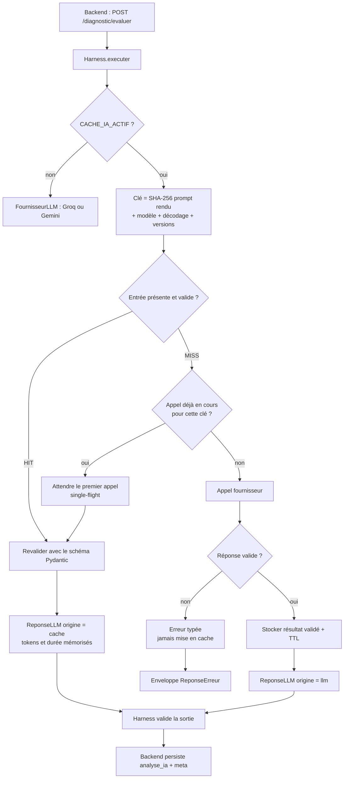
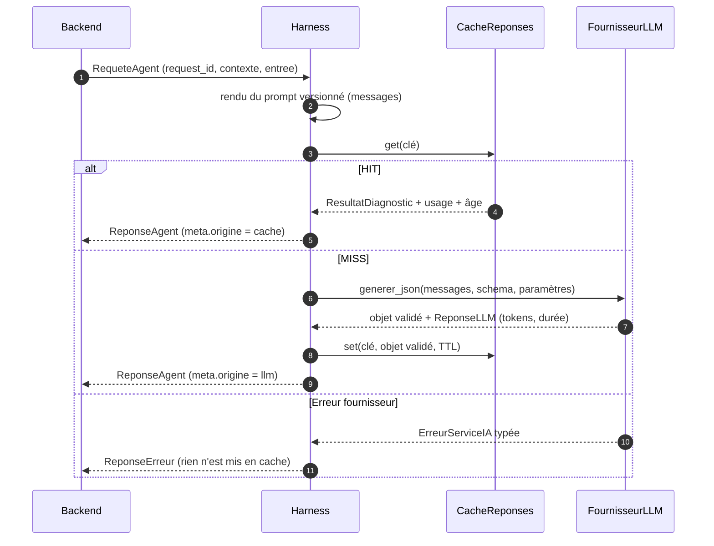

# PRE-11 — Conception du cache des réponses IA

Étude et conception d'un cache de réponses IA pour le mode démonstration, destiné à réduire les appels Groq/Gemini,
la consommation de tokens et les temps de réponse. Ce document est un **livrable de conception** : aucune
implémentation n'est incluse dans cette PR.

| Élément | Valeur |
| --- | --- |
| Dépôt | `Fafa008/langue_IA` |
| Branche de conception | `feature/pre-11-cache-demo-ia` |
| Base | `develop` (`c70f8a6`) |
| Date | 12 novembre 2026 |
| Périmètre audité | `ia-service/app/**`, `backend/app/**`, `frontend/src/**`, `docker-compose*.yml`, `.env.example`, tests |

## 1. Objectif et périmètre

Répondre à trois questions :

1. Existe-t-il déjà un cache des réponses IA ? Où, et pour quel usage ?
2. Quelles briques existantes peuvent servir de fondation sans nouvelle dépendance ?
3. Quelle conception permet un mode démonstration fiable, traçable et sans fuite de données personnelles ?

Contraintes rappelées :

- séparation Frontend / Backend / `ia-service` ;
- aucun accès PostgreSQL depuis `ia-service` ;
- aucun mélange entre cache de démonstration et résultats réels ;
- aucune réutilisation si les paramètres pédagogiques diffèrent ;
- activation/désactivation par environnement ;
- aucune dépendance ni infrastructure inutile ;
- compatibilité Groq (API compatible OpenAI) et Gemini.

## 2. Synthèse de l'existant

| Élément | État | Fichiers concernés | Preuve |
| --- | --- | --- | --- |
| Cache de réponses IA | **Absent** | `ia-service/app/**` | Aucune occurrence de cache dans les appels LLM |
| Cache d'idempotence diagnostic | Présent (par tentative) | `backend/app/services/analyse_diagnostic.py` | Réutilisation de `analyse_ia` si déjà persistée |
| Redis | **Provisionné mais inutilisé** | `docker-compose.yml`, `.env.example` | Service `redis` démarré, aucune dépendance ni code client |
| Cache frontend | Présent (React Query) | `frontend/src/hooks/*`, `frontend/src/mocks/*` | `staleTime`, invalidation, mocks |
| Mode démonstration frontend | Présent | `frontend/src/mocks/**`, `.env.development` | `NEXT_PUBLIC_API_MOCK=true`, latence simulée |
| Mode démonstration backend | Partiel | `backend/app/seed.py`, `seed_diagnostic.py` | Comptes et banque de questions via `SEED_DEMO` |
| Mode démonstration IA | **Absent** | `ia-service/app/**` | Aucun jeu de réponses précalculé, aucun flag dédié |
| Traçabilité origine LLM/cache | **Absente** | `ia-service/app/llm/base.py`, `schemas/commun.py` | `ReponseLLM` n'a pas de champ d'origine |
| Tests du cache | **Absents** | `ia-service/tests/**`, `backend/tests/**` | Aucun test de HIT/MISS, TTL ou invalidation |

## 3. Audit détaillé

### 3.1 Aucun cache de réponses IA

Le pipeline du service IA ne consulte ni mémoire, ni Redis, ni fichier avant d'appeler le fournisseur :

- construction du client unique : `ia-service/app/llm/fabrique.py` (`obtenir_client`) ;
- appel direct depuis les agents : `ia-service/app/agents/diagnostic.py:92`, `ia-service/app/agents/chatbot.py:33` ;
- aucun décorateur, aucune couche intermédiaire entre le Harness et `FournisseurLLM`
  (`ia-service/app/llm/base.py:57-107`).

### 3.2 Redis : infrastructure présente, intégration absente

| Preuve | Emplacement |
| --- | --- |
| Service `redis:7-alpine` démarré et `healthy` | `docker-compose.yml:52-60` |
| Variables transmises au backend | `docker-compose.yml:29-30` (`REDIS_HOST`, `REDIS_PORT`) |
| Variables documentées | `.env.example:107-112` |
| Aucune dépendance Python `redis` | `backend/requirements.txt`, `ia-service/requirements.txt` |
| Aucun import ni client Redis | recherche `redis` dans `backend/app` et `ia-service/app` : aucune occurrence |
| Redis annoncé comme non implémenté | `backend/README.md` (« Pas encore dans le MVP ») |

Conclusion : Redis est disponible dans la stack mais n'est utilisé par aucun service. C'est un candidat sérieux
pour un cache partagé entre workers, sans nouvelle infrastructure.

### 3.3 Organisation des appels Groq et Gemini

- Un seul contrat, deux adaptateurs : `ia-service/app/llm/base.py` (`FournisseurLLM`), implémenté par
  `adaptateurs/compatible_openai.py` (Groq, OpenAI, Mistral, Ollama…) et `adaptateurs/gemini.py`.
- Sélection au démarrage par `LLM_FOURNISSEUR` : `ia-service/app/llm/fabrique.py`.
- Réponses normalisées, y compris les tokens et la durée : `ia-service/app/llm/base.py:29-42`.
- Le mode JSON est utilisé par les deux agents (`generer_json`) ; le streaming existe mais n'est pas utilisé par le
  diagnostic.

Conséquence : un cache placé **à la frontière `FournisseurLLM`** couvre automatiquement les deux fournisseurs et
les deux agents, sans modifier ces adaptateurs.

### 3.4 Structure des requêtes et des réponses IA

Requête backend → service IA (`backend/app/schemas/ia.py:63-69`) :

```
request_id (UUID) | version_agent (opt) | contexte {code_langue, referentiel, niveau_preliminaire}
                                     | entree {scenario, reponses[], score_preliminaire}
```

Côté service IA, la requête est revalidée (`ia-service/app/schemas/commun.py:39-49`) et le contexte accepte en plus
une **mémoire pédagogique** (`ia-service/app/schemas/contexte.py:64-74`) — absente du contrat backend actuel, donc
`None` en pratique.

Les variables réellement rendues dans le prompt incluent : scénario, langue, référentiel, réponses complètes,
score préliminaire, contexte apprenant, descripteurs RAG et exemples few-shot
(`ia-service/app/prompts/variables.py:103-113`).

Réponse : `ReponseAgent[ResultatDiagnostic]` avec `meta`
(`duree_ms`, `fournisseur`, `modele`, `version_corpus`, `empreinte_prompt`) —
`ia-service/app/schemas/commun.py:29-36`, `backend/app/schemas/ia.py:94-101`.

### 3.5 Identifiants de diagnostic

| Élément | Comportement | Emplacement |
| --- | --- | --- |
| `request_id` | UUID aléatoire généré à chaque analyse | `backend/app/services/analyse_diagnostic.py:170` |
| `id_test` | Identifiant stable de la tentative | `TestDiagnostic.id_test` |
| Réutilisation | Si `analyse_ia` existe, aucun nouvel appel | `analyse_diagnostic.py:206-212` |
| Test associé | `test_reutilise_l_analyse_sans_second_appel` | `backend/tests/test_diagnostic_analyse.py:177` |

Il existe donc déjà un **cache d'idempotence par tentative**, persistant et propre à un apprenant. Il ne s'agit pas
d'un cache de contenu partagé : il ne profite pas à un autre apprenant, et il intervient après le premier appel.

`request_id` étant aléatoire, il **ne doit jamais** entrer dans une clé de cache.

### 3.6 Mode démonstration existant

| Couche | Mécanisme | Emplacement |
| --- | --- | --- |
| Frontend | `NEXT_PUBLIC_API_MOCK=true` : services remplacés par des mocks | `frontend/.env.development`, `frontend/src/mocks/*` |
| Frontend | Latence d'analyse simulée à 1 200 ms | `frontend/src/mocks/test-diagnostic.mock.ts:66-67`, `:247`, `:286` |
| Frontend | Résultat pédagogique précalculé (points faibles, phase Assimil) | `test-diagnostic.mock.ts:137-156` |
| Frontend | Cache React Query par requête | `frontend/src/hooks/useTestDiagnostic.ts:35`, `:48` |
| Backend | Comptes de démo (`SEED_DEMO=true`, mot de passe `Demo2026`) | `backend/app/seed.py:64-65`, `:129-137`, `:175-178` |
| Backend | Banque de questions de démonstration | `backend/app/seed_diagnostic.py` |
| Service IA | **Rien** : aucun jeu de réponses, aucun flag | — |

Le mode démo actuel s'arrête au frontend et aux données de seed. Dès que `NEXT_PUBLIC_API_MOCK=false`, chaque
diagnostic déclenche un vrai appel fournisseur : la démonstration dépend du réseau, du quota et de la latence Groq
ou Gemini.

### 3.7 Erreurs et indisponibilités LLM

- Codes stables et rejouables : `ia-service/app/core/codes_erreur.py:14-88`.
- Reprises bornées et budget : `ia-service/app/core/reprise.py:78-110`.
- Traduction systématique en enveloppe : `ia-service/app/harness/execution.py:96-104`.
- Dégradation backend en résultat partiel : `backend/app/services/analyse_diagnostic.py:218-222`.

Un cache doit s'insérer **sans masquer** ces comportements : une erreur n'est jamais mise en cache, et une panne du
cache ne doit jamais faire échouer un diagnostic.

### 3.8 Tests existants

- Adaptateurs et reprises : 71 tests (`test_adaptateur_compatible_openai.py`, `test_adaptateur_gemini.py`,
  `test_reprise.py`).
- Idempotence backend : `test_diagnostic_analyse.py:177`.
- Aucun test de cache, de TTL, de clé ou de mode démo IA.

## 4. Conception recommandée

### 4.1 Principes

1. **Cache à la frontière du fournisseur** : un décorateur conforme à `FournisseurLLM` enveloppe l'adaptateur choisi.
   Aucun agent, aucun prompt, aucun adaptateur n'est modifié. Groq et Gemini sont couverts par construction.
2. **Clé dérivée du prompt réellement rendu**, pas d'une liste de champs à maintenir : tout paramètre ajouté au
   prompt entre automatiquement dans la clé.
3. **Valeur = sortie validée uniquement** : `ResultatDiagnostic` sérialisé + un instantané d'usage (tokens, durée,
   modèle). Jamais le prompt, jamais les réponses brutes.
4. **Fail-open** : cache indisponible ou entrée corrompue ⇒ comportement actuel (appel fournisseur).
5. **Traçabilité explicite** : chaque réponse indique son origine (`llm`, `cache`, `demo`).

### 4.2 Comparaison des technologies

| Solution | Avantages | Inconvénients | Verdict |
| --- | --- | --- | --- |
| **Mémoire locale (dict + TTL + LRU)** | Zéro dépendance, zéro infrastructure, très rapide, simple à tester | Non partagé entre les 2 workers Uvicorn, perdu au redémarrage | **P0** — socle et mode démo local |
| **Redis** (déjà dans la stack) | Partagé entre workers, TTL natif, purge par préfixe, volume persistant | Ajoute `redis` aux dépendances `ia-service`, dépendance réseau à superviser | **P1** — cache partagé |
| Fichier JSON sur disque | Survit au redémarrage, aucune dépendance | Concurrence à gérer, TTL/éviction manuels, écriture conteneur éphémère sans volume | Non retenu |
| SQLite | Requêtes et TTL possibles | Nouveau fichier, verrouillage, complexité inutile pour un cache | Non retenu |
| Cache HTTP/CDN | Aucun code | Inadapté à un POST interne et à une clé pédagogique | Non retenu |
| **Fixtures précalculées (mode démo)** | Aucun appel LLM, résultat instantané et stable | Ne couvre que des scénarios définis, à revalider à chaque changement de contrat | **P1** — complément du cache |

Recommandation : **P0 en mémoire**, **P1 Redis** (infrastructure déjà présente, donc pas de nouveau service), et
**fixtures** pour le mode démo. Aucun autre composant.

### 4.3 Architecture cible

```
Backend
  └─ analyse_diagnostic ──(request_id, entree)──► Service IA

Service IA
  Harness
    └─ FournisseurLLM
         └─ CacheReponses (décorateur)
              ├─ CacheMemoire  (P0 : dict + TTL + LRU + single-flight)
              ├─ CacheRedis    (P1 : redis.asyncio, préfixe versionné)
              └─ CacheDesactive (flag off, défaut en production si non configuré)
         └─ FixturesDemo (P1 : résultats précalculés, sans appel fournisseur)
```

Nouveaux composants :

| Composant | Rôle | Dépendance |
| --- | --- | --- |
| `ia-service/app/cache/base.py` | Protocole `CacheReponses` (`get`, `set`, `purger`), types d'entrée/sortie | stdlib |
| `ia-service/app/cache/memoire.py` | TTL, taille maximale, LRU, verrou par clé (single-flight) | stdlib |
| `ia-service/app/cache/redis.py` | Implémentation `redis.asyncio`, préfixe et TTL | `redis` (P1) |
| `ia-service/app/cache/fabrique.py` | Sélection par configuration, repli mémoire/désactivé | stdlib |
| `ia-service/app/cache/cles.py` | Construction et canonicalisation de la clé | stdlib (`hashlib`, `json`) |
| `ia-service/app/llm/observe.py` | Décorateur `FournisseurLLM` : cache + origine + journalisation | stdlib |
| `ia-service/app/demo/fixtures.py` | Résultats précalculés validés au démarrage | stdlib |

### 4.4 Clé de cache

Formule :

```
clé = "ia:v1:" + sha256(
    json_canonique({
        "agent":            code_agent,
        "version_agent":    version_agent,
        "version_prompt":   version_prompt,
        "empreinte_prompt": empreinte_prompt,          # sha256 du prompt publié
        "modele":           fournisseur + "/" + modele,
        "decodage":         {temperature, max_tokens},
        "schema_sortie":    sha256(schema JSON du résultat),
        "version_corpus":   version_corpus | null,
        "messages":         [ {role, contenu} ... ]     # prompt réellement rendu
    })
)
```

Propriétés :

- **Tout ce qui influence la sortie est inclus** : langue, référentiel, niveau, réponses, score, scénario, mémoire
  pédagogique, descripteurs RAG et exemples few-shot sont déjà dans `messages` ; versions et modèle sont explicites.
- **`request_id` exclu** : il change à chaque appel et n'influence pas la réponse.
- **Aucune donnée identifiante dans la clé en clair** : seuls des identifiants de version et un condensé SHA-256 sont
  stockés.
- **Canonicalisation** : JSON trié par clé, UTF-8, sans espace superflu, contenu normalisé en NFC (pas de
  `strip`/`lower`, qui modifieraient le sens du prompt).
- **Ordre des messages et des descripteurs** : conservé tel quel ; deux prompts différents doivent produire deux clés
  différentes.
- **Collisions** : SHA-256, probabilité négligeable ; un champ `schema_version` permet d'invalider globalement en cas
  d'évolution du format.

Inclus / exclu :

| Inclus | Exclu |
| --- | --- |
| Agent, versions agent/prompt, empreinte du prompt | `request_id` |
| Fournisseur, modèle, température, `max_tokens` | Horodatage, identité de l'apprenant (jamais transmise) |
| Hash du schéma de sortie | Contenu des logs |
| Version du corpus RAG, messages rendus | Résultats d'une autre tentative |

### 4.5 TTL et invalidation

| Paramètre | Valeur par défaut | Rôle |
| --- | --- | --- |
| `CACHE_IA_ACTIF` | `false` en production, `true` en dev/démo | Interrupteur global |
| `CACHE_IA_BACKEND` | `memoire` | `memoire`, `redis`, `desactive` |
| `CACHE_IA_TTL_S` | `3600` | Durée de vie d'une entrée |
| `CACHE_IA_TAILLE_MAX` | `500` | Nombre d'entrées (LRU au-delà) |
| `CACHE_IA_VALEUR_MAX_KO` | `16` | Refus d'une valeur anormalement grosse |
| `CACHE_IA_ESPACE` | `v1` | Préfixe d'espace, incrémenté au déploiement |
| `CACHE_IA_SERVIR_PERIME` | `false` | Jamais de réponse périmée par défaut |

Invalidation : elle est **structurelle**, portée par la clé. Un changement de prompt, de modèle, de température, de
schéma de sortie ou de corpus produit une nouvelle clé ; l'ancienne entrée expire selon le TTL. Pour une purge
immédiate (incident, changement de référentiel), incrémenter `CACHE_IA_ESPACE` ou supprimer le préfixe Redis
(`SCAN` + `DEL` par opérateur) — aucune route HTTP de purge n'est ajoutée, pour éviter une surface d'attaque.

Cas particulier du corpus : `version_corpus` est déjà exposée (`ia-service/app/rag/base.py:63-68`), mais le contenu
des descripteurs rendus est aussi dans `messages` ; une modification sans changement de version est donc malgré tout
détectée.

### 4.6 Flux HIT / MISS



Séquence détaillée :



Note : le diagramme place le cache autour du fournisseur (`CacheReponses` décorant `FournisseurLLM`) ; le Harness
reste inchangé.

### 4.7 Mode démonstration

Trois niveaux, activables séparément :

| Niveau | Flag | Comportement | Environnement |
| --- | --- | --- | --- |
| Cache seul | `CACHE_IA_ACTIF=true` | Réutilise les réponses déjà obtenues ; MISS ⇒ appel fournisseur | dev, démo, prod modérée |
| Cache lecture seule | `CACHE_IA_LECTURE_SEULE=true` | HIT ⇒ réponse ; MISS ⇒ résultat partiel dégradé, **aucun appel** (aucun coût imprévu pendant une démo) | démo |
| Fixtures | `MODE_DEMO_IA=true` | Réponse précalculée choisie par scénario/langue/niveau, validée au démarrage ; `origine=demo` | dev, démo uniquement |

Règles :

- `MODE_DEMO_IA=true` est **refusé si `ENVIRONNEMENT=prod`**, au même titre que le fournisseur `factice`
  (`ia-service/app/core/config.py:80-105`).
- Les fixtures vivent dans un espace de noms séparé (`demo:`) et ne sont jamais écrites dans le cache partagé.
- Une réponse de démonstration est identifiée `origine=demo` dans `meta` et dans les journaux ; elle n'est jamais
  présentée comme une analyse réelle.
- Le backend peut persister une analyse démo dans `analyse_ia`, mais le champ `meta.origine` permet de l'exclure de
  toute statistique ou export ultérieur. En production, le flag est désactivé : aucune contamination possible.
- Le frontend conserve son mode `NEXT_PUBLIC_API_MOCK=true` (démo sans backend) ; le mode démo IA couvre le cas
  `NEXT_PUBLIC_API_MOCK=false` avec un backend réel mais sans fournisseur.

### 4.8 Traçabilité

Extension **optionnelle et rétrocompatible** de `ReponseLLM` et de `MetaExecution` :

```json
{
  "origine": "llm | cache | demo",
  "cle_cache": "sha256:…",
  "age_cache_s": 42,
  "tokens_economises_entree": 912,
  "tokens_economises_sortie": 184
}
```

- `origine` est toujours renseigné ; `cle_cache` et `age_cache_s` seulement pour un HIT.
- Les tokens d'une réponse servie depuis le cache sont des **tokens économisés**, jamais une consommation réelle : on
  ne les additionne pas aux tokens facturés.
- Un événement de log par appel (`cache_lookup`) porte la clé (condensé), le statut HIT/MISS/démo, l'âge et la durée.
- `meta` reste masqué au frontend (`backend/app/schemas/ia.py:94-101`), donc aucune fuite vers l'interface.

### 4.9 Sécurité

| Risque | Mesure |
| --- | --- |
| Données personnelles dans le cache | Valeur limitée au résultat pédagogique validé ; aucune identité, aucun prompt, aucune réponse brute |
| Réponses propres à un apprenant réutilisées | Mémoire pédagogique dans la clé ; cache partagé réservé aux diagnostics sans mémoire (premier test) ; sinon cache par tentative déjà existant |
| Clé inversible | SHA-256 uniquement, jamais de contenu en clair |
| Fuite par les logs | Clé tronquée + identifiants techniques ; pas de contenu (règle déjà appliquée, cf. PRE-10) |
| Empoisonnement | Valeur revalidée par le schéma Pydantic à chaque lecture ; entrée invalide traitée comme MISS |
| Déni de service | Taille maximale d'entrée, LRU, valeur maximale, TTL |
| Démo confondue avec le réel | `origine=demo` explicite, flag refusé en production, espace de noms séparé |

## 5. Risques et limites

| # | Risque | Niveau | Mitigation |
| --- | --- | --- | --- |
| R1 | Clé incomplète ⇒ réponse pédagogiquement fausse | **Élevé** | Clé calculée sur les messages rendus + versions + modèle, pas sur une liste manuelle |
| R2 | Cache mémoire non partagé entre 2 workers | Moyen | Accepté en P0 (démo) ; Redis en P1 |
| R3 | Cache masquant une panne fournisseur | Moyen | Aucune mise en cache des erreurs ; `origine` visible ; pas de servi périmé par défaut |
| R4 | Croissance mémoire/disque | Moyen | LRU, taille max, TTL, valeur max |
| R5 | Fixtures démo désynchronisées du contrat | Moyen | Validation Pydantic au démarrage, comme le corpus CECRL (`rag/corpus.py:200-220`) |
| R6 | Coût réel mal interprété | Moyen | Tokens de HIT = économies, jamais consommation ; coût réel distinct (cf. PRE-10) |
| R7 | Redis indisponible | Faible | Repli mémoire ou désactivation, jamais d'échec de requête |
| R8 | Cache utilisé comme stockage de résultats réels | Faible | Espace de noms, TTL, `origine`, pas de données identifiantes |

## 6. Plan d'implémentation

### P0 — socle (aucune dépendance)

| # | Action | Fichiers | Critère d'acceptation |
| --- | --- | --- | --- |
| P0.1 | Protocole `CacheReponses`, cache mémoire TTL + LRU + single-flight | `app/cache/base.py`, `app/cache/memoire.py`, `app/cache/fabrique.py` | HIT sans appel, MISS appel une seule fois |
| P0.2 | Construction de clé canonicalisée | `app/cache/cles.py` | Déterminisme et sensibilité testés |
| P0.3 | Décorateur `FournisseurLLM` (cache + origine) | `app/llm/observe.py`, `app/llm/fabrique.py` | Groq, Gemini et factice couverts sans modification |
| P0.4 | Configuration et flags | `app/core/config.py`, `docker-compose.yml`, `.env.example` | Désactivé par défaut en production |
| P0.5 | Traçabilité `origine`/`cle_cache`/`age_cache_s` | `llm/base.py`, `schemas/commun.py`, `backend/app/schemas/ia.py` | Champs optionnels, contrat existant préservé |
| P0.6 | Tests P0 | voir §7 | Couverture ≥ 70 % maintenue |

### P1 — démonstration et partage

| # | Action | Fichiers |
| --- | --- | --- |
| P1.1 | Cache Redis (`redis.asyncio`, préfixe, TTL), repli mémoire | `app/cache/redis.py`, `requirements.txt` |
| P1.2 | Fixtures de démonstration validées au démarrage + `MODE_DEMO_IA` | `app/demo/fixtures.py`, `config.py`, `main.py` |
| P1.3 | Mode lecture seule (aucun appel sur MISS) | `app/llm/observe.py`, `config.py` |
| P1.4 | Journalisation `cache_lookup` + taux de HIT | `app/llm/observe.py` |
| P1.5 | Documentation d'exploitation (purge, espace, TTL) | ce document, `ia-service/README.md` |

### P2 — pilotage

| # | Action | Remarque |
| --- | --- | --- |
| P2.1 | Métriques de HIT/MISS et tokens économisés (`/metrics`) | dépend de PRE-10, P2 |
| P2.2 | Préchargement des fixtures au build de l'image | image plus lourde, démo hors ligne |
| P2.3 | Cache du chatbot | clé incluant l'historique complet ; volume plus élevé |
| P2.4 | Purge administrative contrôlée | à sécuriser (jeton interne), seulement si nécessaire |

## 7. Tests nécessaires

### Clé de cache
- Déterminisme : même requête ⇒ même clé, quel que soit `request_id`.
- Sensibilité : langue, niveau, référentiel, réponse, score, scénario, mémoire, descripteurs RAG, version de prompt,
  empreinte, modèle, température, `max_tokens`, version de corpus ⇒ clé différente.
- Canonicalisation : ordre des clés JSON indifférent, ordre des messages significatif, Unicode NFC équivalent.

### Cache mémoire
- HIT : aucun appel fournisseur, objet identique, `origine=cache`, âge et tokens économisés renseignés.
- MISS : un seul appel, valeur stockée après validation.
- Erreur/timeout fournisseur : rien n'est stocké.
- Entrée corrompue ou hors schéma : traitée comme MISS et remplacée.
- TTL : expiration avec horloge injectée ; LRU : éviction au-delà de `CACHE_IA_TAILLE_MAX`.
- Concurrence : deux requêtes simultanées sur la même clé ⇒ un seul appel (single-flight).
- Cache désactivé : comportement strictement identique à l'existant.

### Redis (P1)
- Même suite que la mémoire, plus : indisponibilité ⇒ repli sans échec ; TTL natif ; préfixe d'espace respecté.

### Mode démo
- Fixtures valides au démarrage ; fixture invalide ⇒ refus de démarrer.
- `MODE_DEMO_IA=true` + `ENVIRONNEMENT=prod` ⇒ `ErreurConfiguration`.
- Aucun appel fournisseur, `origine=demo`, aucune écriture dans le cache partagé.
- Mode lecture seule : MISS ⇒ résultat partiel, zéro appel.

### Sécurité et traçabilité
- Aucun prompt, réponse brute, clé API ou donnée personnelle dans la valeur du cache ni dans les logs.
- `meta.origine` persisté dans `analyse_ia` ; absent de la réponse frontend.
- Tokens de HIT comptés comme économies, jamais comme consommation.

### Non-régression
- 71 tests adaptateurs/reprises inchangés.
- `test_reutilise_l_analyse_sans_second_appel` (idempotence backend) toujours vert.
- `ruff check`, `ruff format --check`, `pytest --cov-fail-under=70` (backend et service IA) ; E2E inchangé.

## 8. Décisions à valider

| # | Question | Recommandation |
| --- | --- | --- |
| D1 | Backend de cache P0 | Mémoire (Redis en P1) |
| D2 | Clé | SHA-256 des messages rendus + versions + modèle + décodage |
| D3 | TTL par défaut | 1 h, configurable ; 24 h en démonstration |
| D4 | Mode démo | Fixtures validées + flag refusé en production |
| D5 | Métadonnées | `origine`, `cle_cache`, `age_cache_s`, tokens économisés dans `meta` (non exposés au frontend) |
| D6 | Cache du chatbot | Hors P0, traité en P2 |

## 9. Procédure Git

Ce document est livré sur `feature/pre-11-cache-demo-ia` via une PR vers `develop`, sans fusion. L'implémentation
P0 ne démarrera qu'après validation explicite, sur la même branche, avec tests, commit et mise à jour de la PR.
