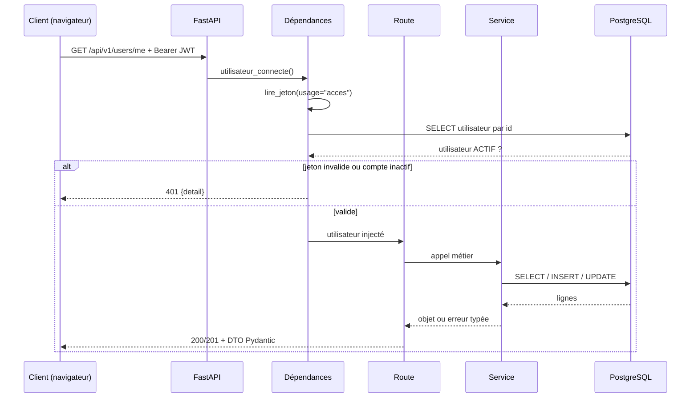

# Chapitre 2 — Le backend (FastAPI)

> Dossier : `backend/`
> Stack : Python 3.11, FastAPI, SQLAlchemy 2 (ORM), Pydantic 2, Alembic, PostgreSQL 16,
> bcrypt + python-jose (JWT), pytest.
> Point d'entrée : `backend/app/main.py`. Toutes les routes sont sous `/api/v1`.

---

## 1. Rôle et position dans l'architecture

Le backend est **le seul composant qui fait autorité**. Il :

- authentifie (mot de passe + JWT) et vérifie les permissions ;
- persiste les données dans PostgreSQL ;
- applique les règles métier (création de tentative, enregistrement des réponses, scoring) ;
- expose un contrat JSON en `snake_case` que le frontend traduit ensuite en `camelCase`.

Il **appelle** le service IA depuis PRE-05, mais uniquement pour l'analyse du diagnostic :
`POST /diagnostic/evaluer` via `backend/app/services/ia.py`. Le score, lui, reste
**déterministe** : aucun LLM ne le calcule. L'appel est **best-effort** — sans
`IA_SERVICE_URL`, en panne ou au-delà de 55 s, la clôture renvoie quand même `200` avec un
résultat partiel.

Il ne rend aucune page HTML : le frontend est une application séparée. La seule chose servie
hors API est le dossier des photos, monté en lecture publique sur `/media`.

---

## 2. Organisation des dossiers

```
backend/
├── app/
│   ├── main.py            # FastAPI, CORS, /media, /health
│   ├── api/
│   │   ├── router.py      # assemblage /api/v1
│   │   ├── deps.py        # session, utilisateur connecté, permissions, pagination
│   │   └── routes/        # un fichier par domaine
│   ├── core/
│   │   ├── config.py      # Settings (variables d'environnement)
│   │   ├── database.py    # moteur + get_db
│   │   └── security.py    # bcrypt, JWT accès/réinitialisation
│   ├── models/            # tables SQLAlchemy + énumérations
│   ├── schemas/           # DTO Pydantic (entrée/sortie HTTP)
│   ├── services/          # logique métier (diagnostic, scoring, recherche…)
│   ├── seed.py            # référentiel + comptes de démonstration
│   └── seed_diagnostic.py # banque de questions de démonstration
├── alembic/
│   ├── env.py
│   └── versions/          # une migration par évolution de schéma
├── tests/                 # pytest, base PostgreSQL réelle
├── requirements.txt
├── requirements-dev.txt
├── pyproject.toml         # ruff (line-length 120, B008 ignoré)
├── Dockerfile
└── docker-entrypoint.sh
```

La séparation est stricte : **route → service → modèle**. Une route ne contient pas de requête
SQL complexe ; un service ne construit pas de `HTTPException` métier (il lève une erreur typée
que la route traduit).

---

## 3. Cycle de vie d'une requête



### 3.1 `main.py` : peu de choses, mais essentielles

```python
app = FastAPI(title="Centre de langues IA — API", version="0.1.0", ...)

app.add_middleware(
    CORSMiddleware,
    allow_origins=settings.cors_origins,
    allow_credentials=True,
    allow_methods=["GET", "POST", "PUT", "PATCH", "DELETE", "OPTIONS"],
    allow_headers=["Content-Type", "Authorization"],
)

app.include_router(api_router)
(settings.media_dir / "photos").mkdir(parents=True, exist_ok=True)
app.mount("/media", StaticFiles(directory=settings.media_dir), name="media")

@app.get("/health", tags=["supervision"])
def health() -> dict[str, str]:
    return {"status": "ok", "service": "backend"}
```

À retenir :

- **CORS** : le navigateur appelle le backend depuis `http://localhost:3000`. Sans cette
  configuration, le navigateur bloquerait la réponse. `allow_headers` limite explicitement à
  `Content-Type` et `Authorization`.
- **`/health`** est la sonde utilisée par Docker Compose et la CI. Elle ne vérifie **pas** la
  base : un backend peut être « healthy » avec une base indisponible.
- **`/media`** est public : une photo de profil est accessible à quiconque connaît l'URL. C'est
  acceptable pour des photos non sensibles, à ne pas reproduire pour des documents privés.

### 3.2 `router.py` : l'ordre compte

```python
api_router = APIRouter(prefix="/api/v1")
api_router.include_router(auth.router)
api_router.include_router(formules.router)
# /users/me avant /users/{id_user}
api_router.include_router(profil.router)
api_router.include_router(roles.router)
api_router.include_router(utilisateurs.router)
api_router.include_router(statistiques.router)
api_router.include_router(pedagogie.router)
api_router.include_router(diagnostic.router)
api_router.include_router(formateurs.router)
```

Le commentaire est important : si `/users/{id_user}` était déclaré avant `/users/me`, FastAPI
tenterait de convertir `"me"` en entier et renverrait **422**. L'ordre de déclaration est une
règle de routage, pas un détail cosmétique.

### 3.3 `deps.py` : les dépendances réutilisables

| Dépendance | Rôle |
| --- | --- |
| `DbSession` | ouvre une session SQLAlchemy et la ferme après la requête |
| `utilisateur_connecte` | lit le JWT, vérifie l'usage, charge l'utilisateur, exige le statut `ACTIF` |
| `UtilisateurConnecte` | raccourci d'annotation pour injecter l'utilisateur |
| `permission_requise(code)` | fabrique une dépendance RBAC : 403 si le rôle n'a pas la permission |
| `Pagination` | `page` ≥ 1 et `page_size` ∈ {10, 20, 50}, avec `offset` calculé |

Le contrôle RBAC réel :

```python
def permission_requise(code_permission: str) -> Callable[..., Utilisateur]:
    def verifier_permission(db: DbSession, utilisateur: UtilisateurConnecte) -> Utilisateur:
        autorise = db.scalar(
            select(
                exists().where(
                    RoleRBAC.code == utilisateur.role.value,
                    role_permission.c.id_role == RoleRBAC.id_role,
                    role_permission.c.id_permission == Permission.id_permission,
                    Permission.code == code_permission,
                )
            )
        )
        if not autorise:
            raise HTTPException(status.HTTP_403_FORBIDDEN, "Droits insuffisants.")
        return utilisateur
    return verifier_permission
```

Deux niveaux de contrôle coexistent :

1. **Le rôle** (colonne `utilisateur.role`, code `SMALLINT`) : utilisé directement dans les
   routes du diagnostic (`if utilisateur.role != Role.APPRENANT: 403`).
2. **La permission RBAC** (tables `role`, `permission`, `role_permission`) : utilisée sur les
   routes d'administration, plus fine et modifiable en base.

---

## 4. Authentification et jetons

### 4.1 Mots de passe

```python
def hacher_mot_de_passe(mot_de_passe: str) -> str:
    sel = bcrypt.gensalt(rounds=get_settings().bcrypt_rounds)
    return bcrypt.hashpw(mot_de_passe.encode(), sel).decode()

def verifier_mot_de_passe(mot_de_passe: str, hache: str) -> bool:
    try:
        return bcrypt.checkpw(mot_de_passe.encode(), hache.encode())
    except ValueError:
        return False
```

Le coût (`bcrypt_rounds = 12`) est réglable : plus haut = plus lent à vérifier, donc plus
coûteux à attaquer par force brute.

### 4.2 Deux usages de jeton, jamais interchangeables

```python
USAGE_ACCES = "acces"
USAGE_REINITIALISATION = "reinitialisation"

def _creer_jeton(claims: dict, duree: timedelta) -> str:
    settings = get_settings()
    maintenant = datetime.now(UTC)
    return jwt.encode(
        {**claims, "iat": maintenant, "exp": maintenant + duree},
        settings.secret_key,
        settings.algorithm,
    )
```

- `creer_jeton_acces(id_user)` : `sub`, `usage="acces"`, durée `access_token_expire_minutes`
  (24 h par défaut).
- `creer_jeton_reinitialisation(...)` : `usage="reinitialisation"` **et** une empreinte du
  hachage actuel (`mdp`). Dès que le mot de passe change, l'empreinte change et le lien devient
  invalide.

`lire_jeton(jeton, usage)` refuse un jeton dont l'usage ne correspond pas :

```python
if claims.get("usage") != usage or not str(claims.get("sub", "")).isdigit():
    return None
```

Conséquence concrète : un jeton de réinitialisation volé **ne peut pas** ouvrir une session, et
un jeton d'accès **ne peut pas** réinitialiser un mot de passe.

### 4.3 Ce que le JWT ne protège pas

Le JWT contient `sub` (identifiant) et `exp`. Il **ne contient ni rôle ni permission**. À chaque
requête, le backend recharge l'utilisateur en base :

```python
utilisateur = db.get(Utilisateur, int(claims["sub"]))
if utilisateur is None or utilisateur.statut != StatutUtilisateur.ACTIF:
    raise SESSION_INVALIDE
```

C'est ce qui rend une **suspension immédiate** : le jeton reste techniquement valide, mais le
compte n'est plus `ACTIF`, donc la requête est refusée. Il n'y a en revanche **aucune liste de
révocation** (pas de table de jetons noirs) : changer le mot de passe n'invalide pas les jetons
d'accès déjà émis. Il n'y a **pas de refresh token** : aucun code ne lit de durée de refresh,
et le jeton d'accès doit simplement être renouvelé par une nouvelle connexion.

---

## 5. Modèles, énumérations et migrations

### 5.1 Le rôle central de `enums.py`

Les statuts sont stockés en `SMALLINT`, pas en texte :

```python
CODES: dict[type[enum.Enum], dict[enum.Enum, int]] = {
    Role: {Role.APPRENANT: 1, Role.FORMATEUR: 2, Role.ADMINISTRATEUR: 3},
    StatutUtilisateur: {StatutUtilisateur.ACTIF: 1, StatutUtilisateur.INACTIF: 2, StatutUtilisateur.SUSPENDU: 3},
    StatutDiagnostic: {StatutDiagnostic.EN_COURS: 1, StatutDiagnostic.TERMINE: 2, StatutDiagnostic.ANNULE: 3},
    # ...
}

class EnumEntier(TypeDecorator):
    impl = SmallInteger
    cache_ok = True

    def process_bind_param(self, value, dialect):
        return None if value is None else self._vers_code[self.enum_cls(value)]

    def process_result_value(self, value, dialect):
        return None if value is None else self._depuis_code[value]
```

`TypeDecorator` fait la traduction dans les deux sens : le Python manipule `Role.APPRENANT`,
la base stocke `1`, l'API renvoie `"APPRENANT"` (via Pydantic).

**Règle absolue** : un code déjà écrit en base ne change jamais. Si `APPRENANT = 1` devenait
`APPRENANT = 4`, toutes les lignes existantes seraient relues avec le mauvais rôle. On ajoute,
on ne réordonne pas.

### 5.2 Modèles principaux

| Fichier | Classes |
| --- | --- |
| `models/utilisateurs.py` | `Utilisateur`, `Apprenant`, `Formateur`, `Administrateur` |
| `models/roles.py` | `RoleRBAC`, `Permission`, table `role_permission` |
| `models/pedagogie.py` | `Langue`, `Niveau`, table d'association langue↔niveaux |
| `models/diagnostic.py` | `Question`, `TestDiagnostic`, `Reponse` |
| `models/parcours.py` | `Parcours`, `Exercice` (aucune route dédiée) |
| `models/ateliers.py` | `Atelier` (lu par les statistiques, aucune route dédiée) |
| `models/facturation.py` | `Abonnement` (créé à l'inscription, lu par les statistiques, aucune route dédiée) |

Chaque rôle a **sa propre table** reliée à `utilisateur` par `id_user`. Un changement de rôle
crée la nouvelle ligne et conserve l'ancienne : l'historique n'est pas écrasé.

### 5.3 Alembic

Le conteneur applique les migrations à chaque démarrage :

```sh
#!/bin/sh
set -e
alembic upgrade head
python -m app.seed
exec "$@"
```

Une migration est un fichier Python versionné dans `alembic/versions/`. Pour en créer une :

```powershell
make migration m="ajout table parcours"
```

ou, sans `make` :

```powershell
docker compose -f docker-compose.yml -f docker-compose.dev.yml run --rm backend alembic revision --autogenerate -m "ajout table parcours"
```

**Toujours relire** le fichier généré : l'autogénération ne devine pas les renommages (elle
produit un `drop` + `create`, donc une perte de données) ni les contraintes partielles.

Migrations présentes, dans l'ordre :

1. `schema_initial`
2. `rbac`
3. `tables_du_diagnostic`
4. `diagnostic_question_payload`
5. `diagnostic_scoring`
6. `us45_parcours`
7. `diagnostic_analyse_ia` (colonne `test_diagnostic.analyse_ia`, PRE-05)

---

## 6. Le diagnostic : la partie métier la plus riche

### 6.1 Routes existantes

| Méthode | Chemin | Rôle | Réponse |
| --- | --- | --- | --- |
| GET | `/diagnostic/langues` | apprenant | langues + niveau de départ + disponibilité |
| GET | `/diagnostic/questions?code_langue=&code_niveau=` | apprenant | questions du niveau |
| POST | `/diagnostic/tentatives` | apprenant | `201` tentative créée |
| POST | `/diagnostic/reponse` | apprenant | `201` réponse enregistrée |
| POST | `/diagnostic/tentatives/{id}/terminer` | apprenant | `200` score + niveau + analyse IA facultative |

**Routes absentes** (appelées par le frontend, donc 404) :

- `GET /diagnostic/tentatives/en-cours`
- `POST /diagnostic/tentatives/{id}/abandonner`

### 6.2 Création d'une tentative

```python
def creer_tentative(db: Session, id_apprenant: int, code_langue: str) -> TestDiagnostic:
    langue = db.scalar(select(Langue).where(Langue.code == code_langue))
    if langue is None:
        raise ErreurDiagnostic(CodeErreurDiagnostic.LANGUE_INCONNUE)

    niveau, _ = _niveau_de_depart(db, langue)
    if niveau is None:
        raise ErreurDiagnostic(CodeErreurDiagnostic.AUCUNE_QUESTION)

    tentative = TestDiagnostic(id_apprenant=id_apprenant, langue=langue, niveau=niveau)
    db.add(tentative)
    db.commit()
    db.refresh(tentative)
    return tentative
```

Points importants :

- le niveau n'est **pas choisi par le client** : c'est le premier niveau ouvert qui possède des
  questions enregistrables ;
- le frontend collecte pourtant `objectif` et `creneaux` (formulaire de personnalisation) : ils
  sont **ignorés** par le service et jamais envoyés (voir chapitre 05) ;
- aucune limite n'empêche un même apprenant de créer plusieurs tentatives en parallèle.

### 6.3 Enregistrement d'une réponse

La règle est **idempotente** et **sans écrasement** :

```python
if precedente is not None:
    if precedente.reponse_fournie == reponse_fournie:
        return precedente
    raise ErreurDiagnostic(CodeErreurDiagnostic.REPONSE_DIFFERENTE)
```

- même réponse → on renvoie la ligne existante (pas de doublon) ;
- réponse différente → `409`. Un apprenant ne peut donc pas changer d'avis après validation.

Une course entre deux requêtes simultanées est gérée par la contrainte d'unicité
`(id_tentative, id_question)` : le `IntegrityError` `23505` est intercepté, puis on relit la
ligne. C'est une bonne pratique à retenir : **la base est le dernier rempart**, pas seulement
le code Python.

Les types acceptés : `TYPES_ENREGISTRABLES = ("choix", "texte")`. Une question `audio` renvoie
`422 AUDIO_NON_DISPONIBLE`.

### 6.4 Scoring déterministe

```python
SCORE_MAX = 100
SEUILS_NIVEAUX = (
    (Decimal("20"), "A1", "HSK 1"),
    (Decimal("40"), "A2", "HSK 2"),
    (Decimal("60"), "B1", "HSK 3"),
    (Decimal("75"), "B2", "HSK 4"),
    (Decimal("90"), "C1", "HSK 5"),
    (Decimal("101"), "C2", "HSK 6"),
)

def _calculer_pourcentage(nb_correctes: int, nb_questions: int) -> Decimal:
    return (Decimal(nb_correctes * SCORE_MAX) / Decimal(nb_questions)).quantize(
        Decimal("0.01"), rounding=ROUND_HALF_UP
    )
```

Algorithme réel :

1. verrouiller la tentative (`with_for_update`), vérifier qu'elle appartient à l'apprenant ;
2. si elle est déjà terminée, renvoyer le résultat enregistré (idempotence) ;
3. charger **toutes** les questions à choix du niveau ;
4. vérifier que chacune a une clé `reponse_correcte` valide ;
5. compter les réponses égales à la clé ;
6. `pourcentage = correctes × 100 / total`, arrondi au centième ;
7. niveau selon le premier seuil **strictement supérieur** au pourcentage ;
8. persister `score`, `id_niveau_final`, `statut = TERMINE`, `date_fin`.

Conséquences à connaître :

- **les questions sans réponse comptent comme fausses** : la note est calculée sur la totalité
  du niveau, pas sur ce que l'apprenant a répondu ;
- **les questions `texte` ne sont pas corrigées** : seules les questions `choix` entrent dans
  le calcul ;
- `19,99 %` donne `A1`, `20,00 %` donne `A2` (la condition est « pourcentage < 20 »), `20,01 %` donne
  aussi `A2` ;
- le score est un `Decimal` en base, converti en `float` dans la réponse HTTP.

### 6.5 Traduction des erreurs métier en HTTP

```python
_ERREURS_HTTP = {
    CodeErreurDiagnostic.LANGUE_INCONNUE: (404, "Langue introuvable."),
    CodeErreurDiagnostic.TENTATIVE_TERMINEE: (409, "Cette tentative n'est plus en cours."),
    CodeErreurDiagnostic.CHOIX_INVALIDE: (422, "La réponse ne correspond à aucun choix proposé."),
    # ...
}

def _convertir_erreur(erreur: ErreurDiagnostic) -> HTTPException:
    code, detail = _ERREURS_HTTP[erreur.code]
    return HTTPException(code, detail)
```

Le service ne connaît pas HTTP ; la route traduit. C'est ce qui permet de tester le service sans
client HTTP et de réutiliser la logique ailleurs (une tâche de fond, par exemple).

### 6.6 Analyse IA facultative (PRE-05)

Après le scoring, la route `terminer` **ferme la session PostgreSQL** puis tente l'analyse IA :

```python
id_test = tentative.id_test
db.close()                       # ne pas immobiliser une connexion pendant l'appel HTTP
analyse = analyser_tentative(id_test)

return ScoreDiagnosticOut(
    # ... score, percentage, level, framework
    competences=analyse.competences if analyse else None,
    points_faibles=analyse.points_faibles if analyse else None,
    phase_assimil=analyse.phase_assimil if analyse else None,
)
```

`analyser_tentative` (`app/services/analyse_diagnostic.py`) applique quatre règles :

1. **idempotence** : si `test_diagnostic.analyse_ia` est déjà rempli, on le relit sans rappeler
   le service ;
2. **garde-fous** : langue non supportée, niveau hors référentiel ou aucune réponse exploitable →
   `None` (résultat partiel), sans erreur ;
3. **best-effort** : `ErreurServiceIA` (`non_configure`, `timeout`, `indisponible`,
   `reponse_invalide`, `http_<statut>`) est journalisée puis absorbée ;
4. **persistance** : le document JSON validé est écrit dans `analyse_ia` sous verrou
   (`with_for_update`), ce qui rend deux clôtures concurrentes sûres.

`competences` est calculé **localement**, pas par le LLM : on ne compte que les questions
`choix`, compétence par compétence. Une compétence inconnue (par exemple `vocabulaire`) est
ignorée par `_normaliser_competence`, donc la liste peut être partielle.

---

## 7. Seed : données de départ et idempotence

`app/seed.py` charge :

- **toujours** : les 5 langues, les 12 niveaux CECRL/HSK, les 3 formules, les 3 rôles et les
  9 permissions ;
- **si `SEED_DEMO=true`** : trois comptes de démonstration, un abonnement et **35 questions**
  (`app/seed_diagnostic.py` : 18 en anglais, 17 en français, toutes à choix).

```python
MOT_DE_PASSE_DEMO = "Demo2026"
COMPTES_DEMO = [
    # apprenant@digitheque.mg, formateur@digitheque.mg, admin@digitheque.mg
]
```

Le seed est **idempotent** : rejouer `python -m app.seed` ne duplique pas les lignes. La CI le
vérifie explicitement en lançant le seed une seconde fois.

Deux pièges :

- `SEED_DEMO` vaut `true` par défaut dans `docker-compose.yml`. En production, il **faut** le
  passer à `false`, sinon les comptes `Demo2026` existent.
- Le seed s'exécute à **chaque** démarrage du conteneur, pas seulement au premier.
- La déduplication des questions se fait sur `(langue, niveau, énoncé)`, et non sur un code
  stable : corriger un énoncé crée une **nouvelle** question au lieu de modifier l'ancienne.
- Les questions `zh`, `it`, `de` ne sont pas seedées : le test y est indisponible.

---

## 8. Configuration et secrets

`app/core/config.py` lit un fichier `.env` (facultatif) et les variables d'environnement :

```python
class Settings(BaseSettings):
    environment: str = "development"
    secret_key: str = "changeme_super_secret_key_here"
    access_token_expire_minutes: int = 1440
    backend_cors_origins: str = "http://localhost:3000"
    bcrypt_rounds: int = 12
    media_dir: Path = Path("media")
    photo_taille_max: int = 2 * 1024 * 1024

    @model_validator(mode="after")
    def secret_obligatoire_en_production(self) -> "Settings":
        if self.environment == "production" and self.secret_key in SECRETS_PAR_DEFAUT:
            raise ValueError("SECRET_KEY doit être changée en production (valeur d'exemple détectée).")
        return self
```

Le garde-fou est réel **mais** il ne se déclenche que si `ENVIRONMENT=production`. Or
`docker-compose.yml` ne fixe pas `ENVIRONMENT` pour le backend : sa valeur par défaut est
`development`. **Conséquence** : démarrer la stack de production avec la clé d'exemple ne
provoque aucune erreur. C'est un écart à corriger (voir chapitre 04).

Autres variables présentes dans `.env.example` mais non lues par le code :
`RATE_LIMIT_PER_MINUTE`, `BACKUP_ENABLED`, `BACKUP_PATH`, `BACKUP_RETENTION_DAYS`.

---

## 9. Tests

Les tests tournent sur une **vraie PostgreSQL**, jamais SQLite :

```python
# tests/conftest.py (principe)
# 1. crée <db>_test à côté de DATABASE_URL
# 2. applique les migrations Alembic
# 3. tronque les tables entre deux tests
```

Fichiers notables :

| Fichier | Ce qu'il vérifie |
| --- | --- |
| `test_auth.py` | login, register, jetons, erreurs |
| `test_rbac.py` | 401 sans jeton, 403 sans permission |
| `test_diagnostic_langues.py` | disponibilité, rôle |
| `test_diagnostic_questions.py` | filtrage par langue/niveau |
| `test_diagnostic_reponses.py` | idempotence, conflit, audio refusé |
| `test_diagnostic_scoring.py` | seuils, arrondi, tentative terminée |
| `test_seed.py` | idempotence du seed |
| `test_modele_*` | contraintes et relations SQLAlchemy |

Lancer un seul test (Windows, sans le `--user` du Makefile) :

```powershell
docker compose -f docker-compose.yml -f docker-compose.dev.yml run --rm backend `
  pytest tests/test_diagnostic_scoring.py::test_applique_les_seuils_cecrl
```

Couverture minimale imposée par la CI : **70 %** (`--cov-fail-under=70`). Concrètement, ajouter
une route sans test peut faire échouer la CI même si tous les tests passent.

---

## 10. Limites et dettes techniques

1. **Service IA appelé en best-effort** : `POST /diagnostic/evaluer` est tenté à la clôture ;
   sans URL configurée, en panne ou en timeout, le résultat reste partiel sans erreur visible.
2. **Routes manquantes** : `en-cours` et `abandonner` (404 côté frontend).
3. **Réponse de score dépendante de l'IA** : `ScoreDiagnosticOut` expose bien `competences`,
   `points_faibles` et `phase_assimil`, mais ils sont **omis** de la réponse
   (`response_model_exclude_none=True`) quand l'analyse échoue. `justification` n'existe pas
   dans le schéma backend, même si le frontend sait le lire.
4. **`terminer` synchrone** : renvoie `200`, jamais `202` ; le polling du frontend est inutile.
5. **Questions texte non notées** et **questions sans réponse comptées fausses**.
6. **Audio impossible** : le backend refuse le type `audio`, le frontend le masque.
7. **Pas de refresh token** ni de révocation : un jeton d'accès reste valide jusqu'à `exp`.
8. **`/health` ne teste pas la base** : un conteneur peut être « healthy » et l'API en erreur
   au premier appel SQL.
9. **Garde-fou `SECRET_KEY` inopérant** en stack Docker (voir §8).
10. **`SEED_DEMO=true` par défaut** : risque de comptes de démonstration en production.
11. **Redis provisionné mais inutilisé** : aucun cache, aucune file.
12. **Pas de limitation de débit** : `RATE_LIMIT_PER_MINUTE` n'est lu par aucun middleware.
13. **Pas de pagination sur le diagnostic** : la liste des questions est renvoyée d'un bloc.
14. **Pas de transaction englobante sur un parcours complet** : chaque réponse est un commit.

---

## 11. Commandes utiles

```powershell
# Démarrer la stack de développement
make dev
# ou :
docker compose -f docker-compose.yml -f docker-compose.dev.yml up --build

# Tests complets
make test

# Un fichier de test (Windows : sans --user)
docker compose -f docker-compose.yml -f docker-compose.dev.yml run --rm backend pytest tests/test_auth.py

# Lint et format
docker compose -f docker-compose.yml -f docker-compose.dev.yml run --rm backend ruff check .
docker compose -f docker-compose.yml -f docker-compose.dev.yml run --rm backend ruff format --check .

# Nouvelle migration
make migration m="description courte"

# Seed manuel
docker compose exec backend python -m app.seed

# Console SQL
docker compose exec db psql -U admin -d centre_langues

# Documentation interactive
# http://localhost:8000/docs
```

Sous Windows, `make` peut être absent et le Makefile utilise `--user "$(id -u):$(id -g)"`,
qui n'existe pas. Utiliser les commandes `docker compose` ci-dessus.

---

## 12. Ce que tu dois maîtriser

- Le trajet **route → dépendance → service → modèle → base** et la frontière entre chaque couche.
- La différence entre **rôle** (`utilisateur.role`) et **permission RBAC**, et pourquoi le JWT
  ne contient ni l'un ni l'autre.
- Pourquoi `usage` empêche d'utiliser un jeton de réinitialisation comme jeton d'accès.
- Le fonctionnement de `TypeDecorator` et la règle « on ajoute un code, on n'en modifie pas ».
- Le contrat d'une migration Alembic et le danger d'un `drop`/`create` autogénéré.
- L'idempotence du seed et de l'enregistrement d'une réponse.
- Le calcul exact du score : total du niveau, arrondi, seuils stricts, texte non corrigé.
- La traduction d'une erreur métier typée en `HTTPException`.
- La différence entre une erreur `401` (identité) et `403` (droit).
- Pourquoi un test backend a besoin d'une vraie PostgreSQL.

---

## Questions de compréhension

1. Un apprenant obtient un JWT, puis l'administrateur passe son compte en `SUSPENDU`. Le jeton
   n'a pas expiré. Que renvoie le backend au prochain appel, et **où** cette vérification
   a-t-elle lieu ?
2. Pourquoi un jeton de réinitialisation ne peut-il pas ouvrir une session, même s'il est signé
   avec la même `SECRET_KEY` ? Quel champ l'empêche ?
3. Un niveau contient 10 questions à choix. L'apprenant répond correctement à 2 questions puis
   termine. Quel score obtient-il ? Pourquoi ? Que se passerait-il si l'une des 10 questions
   n'avait pas de `reponse_correcte` ?
4. Deux requêtes `POST /diagnostic/reponse` identiques arrivent en même temps pour la même
   question. Décris le chemin dans le code : quel mécanisme empêche le doublon, et que renvoie
   la seconde requête ?
5. `SEED_DEMO` vaut `true` dans `docker-compose.yml`. Quel risque cela crée-t-il si la stack est
   déployée telle quelle, et pourquoi le garde-fou `SECRET_KEY` ne protège-t-il pas ?
