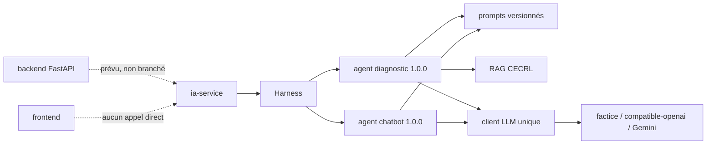
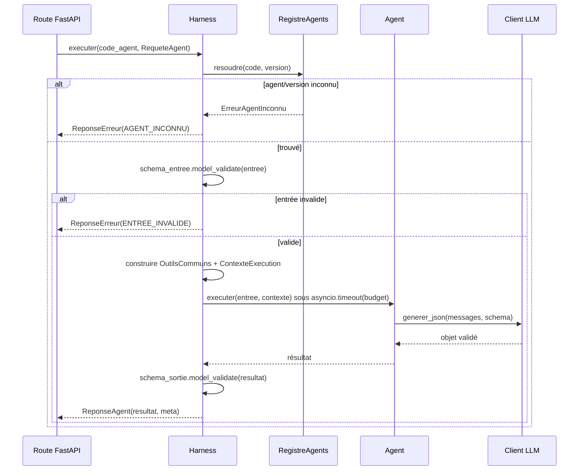
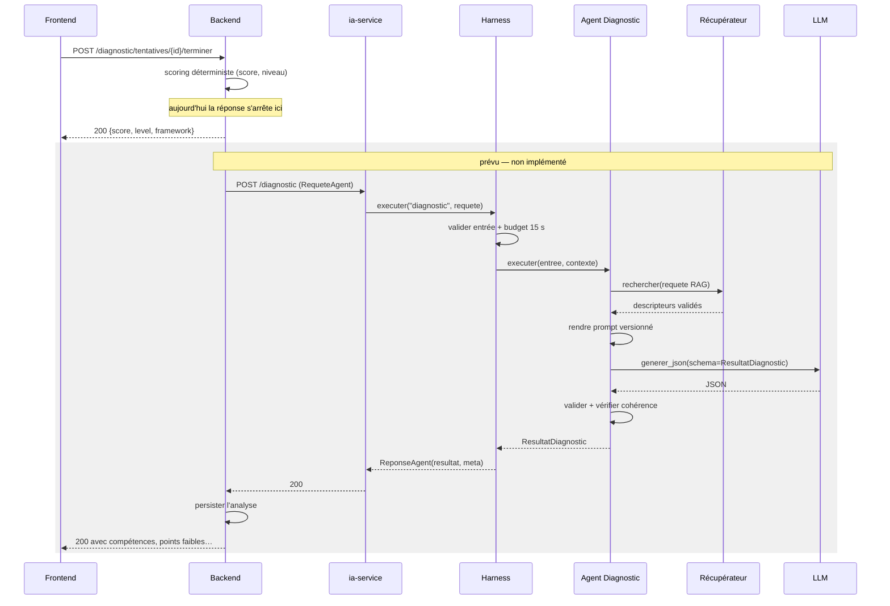

# Chapitre 3 — Le service IA (`ia-service`)

> Dossier : `ia-service/`
> Stack : Python 3.11, FastAPI, Pydantic 2, httpx, packaging, pytest.
> Rôle : exécuter des **agents IA** bornés (diagnostic, chatbot) derrière un pipeline commun
> appelé **Harness**.

---

## 1. Rôle et position dans l'architecture

Le service IA est un **service interne** : il ne possède ni base de données, ni session, ni
mémoire persistée. Il reçoit une requête JSON typée, rend un prompt versionné, appelle un
fournisseur LLM, valide la sortie, puis renvoie une enveloppe standardisée.

Trois principes structurent tout le service :

1. **Aucun état** : pas d'accès PostgreSQL, pas de fichier utilisateur. Le contexte apprenant
   arrive dans la requête et repart avec la réponse.
2. **Aucune autorité** : le score objectif est calculé par le backend. L'agent ne le recalcule
   pas, il l'utilise comme point de départ.
3. **Tout est borné** : taille d'entrée, budget de temps, nombre de reprises, schéma de sortie,
   catalogue d'erreurs fermé.

Aujourd'hui, **une seule route métier est exposée** : `POST /chatbot/message` (plus la sonde
`GET /health`). L'agent Diagnostic est enregistré au démarrage mais **n'a pas de route**. Le
backend n'appelle jamais ce service.



---

## 2. Organisation des dossiers

```
ia-service/
├── app/
│   ├── main.py               # lifespan, routes, CORS, gestionnaires d'erreurs
│   ├── api/
│   │   └── chatbot.py        # POST /chatbot/message
│   ├── agents/
│   │   ├── diagnostic.py     # évaluation diagnostique (sans route)
│   │   └── chatbot.py        # conversation (route exposée)
│   ├── harness/
│   │   ├── agent.py          # contrat DefinitionAgent + ContexteExecution
│   │   ├── execution.py      # pipeline commun
│   │   └── registre.py       # code → version → définition
│   ├── llm/
│   │   ├── base.py           # protocole FournisseurLLM
│   │   ├── fabrique.py       # client unique du processus
│   │   └── adaptateurs/      # factice, compatible_openai, gemini
│   ├── prompts/
│   │   ├── registre.py       # chargement, validation, version, empreinte
│   │   ├── variables.py      # variables typées des prompts
│   │   ├── bibliotheque_few_shot.py
│   │   ├── diagnostic/       # prompt diagnostic
│   │   └── chatbot/          # prompt chatbot
│   ├── rag/
│   │   ├── base.py           # port RecuperateurRAG
│   │   ├── corpus.py         # chargement du corpus CECRL
│   │   ├── local.py          # recherche locale
│   │   ├── vide.py           # récupérateur neutre
│   │   └── fabrique.py
│   ├── schemas/              # contrats Pydantic (commun, contexte, diagnostic, chatbot)
│   └── core/                 # config, erreurs, catalogue, reprise, gestionnaire
├── corpus/                   # manifeste + descripteurs privés (non versionnés)
├── models/                   # modèles entraînés (*.pkl) — non versionnés
├── tests/
├── Dockerfile
└── requirements*.txt
```

---

## 3. Démarrage : ce qui se construit une fois

`app/main.py` utilise le **lifespan** FastAPI. Tout est construit au démarrage, pas au premier
appel :

```python
@asynccontextmanager
async def duree_vie(app: FastAPI) -> AsyncIterator[None]:
    registre_prompts = RegistrePrompts()
    client_llm = obtenir_client()          # lit la config, choisit l'adaptateur
    registre_agents = RegistreAgents()
    recuperateur_rag = construire_recuperateur()

    registre_agents.enregistrer(construire_definition(registre_prompts))
    registre_agents.enregistrer(definir_agent_chatbot(registre_prompts))

    app.state.harness = Harness(registre_agents, client_llm, ...)
    try:
        yield
    finally:
        await client_llm.fermer()
        await recuperateur_rag.fermer()
        reinitialiser_client()
```

Conséquences :

- une **configuration LLM invalide empêche le service de démarrer** : l'erreur est visible
  immédiatement, pas à la première requête ;
- le client HTTP et le corpus sont **partagés** par toutes les requêtes ;
- l'arrêt ferme proprement le client `httpx` et le récupérateur.

---

## 4. Le Harness : le pipeline commun

Le Harness est le **seul point d'entrée** d'un agent. Il ne contient aucune logique pédagogique.



Les étapes, dans l'ordre exact de `execution.py` :

1. **résoudre** l'agent et sa version (dernière version SemVer si absente) ;
2. **revalider l'entrée** avec le schéma de l'agent (la route a déjà validé l'enveloppe) ;
3. **construire les outils communs** : client LLM, registre de prompts, récupérateur RAG,
   horloge ;
4. **exécuter sous budget** : `asyncio.timeout(definition.budget_ms / 1000)` ;
5. **valider la sortie** avec `schema_sortie` ;
6. **retourner une enveloppe** `ReponseAgent` (succès) ou `ReponseErreur` (échec).

Toute exception interne devient une `ReponseErreur` : **l'appelant ne voit jamais une
traceback Python**. C'est un choix fort : le contrat HTTP reste stable même si l'agent plante.

```python
async with asyncio.timeout(definition.budget_ms / 1000):
    resultat_brut = await definition.executer(entree, contexte)
```

Le budget de l'agent (15 s pour le diagnostic, 30 s pour le chatbot) englobe **toutes** les
reprises du client LLM. Un fournisseur lent ne peut pas bloquer indéfiniment la requête.

---

## 5. Le contrat d'un agent

`harness/agent.py` définit une **fonction injectée**, pas une classe qui connaît le monde :

```python
@dataclass(frozen=True, slots=True)
class OutilsCommuns:
    client_llm: FournisseurLLM
    registre_prompts: RegistrePrompts
    recuperateur_rag: RecuperateurRAG
    horloge: Callable[[], float]

@dataclass(frozen=True)
class ContexteExecution:
    request_id: UUID
    contexte: ContexteApprenant
    outils: OutilsCommuns
```

Un agent **n'importe ni `httpx`, ni SQLAlchemy, ni le registre**. Il reçoit son entrée typée et
le contexte. C'est ce qui rend un agent testable sans réseau et remplaçable sans toucher au
reste du service.

Le registre :

```python
registre.enregistrer(definition)      # (code, version) unique, jamais écrasé
registre.resoudre("diagnostic")       # dernière version SemVer
registre.resoudre("diagnostic", "1.0.0")
```

Une version demandée mais absente est une erreur métier (`AGENT_INCONNU`), pas un `KeyError`.

---

## 6. Catalogue d'erreurs : un seul endroit décide

`app/core/codes_erreur.py` contient trois tables qui doivent rester cohérentes :

```python
class CodeErreur(str, Enum):
    ENTREE_INVALIDE = "ENTREE_INVALIDE"
    AGENT_INCONNU = "AGENT_INCONNU"
    LLM_INDISPONIBLE = "LLM_INDISPONIBLE"
    LLM_TIMEOUT = "LLM_TIMEOUT"
    LLM_LIMITE_REQUETES = "LLM_LIMITE_REQUETES"
    LLM_REPONSE_INVALIDE = "LLM_REPONSE_INVALIDE"
    CORPUS_INDISPONIBLE = "CORPUS_INDISPONIBLE"
    # ...

MESSAGES_PUBLICS = { ... }     # texte générique, une ligne, jamais de donnée d'entrée
CODES_RETRYABLES = frozenset({...})
STATUTS_HTTP = { ... }         # 422, 404, 429, 500, 502, 503, 504
```

| Code | HTTP | Rejouable ? | Pourquoi |
| --- | --- | --- | --- |
| `ENTREE_INVALIDE` | 422 | non | réessayer ne corrige pas l'entrée |
| `AGENT_INCONNU` | 404 | non | le code ou la version n'existe pas |
| `TAILLE_DEPASSEE` | 413 | non | il faut réduire la requête |
| `QUOTA_DEPASSE` | 429 | oui | peut se libérer |
| `LLM_INDISPONIBLE` | 503 | oui | panne temporaire |
| `LLM_TIMEOUT` | 504 | oui | latence temporaire |
| `LLM_LIMITE_REQUETES` | 429 | oui | limite fournisseur |
| `LLM_AUTHENTIFICATION` | 502 | non | clé invalide |
| `LLM_REQUETE_INVALIDE` | 502 | non | requête refusée |
| `LLM_CONFIGURATION` | 500 | non | configuration à corriger |
| `LLM_REPONSE_INVALIDE` | 502 | oui | le modèle peut redevenir conforme |
| `CORPUS_INDISPONIBLE` | 503 | oui | ressource temporaire |
| `PROMPT_INTROUVABLE` | 500 | non | version de prompt absente |
| `ERREUR_INTERNE` | 500 | non | bug |

La cohérence est **vérifiée par Pydantic** : `ErreurAgent` refuse un `retryable` qui ne
correspond pas au code.

```python
@model_validator(mode="after")
def verifier_retryable(self) -> "ErreurAgent":
    attendu = self.code in CODES_RETRYABLES
    if self.retryable != attendu:
        raise erreur(...)
    return self
```

Le gestionnaire d'erreurs remplace aussi la **422 par défaut de FastAPI**, qui recopie la valeur
refusée (donc le message de l'apprenant) :

```python
async def gerer_erreur_validation(_, exception: RequestValidationError) -> JSONResponse:
    emplacements = sorted({".".join(str(p) for p in e.get("loc", ())) for e in exception.errors()})
    logger.warning("Erreur %s : %s", CodeErreur.ENTREE_INVALIDE.value, ", ".join(emplacements[:10]))
    return _reponse_http_pour_code(CodeErreur.ENTREE_INVALIDE)
```

On journalise **les champs fautifs**, jamais leur contenu.

---

## 7. Le client LLM : un contrat, trois adaptateurs

`llm/base.py` définit le protocole que tout le reste connaît :

```python
class FournisseurLLM(Protocol):
    nom: str
    modele: str

    async def generer_texte(...) -> tuple[str, ReponseLLM]: ...
    async def generer_json(messages, *, schema, ...) -> tuple[T, ReponseLLM]: ...
    def generer_flux(...) -> AsyncIterator[MorceauFlux]: ...
    async def fermer(self) -> None: ...
```

| Adaptateur | Usage | Particularités |
| --- | --- | --- |
| `FakeLLMClient` | tests, dev sans clé | scénarios consommés dans l'ordre, erreurs et délais simulables |
| `CompatibleOpenAI` | OpenAI, Mistral, Ollama, vLLM… | `httpx` seul, mode JSON, SSE, aucune reprise interne |
| `GeminiClient` | Google Gemini | import paresseux du SDK, choisi uniquement si configuré |

### 7.1 Configuration

`core/config.py` valide tout au démarrage :

```python
class ConfigLLM(BaseSettings):
    environnement: Environnement = "dev"       # ENVIRONNEMENT
    fournisseur: Fournisseur = "factice"       # LLM_FOURNISSEUR
    modele: str | None = None
    base_url: HttpUrl | None = None
    api_key: SecretStr | None = None
    gemini_modele: str | None = None           # GEMINI_MODEL
    gemini_cle_api: SecretStr | None = None    # GEMINI_API_KEY
    temperature: float = 0.2
    max_tokens: int = 600
    timeout_s: float = 12.0
    max_retries: int = 1
    reprise_delai_s: float = 0.5
    reprise_delai_max_s: float = 4.0
    budget_total_s: float = 30.0
```

Deux garde-fous :

- en `prod`, `LLM_FOURNISSEUR=factice` est **refusé** ;
- un fournisseur réel exige ses paramètres (`modele`, `base_url`, `api_key` ou les équivalents
  Gemini).

Les clés sont des `SecretStr` : elles n'apparaissent ni dans `repr`, ni dans les messages
d'erreur, ni dans les journaux.

### 7.2 Reprise bornée

La boucle de reprise est **commune** (`core/reprise.py`) ; l'adaptateur fait **une** tentative et
lève une erreur typée.

```python
for tentative in range(politique.tentatives_max):
    try:
        return await operation()
    except Exception as exception:
        if tentative + 1 >= politique.tentatives_max or not est_rejouable(exception):
            raise
        reste_s = politique.budget_total_s - (horloge() - debut)
        delai_s = politique.delai_s(tentative, retry_after_s=..., desordre=desordre())
        if reste_s <= 0 or delai_s >= reste_s:
            raise
        await attente(delai_s)
```

Trois bornes empêchent tout blocage :

1. **nombre de tentatives** (`max_reprises`, 0 à 3) ;
2. **délai croissant plafonné** (`0.5 s`, `1 s`, `2 s`… max `4 s`) avec un petit désordre
   aléatoire ;
3. **budget total** (`budget_total_s`) : si le délai nécessaire dépasse le temps restant, on
   renonce immédiatement.

Seules les erreurs **déclarées rejouables** sont retentées. Une clé refusée ou une entrée
invalide remonte tout de suite : la retenter gaspillerait du budget et masquerait le vrai
problème.

Un **flux commencé n'est jamais rejoué** : des morceaux ont déjà pu être affichés.

---

## 8. L'agent Diagnostic

### 8.1 Entrée

```python
class EntreeDiagnostic(ModeleStrict):
    scenario: ScenarioDiagnostic = "quotidien"
    reponses: list[ReponseDiagnosticPrompt] = Field(min_length=1, max_length=100)
    score_preliminaire: float = Field(ge=0, le=100)
```

Le score et le niveau préliminaire viennent du **backend**. L'agent ne les recalcule pas.

### 8.2 Déroulement

1. **RAG** : construire une requête à partir de la langue, du référentiel, du niveau et des
   compétences rencontrées, puis demander au récupérateur des descripteurs.
2. **Validation des descripteurs** : refuser un corpus incohérent (mauvaise langue, mauvais
   référentiel, doublon) plutôt que d'injecter un document hors contexte.
3. **Prompt** : assembler les variables typées, laisser le registre choisir la version et
   l'exemple few-shot (scénario + langue).
4. **Appel LLM** : `generer_json(messages, schema=ResultatDiagnostic)`.
5. **Cohérence** : vérifier que le résultat concerne bien le contexte reçu et que chaque preuve
   cite une question réellement posée.
6. **Signalement** : si l'estimation s'écarte du niveau préliminaire de **2 niveaux ou plus**,
   écrire un avertissement dans les journaux (sans contenu d'apprenant).

```python
resultat, _meta = await contexte.outils.client_llm.generer_json(
    rendu.messages,
    schema=ResultatDiagnostic,
    temperature=rendu.temperature,
    max_tokens=rendu.max_tokens,
)
self._verifier_coherence(resultat, apprenant, entree.reponses)
self._signaler_ecart(resultat, contexte)
```

### 8.3 Séquence complète (état cible, non branché au backend)



La partie grise est la **cible** : elle n'existe pas dans le code actuel.

### 8.4 Budget et erreurs

- budget agent : **15 000 ms** ;
- budget LLM total : **30 000 ms** par défaut, donc le budget agent coupe avant ;
- une incohérence du résultat devient `LLM_REPONSE_INVALIDE` (rejouable) ;
- un corpus cassé devient `CORPUS_INDISPONIBLE` (rejouable), mais la fabrique RAG absorbe
  l'erreur au démarrage et retombe sur un récupérateur vide.

---

## 9. La seule route métier : le chatbot

`api/chatbot.py` ne contient aucune logique :

```python
@router.post("/message", response_model=ReponseAgent[ResultatChatbot], responses={...})
async def envoyer_message(requete: RequeteAgent[EntreeChatbot], request: Request):
    reponse = await request.app.state.harness.executer(CODE_AGENT_CHATBOT, requete)
    if isinstance(reponse, ReponseErreur):
        return JSONResponse(
            status_code=STATUTS_HTTP[reponse.erreur.code],
            content=reponse.model_dump(mode="json"),
        )
    return reponse
```

L'enveloppe d'entrée est **commune** à tous les agents :

```json
{
  "request_id": "3f1c…",
  "version_agent": null,
  "contexte": {
    "code_langue": "en",
    "referentiel": "CECRL",
    "niveau_preliminaire": "B1",
    "memoire_pedagogique": null
  },
  "entree": { "message": "…", "historique": [] }
}
```

L'enveloppe de succès contient `request_id`, `agent`, `version_agent`, `version_prompt`,
`resultat`, `meta` (durée, fournisseur, modèle, version du corpus, empreinte du prompt).

**Important** : cette route n'est appelée par **personne**. Ni le frontend ni le backend ne
l'utilisent. En local, le fournisseur par défaut est `factice`.

---

## 10. Prompts versionnés et few-shot

`prompts/registre.py` charge des fichiers, vérifie leur intégrité et calcule une empreinte
SHA-256 :

```python
VERSION_EVALUATION_DIAGNOSTIC = "1.1.0"
VERSION_CONVERSATION_CHATBOT = "1.0.0"
```

Un prompt est identifié par `domaine/tâche@version` (par exemple
`diagnostic/evaluation@1.1.0`). L'empreinte est transmise dans `meta.empreinte_prompt`, ce qui
permet de savoir **quelle version exacte** a produit une réponse.

Le registre sélectionne aussi l'exemple few-shot selon le **scénario** et la **langue**, dans
une limite de 3 exemples. Un prompt introuvable lève `PROMPT_INTROUVABLE` (500, non rejouable).

Le rendu est contraint : les variables du template sont vérifiées, et un placeholder inconnu
est refusé. On ne peut donc pas injecter une variable arbitraire dans un prompt.

---

## 11. RAG : optionnel, prudent, borné

Le port `RecuperateurRAG` a trois implémentations :

| Implémentation | Quand | Effet |
| --- | --- | --- |
| `RecuperateurVide` | `RAG_CORPUS_ACTIF=false` (défaut) ou corpus cassé | aucun descripteur, estimation prudente |
| `RecuperateurLocal` | corpus CECRL chargé | recherche dans les descripteurs locaux |
| `CorpusCecrl` | chargement + vérification d'empreinte | source des descripteurs |

```python
def construire_recuperateur(config: ConfigRAG | None = None) -> RecuperateurRAG:
    parametres = config or ConfigRAG()
    if not parametres.corpus_actif:
        return RecuperateurVide()
    try:
        corpus = CorpusCecrl.charger(parametres.dossier, verifier_empreinte=parametres.verifier_empreinte)
    except (ErreurServiceIA, OSError, ValueError) as exc:
        logger.error("Corpus CECRL indisponible (%s) : récupérateur vide...", type(exc).__name__)
        return RecuperateurVide()
    return RecuperateurLocal(corpus)
```

Choix de conception à retenir : **un corpus cassé ne bloque pas le service**. Le diagnostic
continue, avec une estimation prudente et un avertissement dans les journaux. C'est le bon
compromis pour un parcours apprenant : mieux vaut une réponse moins précise qu'un écran
d'erreur.

Les descripteurs sont ensuite **revérifiés** par l'agent : langue et référentiel doivent
correspondre au contexte, et les doublons sont écartés.

---

## 12. Tests

Les tests du service IA ne dépendent ni d'une clé API ni du réseau :

- `FakeLLMClient` rejoue des scénarios préparés (succès, erreur, timeout, réponse invalide) ;
- `test_harness.py` vérifie l'ordre des étapes, les budgets et les enveloppes d'erreur ;
- `test_codes_erreur.py` vérifie la cohérence code / message / rejouable / statut ;
- `test_reprise.py` vérifie le nombre de tentatives, les délais et le budget ;
- `test_agent_diagnostic.py` vérifie le RAG, la cohérence et le signalement d'écart ;
- `test_chatbot.py` vérifie la route et la traduction des erreurs ;
- `test_prompts.py`, `test_registre.py`, `test_bibliotheque_few_shot.py` vérifient le
  versionnement ;
- `test_adaptateur_compatible_openai.py`, `test_adaptateur_gemini.py` simulent le fournisseur.

Couverture imposée : **70 %**.

```powershell
make test-ia
# ou :
docker compose -f docker-compose.yml -f docker-compose.dev.yml run --rm ia-service pytest
```

---

## 13. Limites et dettes techniques

1. **Agent Diagnostic sans route** : la logique existe, rien ne peut l'appeler.
2. **Backend non branché** : aucun client HTTP vers `ia-service`, aucune persistance de
   l'analyse.
3. **Chatbot sans appelant** : la route fonctionne, mais aucun écran ne l'utilise.
4. **Fournisseur `factice` par défaut** : en local, les réponses sont simulées. C'est voulu,
   mais il faut le savoir avant de conclure qu'un agent « fonctionne ».
5. **RAG désactivé par défaut** : `RAG_CORPUS_ACTIF=false` ; sans corpus, l'estimation reste
   prudente.
6. **Pas de mémoire persistée** : le contexte est transmis à chaque appel ; aucune continuité
   entre deux requêtes.
7. **Pas de limitation de débit propre** : le code `QUOTA_DEPASSE` existe, mais aucun middleware
   ne compte les requêtes.
8. **Pas de streaming exposé** : `generer_flux` existe dans le client, mais aucune route ne
   l'utilise.
9. **Le service n'authentifie pas ses appelants** : il est supposé interne. S'il était exposé,
   n'importe qui pourrait consommer le budget LLM.
10. **Budget agent < budget LLM** : avec un budget de 15 s et un budget LLM de 30 s, c'est
    l'agent qui coupe. Un réglage incohérent ne produit pas d'erreur de configuration.
11. **Modèles non versionnés** : `ia-service/models/` est ignoré par Git ; un modèle absent n'est
    pas détecté au démarrage.

---

## 14. Commandes utiles

```powershell
# Tests du service IA
make test-ia

# Démarrage seul (dev)
docker compose -f docker-compose.yml -f docker-compose.dev.yml up ia-service

# Santé
curl http://localhost:8001/health

# Essai du chatbot (fournisseur factice en local)
curl -X POST http://localhost:8001/chatbot/message `
  -H "Content-Type: application/json" `
  -d '{\"request_id\":\"3f1c1e0e-0000-4000-8000-000000000000\",\"contexte\":{\"code_langue\":\"en\",\"referentiel\":\"CECRL\",\"niveau_preliminaire\":\"B1\",\"memoire_pedagogique\":null},\"entree\":{\"message\":\"Bonjour\",\"historique\":[]}}'
```

Sous PowerShell, préférer un fichier JSON et `--data-binary "@requete.json"` pour éviter les
problèmes d'échappement.

---

## 15. Ce que tu dois maîtriser

- Le rôle du **Harness** : un seul chemin d'exécution, aucune logique pédagogique.
- La différence entre **enveloppe** (`RequeteAgent`, `ReponseAgent`, `ReponseErreur`) et
  **entrée métier** (`EntreeDiagnostic`, `EntreeChatbot`).
- Pourquoi une exception ne sort jamais du service : elle devient un code stable.
- Le lien entre **code d'erreur**, **statut HTTP** et **`retryable`**, et pourquoi Pydantic
  vérifie cette cohérence.
- Le fonctionnement de la **reprise bornée** (tentatives, délai, budget) et pourquoi un flux
  n'est jamais rejoué.
- Le versionnement des prompts et la signification de l'**empreinte**.
- Le contrat d'un agent : entrée typée, sortie typée, outils injectés, budget.
- Le rôle du **RAG** et la règle de prudence quand il est absent.
- La différence entre `RecuperateurVide` et une erreur bloquante.
- Pourquoi le service n'a **ni base ni mémoire**.

---

## Questions de compréhension

1. Une requête arrive avec un `code_agent` inconnu. Décris les étapes du Harness et l'enveloppe
   renvoyée. Pourquoi le service ne renvoie-t-il pas une traceback ?
2. Le fournisseur répond `429` avec `Retry-After: 2`. Que fait la politique de reprise ? Que se
   passe-t-il si le budget total restant est de 1 seconde ?
3. Pourquoi `reponse_erreur` ne recopie-t-elle jamais le message de l'exception d'origine ?
   Quel risque évite-t-on ?
4. Le corpus RAG est activé mais le dossier est absent. Que fait `construire_recuperateur` ?
   Quel est l'effet sur la réponse du diagnostic, et est-ce un bon choix ?
5. Le budget de l'agent Diagnostic est de 15 s et `LLM_BUDGET_TOTAL_S` de 30 s. Qui coupe en
   premier ? Que se passe-t-il si l'on inverse les deux valeurs sans changer le code ?
