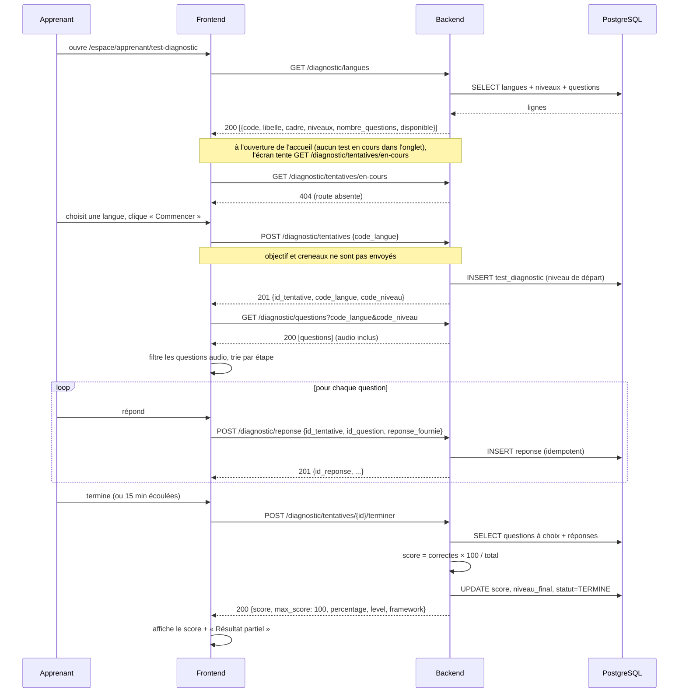

# Chapitre 5 — L'intégration frontend ↔ backend

> Fichiers clés : `docs/api/contrat-frontend.md`, `frontend/src/services/endpoints.ts`,
> `frontend/src/lib/api-client.ts`, `frontend/src/services/test-diagnostic.service.ts`,
> `frontend/src/app/providers.tsx`, `backend/app/api/routes/diagnostic.py`,
> `backend/app/schemas/diagnostic.py`.

---

## 1. Le contrat est la source de vérité

Le dépôt a choisi une règle simple : **`docs/api/contrat-frontend.md` décrit exactement ce que
le frontend attend**. Toute route, tout champ, tout code HTTP doit y figurer. Une modification
de contrat impose de mettre à jour, **dans la même PR** :

1. `docs/api/contrat-frontend.md` ;
2. `frontend/src/services/endpoints.ts` ;
3. le service concerné (`*.service.ts`, `*.mapper.ts`) ;
4. `frontend/src/services/__tests__/services.test.ts`.

Cette règle est bonne. Le problème n'est pas la règle, c'est son **application partielle** : le
contrat décrit des routes et des champs que le backend n'implémente pas encore. Ce chapitre
montre la chaîne réelle, puis les écarts, puis comment les corriger.

---

## 2. La chaîne d'un appel

```
composant React
   ↓ (hook)
hook (useUtilisateurs, useTestDiagnostic…)
   ↓
service (utilisateurs.service.ts, test-diagnostic.service.ts…)
   ↓
apiRequest<T>()  ← seul endroit qui connaît fetch, le JWT, les erreurs
   ↓
FastAPI (route → dépendance → service → SQLAlchemy → PostgreSQL)
   ↓
DTO snake_case
   ↓
mapper → objet camelCase
   ↓
état React (React Query ou Zustand)
```

Deux règles structurent cette chaîne :

- **un composant ne fait jamais `fetch`** : il appelle un hook, qui appelle un service ;
- **seuls les services et les mappers connaissent le `snake_case`**. Un composant ne doit jamais
  lire `dto.id_user` : il lit `utilisateur.idUser`.

---

## 3. Le trajet réseau : navigateur → backend, en direct

Il n'y a **ni BFF, ni proxy Next.js, ni route API interne**. Le navigateur appelle directement
le backend :

```ts
// frontend/src/lib/env.ts
export const API_URL = (process.env.NEXT_PUBLIC_API_URL ?? "http://localhost:8000").replace(/\/+$/, "");
```

```ts
// frontend/src/lib/api-client.ts
res = await fetch(buildUrl(path, query), {
  method,
  headers,
  body: ...,
  signal: controller.signal,
});
```

Conséquences :

1. **CORS est obligatoire** : sans `Access-Control-Allow-Origin`, le navigateur bloque la
   réponse même si le backend a répondu `200`.
2. **Le JWT circule dans l'en-tête `Authorization`** : c'est le frontend qui l'ajoute, pas un
   serveur intermédiaire.
3. **L'URL de l'API est publique** : elle est visible dans le JavaScript. Ce n'est pas un
   secret, mais cela signifie qu'un déploiement doit la configurer correctement au build.

Côté backend :

```python
app.add_middleware(
    CORSMiddleware,
    allow_origins=settings.cors_origins,          # BACKEND_CORS_ORIGINS
    allow_credentials=True,
    allow_methods=["GET", "POST", "PUT", "PATCH", "DELETE", "OPTIONS"],
    allow_headers=["Content-Type", "Authorization"],
)
```

`BACKEND_CORS_ORIGINS` vaut par défaut `http://localhost:3000,http://localhost:8000`. Si le
frontend est servi sur un autre hôte ou un autre port, il faut **modifier cette variable**,
sinon le navigateur bloque tout.

> Détail : `Accept` n'a pas besoin d'être dans `allow_headers`, car c'est un en-tête
> « safelisted » par CORS. `Authorization` et `Content-Type` sont bien nécessaires.

---

## 4. DTO, mapper, domaine

Un service ne renvoie pas le DTO brut : il le traduit.

```ts
// frontend/src/services/utilisateur.mapper.ts
export interface UtilisateurDto {
  id_user: number;
  date_inscription: string;
  photo_url?: string | null;
}

export const toUtilisateur = (dto: UtilisateurDto): Utilisateur => ({
  idUser: dto.id_user,
  dateInscription: dto.date_inscription,
  photoUrl: resoudreUrlPhoto(dto.photo_url),
});
```

Pourquoi cette couche :

- **isoler le backend** : si `id_user` devient `identifiant`, seul le mapper change ;
- **normaliser** : dates, URLs de photos, valeurs `null` → `undefined` ;
- **typer le domaine** : `Utilisateur` est un type métier, pas la forme du JSON.

Limite importante : **le mapper ne valide pas les types à l'exécution**. Si le backend renvoie
`id_user: "12"` (chaîne), TypeScript compile mais l'application reçoit une chaîne. Il n'y a ni
Zod ni génération de types depuis `/openapi.json`. Une dérive de type n'est détectée qu'à
l'usage.

---

## 5. Authentification et réaction aux erreurs

### 5.1 Le JWT

`apiRequest` ajoute le jeton sauf pour les routes publiques :

```ts
const token = auth ? authHandlers.getToken() : null;
if (token) headers.Authorization = `Bearer ${token}`;
```

Les routes publiques (`login`, `register`, `forgot-password`, `reset-password`) passent
`auth: false`. C'est important : un `401` sur le login signifie « identifiants incorrects », pas
« session expirée ». Sans ce drapeau, une erreur de mot de passe purgerait la session et
redirigerait l'utilisateur.

### 5.2 Le 401

`apiRequest` appelle `onUnauthorized()` **uniquement** sur une route authentifiée :

```ts
if (!res.ok) {
  if (res.status === HTTP_STATUS.UNAUTHORIZED && auth) authHandlers.onUnauthorized();
  const detail = await readErrorDetail(res);
  throw new ApiError(res.status, detail ?? (res.statusText || "Erreur inattendue"), detail);
}
```

Le branchement est fait dans `providers.tsx` :

```ts
configureApiClient({
  getToken: () => useAuthStore.getState().accessToken,
  onUnauthorized: () => {
    useAuthStore.getState().clearSession();
    useTestDiagnosticStore.getState().reinitialiser();
    queryClient.clear();
  },
});
```

Puis `RequireAuth` observe `isAuthenticated` et redirige vers `/login`. La purge vide aussi le
test en cours et le cache React Query : aucune donnée d'un ancien utilisateur ne reste à
l'écran.

### 5.3 401 vs 403

| Code | Sens | Exemple |
| --- | --- | --- |
| `401` | identité absente, invalide ou expirée | JWT expiré, compte supprimé |
| `403` | identité valide, droit insuffisant | apprenant qui appelle `/users` |

`RequireAuth` masque l'écran, mais la vraie décision est backend. Un utilisateur qui modifie
`localStorage` peut afficher une page, pas obtenir les données.

---

## 6. Les erreurs, du backend à l'écran

### 6.1 `ApiError`

```ts
export class ApiError extends Error {
  constructor(
    public readonly status: number,   // 0 si le serveur n'a pas répondu
    message: string,
    public readonly detail?: string,
    public readonly delaiDepasse = false,
  ) { ... }
}
```

Trois cas :

- **statut HTTP** : `detail` lu dans `{ detail: string }` ou `{ detail: [{ msg }] }` ;
- **timeout** : `status = 0`, `delaiDepasse = true` ;
- **panne réseau** : `status = 0`, `delaiDepasse = false`.

### 6.2 `getErrorMessage`

```ts
export function getErrorMessage(error: unknown, byStatus: Record<number, string> = {}): string {
  if (error instanceof ApiError) {
    if (byStatus[error.status]) return byStatus[error.status];
    if (error.status === 0) return error.message;
    if (error.status === HTTP_STATUS.FORBIDDEN) return "Vous n'avez pas les droits nécessaires pour cette action.";
    if (error.status < 500 && error.detail) return error.detail;
    if (error.status >= 500) return "Le serveur rencontre un problème. Réessayez plus tard.";
  }
  return "Une erreur est survenue. Veuillez réessayer.";
}
```

Sur un `422` Pydantic, `detail` est un tableau ; `readErrorDetail` prend le **premier** message,
en anglais, sans le champ fautif. C'est suffisant pour l'utilisateur, insuffisant pour le
développeur.

### 6.3 Le cas du diagnostic

Le test de positionnement applique une règle plus stricte : **ne jamais montrer le `detail`
technique**. `messageErreurDiagnostic` traduit uniquement le code HTTP :

```ts
if (error.status === 401) return "Votre session a expiré. Reconnectez-vous pour reprendre le test.";
if (error.status === 403) return "Votre compte ne permet pas de passer ce test.";
if (error.status === 404) return `${PANNE[action]} Ce test n'est plus disponible : recommencez-le depuis l'accueil.`;
```

C'est cohérent avec le contrat, qui autorise le backend à mettre des informations de diagnostic
dans `detail` sans risque qu'elles soient affichées.

---

## 7. React Query : cache, reprise, invalidation

```ts
new QueryClient({
  defaultOptions: {
    queries: {
      retry: (failureCount, error) => failureCount < 1 && isRetryable(error),
    },
  },
});
```

- **une seule** nouvelle tentative ;
- **uniquement** pour une panne réseau ou un `5xx` (`isRetryable` exclut les `4xx`) ;
- **les mutations ne sont pas retentées** automatiquement.

Aucun `staleTime` global : la valeur par défaut est `0`. Une requête est donc considérée
périmée immédiatement, et React Query peut recharger au focus de la fenêtre ou à la
reconnexion. Acceptable pour un profil, à surveiller pour un appel coûteux.

Les clés sont centralisées dans `src/hooks/queryKeys.ts`, avec des préfixes pour invalider toute
une famille :

```ts
utilisateursTous: ["utilisateurs"] as const,
utilisateurs: (filtres) => ["utilisateurs", filtres] as const,
```

Après une mutation, le hook appelle `invalidateQueries({ queryKey: … })`.

---

## 8. Le mode mock

Trois mécanismes :

1. **le drapeau** `NEXT_PUBLIC_API_MOCK`, lu dans `src/lib/env.ts` ;
2. **l'aiguillage** dans chaque service :
   ```ts
   langues: () => API_MOCK ? testDiagnosticMockService.langues() : httpTestDiagnosticService.langues(),
   ```
3. **le remplacement webpack** dans `next.config.js` : en build sans mock, le module
   `@/mocks/test-diagnostic.mock` est remplacé par un stub qui lève une erreur.

```js
if (process.env.NEXT_PUBLIC_API_MOCK !== "true") {
  config.plugins.push(new webpack.NormalModuleReplacementPlugin(
    /^@\/mocks\/test-diagnostic\.mock$/,
    path.resolve(__dirname, "src/mocks/test-diagnostic.mock.stub.ts"),
  ));
}
```

Attention : ce filet ne concerne **que** le mock du diagnostic. Les autres mocks
(`auth.mock`, `utilisateurs.mock`, `langues.mock`…) restent dans le bundle.

`frontend/.env.development` met `NEXT_PUBLIC_API_MOCK=true` ; Docker et la CD forcent `false`.
Comme `NEXT_PUBLIC_*` est inliné au build, changer la valeur impose de reconstruire l'image.

---

## 9. Le diagnostic de bout en bout : ce qui se passe réellement



Points à observer :

- **le niveau de départ est choisi par le backend**, pas par l'apprenant ;
- **les questions audio sont renvoyées** par le backend puis **filtrées** par le frontend ;
- **le score est synchrone** : pas de `202`, pas d'attente ;
- **l'écran de résultats est volontairement partiel** : le backend ne fournit pas encore
  l'analyse détaillée.

---

## 10. Tableau des dérives de contrat

| Élément | Contrat | Frontend | Backend | Effet réel |
| --- | --- | --- | --- | --- |
| `GET /diagnostic/tentatives/en-cours` | décrit | appelé au montage | **absent** | `404`, reprise impossible |
| `POST …/abandonner` | décrit | appelé | **absent** | `404`, abandon impossible |
| `202 {statut:"en_attente"}` | décrit | géré + polling | **jamais renvoyé** | branche morte |
| `competences` | décrit | lu | **absent du schéma** | toujours vide |
| `points_faibles` | décrit | lu | **absent** | « Résultat partiel » |
| `phase_assimil` | décrit | lu | **absent** | « Résultat partiel » |
| `justification` | décrit | lu | **absent** | « Résultat partiel » |
| `objectif`, `creneaux` | décrits | dans l'interface | **ignorés** | aucune personnalisation |
| `audio` | décrit | types + UI | **refusé** (`422`) | fonctionnalité morte |
| `max_score` | 100 | exige `=== 100` | renvoie `100` | passe, mais rigide |
| `score === percentage` | implicite | exige l'égalité | renvoie la même valeur | passe, mais rigide |
| `date_debut`, `reponses` (`en-cours`) | décrits | lus | **absents** | reprise impossible |
| `duree_minimale_secondes`, `mots_minimum` | facultatifs | lus | **absents** | valeurs de repli |

### 10.1 Pourquoi `terminer` est fragile

```ts
if (
  dto.score !== dto.percentage ||
  dto.max_score !== 100 ||
  dto.percentage < 0 ||
  dto.percentage > 100
) {
  throw new Error("Le résultat de scoring renvoyé par le serveur est invalide.");
}
```

Aujourd'hui, le backend renvoie `score = percentage = float(pourcentage)` et `max_score = 100`.
La condition passe. Mais si le barème évolue (score brut sur 20, pourcentage arrondi
différemment, `max_score` sur 20), le frontend **rejettera un résultat valide**. C'est un
couplage implicite à un détail d'implémentation.

### 10.2 Pourquoi `demarrer` ignore la personnalisation

```ts
async demarrer(langue: string, _objectif: ObjectifFormation, _creneaux: string[]): Promise<SessionTest> {
  const tentative = await apiRequest<SessionTestDto>(ENDPOINTS.diagnostic.tentatives, {
    method: "POST",
    body: { code_langue: langue },
  });
  ...
}
```

Les paramètres sont préfixés par `_` : ils sont **volontairement inutilisés**. Le schéma backend
`TentativeCreate` ne contient que `code_langue`. Même si le frontend les envoyait, Pydantic les
ignorerait (comportement par défaut). Aucune personnalisation n'est donc persistée.

### 10.3 Pourquoi l'audio est doublement bloqué

- Backend : `TYPES_ENREGISTRABLES = ("choix", "texte")` et
  `if question.type_reponse == "audio": raise AUDIO_NON_DISPONIBLE` ;
- Frontend : filtre les questions audio au chargement et lève une erreur si on tente d'en
  enregistrer une.

La fonctionnalité est annoncée par le contrat et par les types, mais **inatteignable des deux
côtés**.

---

## 11. Recommandations concrètes

Par ordre de priorité :

1. **Implémenter `en-cours` et `abandonner`** (ou retirer les appels). Sans elles, la reprise et
   l'abandon sont cassés. C'est le plus visible pour l'utilisateur.
2. **Compléter `ScoreDiagnosticOut`** avec `competences`, `points_faibles`, `phase_assimil`,
   `justification` (ou une route d'analyse séparée). Sinon l'écran restera « Résultat partiel ».
3. **Décider du statut de `terminer`** : soit synchrone (`200`), soit asynchrone (`202` +
   polling). Aujourd'hui le contrat et le frontend prévoient `202`, le backend renvoie `200`.
   Aligner les trois.
4. **Persister `objectif` et `creneaux`** ou les retirer de l'interface. Un champ affiché mais
   ignoré est un mensonge fonctionnel.
5. **Trancher l'audio** : soit un stockage de médias et une évaluation, soit retirer le type du
   contrat et de l'UI.
6. **Assouplir la validation du score** : valider `0 ≤ score ≤ max_score`, sans exiger
   `score === percentage`. Le pourcentage est une projection, pas une identité.
7. **Ajouter une validation runtime** (Zod) ou générer les types depuis OpenAPI. Cela détecte
   une dérive avant l'utilisateur.
8. **Ajouter un test de contrat en CI** : appeler le vrai backend et vérifier les champs
   attendus par le frontend. Aujourd'hui, les tests frontend simulent HTTP et ne voient pas la
   dérive.
9. **Documenter `BACKEND_CORS_ORIGINS` par environnement** : un déploiement sur un autre
   domaine échoue silencieusement côté navigateur.
10. **Envisager un BFF** si l'on veut sortir le JWT du `localStorage` et utiliser un cookie
    `HttpOnly`. C'est un changement d'architecture, pas un correctif.

---

## 12. Ce que tu dois maîtriser

- La chaîne `composant → hook → service → apiRequest` et l'interdiction de `fetch` dans un
  composant.
- La différence entre **DTO** (`snake_case`, forme de l'API) et **objet métier**
  (`camelCase`, forme de l'UI).
- Pourquoi le navigateur appelle le backend directement et ce que cela implique pour CORS.
- Le cycle d'un JWT : ajout de l'en-tête, expiration, `401`, purge, redirection.
- La différence entre `401` et `403`.
- Le comportement de `ApiError` sur timeout, panne réseau, `4xx`, `5xx`.
- Le rôle de React Query (état serveur) et de Zustand (état local/global).
- Le mode mock et le fait que `NEXT_PUBLIC_*` est figé au build.
- Comment lire le contrat et **détecter une dérive** sans exécuter l'application.
- Pourquoi un test E2E qui simule HTTP ne prouve pas que le backend respecte le contrat.

---

## Questions de compréhension

1. Le backend renvoie `422` avec `detail: [{ loc: ["body", "email"], msg: "value is not a valid
   email address" }]`. Quel message l'utilisateur voit-il dans un formulaire classique ? Et dans
   le test de positionnement ? Quelle information est perdue pour le développeur ?
2. Un apprenant modifie `localStorage` pour se donner le rôle `ADMINISTRATEUR`. Que se passe-t-il
   à l'écran ? Que se passe-t-il à l'appel de `GET /users` ? Pourquoi ?
3. Le frontend appelle `GET /diagnostic/tentatives/en-cours` et reçoit `404`. Pourquoi ce n'est
   pas un `401` ni un `500` ? Quel message l'écran de diagnostic affiche-t-il ?
4. Le backend renvoie `score: 72.0`, `percentage: 72.0`, `max_score: 100`. Le frontend accepte.
   Le backend décide un jour de renvoyer `score: 14.4` sur 20 et `percentage: 72.0`. Que
   se passe-t-il ? Est-ce un bug backend ou frontend ?
5. Un test E2E passe alors que le backend est éteint. Que prouve-t-il exactement ? Que ne
   prouve-t-il pas ? Quel test ajouterais-tu pour couvrir la dérive de contrat ?
