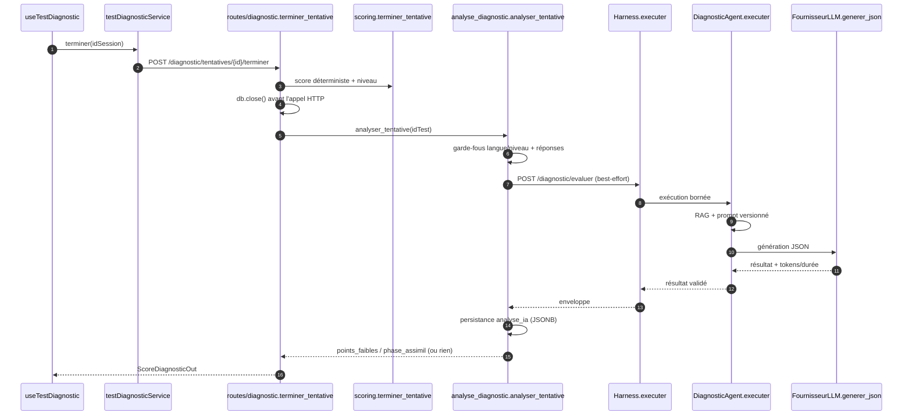

# Guide de lecture — les fonctions qui portent l'architecture

Ce chapitre complète le [README](README.md) et les chapitres 01 à 05. Il ne décrit pas de nouvelles règles :
il associe **chaque fonction importante à son rôle et à la règle qu'elle protège**, pour pouvoir lire le code sans
deviner. Aucune signature n'est modifiée ici.

Légende : **A** = autorité métier, **P** = port/frontière, **O** = orchestration, **T** = technique.

---

## 1. Frontend — du clic à la requête HTTP

Le navigateur appelle le backend **directement** avec un JWT ; il n'y a ni BFF ni proxy Next.js. Une responsabilité
par couche : composant → hook → service → `api-client`.

| Couche | Fonction / symbole | Rôle | Règle à connaître |
| --- | --- | --- | --- |
| T | `configureApiClient` (`src/lib/api-client.ts`) | Enregistre les handlers 401 et l'en-tête `Authorization` | Appelé une seule fois par `providers.tsx` ; la déconnexion purge le store |
| T | `apiRequest` (`src/lib/api-client.ts`) | Construit l'URL, envoie le JWT, traduit les erreurs en `ApiError` | C'est le **seul** endroit qui sait qu'un JWT est envoyé au backend |
| P | `ENDPOINTS` (`src/services/endpoints.ts`) | Liste unique des URLs backend | `tentativeEnCours` et `abandonnerTentative` sont des routes prévues, absentes du backend : 404 hors mock |
| P | `testDiagnosticService` (`src/services/test-diagnostic.service.ts`) | Route vers le mock ou l'API selon `API_MOCK` | Les mappers sont les seuls à connaître le `snake_case` |
| P | `lirePointsFaibles`, `lirePhase`, `lireJustification` | Traduisent les champs IA du DTO vers l'objet TS | Une valeur absente reste absente ; aucun score n'est fabriqué côté frontend |
| O | `useTestDiagnostic` (`src/hooks/useTestDiagnostic.ts`) | Orchestre démarrage, réponses, clôture, reprise | Le statut `en_attente` n'existe que dans le mock ; le backend renvoie le résultat directement |
| O | `useForm` (`src/hooks/useForm.ts`) | Valeurs, erreurs et soumission d'un formulaire | Les erreurs n'apparaissent qu'après le 1ᵉʳ envoi, puis sont recalculées à chaque frappe |
| O | `queryKeys` (`src/hooks/queryKeys.ts`) | Clés React Query centralisées | Toute invalidation passe par ces clés, jamais par une chaîne littérale |
| A | `calculerResultat` (`src/mocks/test-diagnostic.mock.ts`) | Résultat de démonstration calculé localement | Uniquement actif si `NEXT_PUBLIC_API_MOCK=true` ; ne jamais confondre avec le score backend |

---

## 2. Backend — authentification et autorisation

| Couche | Fonction / symbole | Rôle | Règle à connaître |
| --- | --- | --- | --- |
| T | `hacher_mot_de_passe`, `verifier_mot_de_passe` (`core/security.py`) | Hachage bcrypt et comparaison | Le mot de passe en clair n'est jamais persisté ni journalisé |
| T | `creer_jeton_acces`, `creer_jeton_reinitialisation`, `lire_jeton` | Émission et lecture des JWT signés | `lire_jeton` vérifie l'`usage` : un jeton de reset ne peut pas servir de jeton d'accès |
| A | `login` (`api/routes/auth.py`) | Vérifie identifiants et renvoie le JWT | E-mail inconnu = mauvais mot de passe (même 401) : pas d'énumération de comptes ; compte inactif = 403 |
| A | `register` (`api/routes/auth.py`) | Crée apprenant, langues et abonnement | Une formule sans langue couvre toutes les langues ; conflit d'e-mail = 409 |
| P | `utilisateur_connecte` (`api/deps.py`) | Décode le JWT et charge l'utilisateur | Source de vérité de l'identité ; le frontend n'est jamais cru |
| P | `permission_requise` (`api/deps.py`) | Fabrique une dépendance RBAC par code de permission | Le 403 vient toujours du backend, jamais d'un simple masquage UI |
| T | `secret_obligatoire_en_production` (`core/config.py`) | Refuse les secrets d'exemple en production | Un `SECRET_KEY` faible empêche le démarrage |
| P | `Pagination.offset` (`api/deps.py`) | Convertit page/page_size en décalage SQL | Bornage central des listes paginées |

---

## 3. Backend — diagnostic et analyse IA

Le score déterministe est la **seule autorité** ; l'IA ne propose que `points_faibles` et `phase_assimil`.
L'appel IA est best-effort : il ne doit jamais faire échouer la clôture.

| Couche | Fonction / symbole | Rôle | Règle à connaître |
| --- | --- | --- | --- |
| A | `cadre_de_langue`, `niveau_de_reference` (`services/scoring.py`) | Choisissent CECRL/HSK et convertissent un pourcentage en niveau | Le chinois suit le HSK, pas le CECRL |
| A | `terminer_tentative` (`services/scoring.py`) | Calcule le score, fixe le niveau et clôt la tentative | Aucun arrondi fantaisiste : le pourcentage est décimal |
| O | `lister_langues`, `lister_questions`, `creer_tentative`, `enregistrer_reponse` (`services/diagnostic.py`) | Parcours de test et persistance | Répondre deux fois la même chose est idempotent ; une réponse différente est refusée |
| O | `terminer_tentative` (`api/routes/diagnostic.py`) | Point d'entrée HTTP de la clôture | `db.close()` **avant** l'appel IA : aucune connexion PostgreSQL immobilisée pendant l'attente |
| O | `analyser_tentative` (`services/analyse_diagnostic.py`) | Construit la requête, appelle l'IA, persiste `analyse_ia` | Langues `fr,en,zh,it,de` et niveaux du référentiel uniquement ; 2ᵉ clôture = réemploi, sans nouvel appel facturé |
| P | `_preparer` (`services/analyse_diagnostic.py`) | Applique les garde-fous et rejette les compétences inconnues | Aucune réponse exploitable ⇒ aucun appel LLM |
| P | `_calculer_competences` (`services/analyse_diagnostic.py`) | Compte les bonnes réponses des **seules** questions à choix | Inclure les réponses libres afficherait un score trompeur |
| P | `evaluer_diagnostic` (`services/ia.py`) | Client HTTP vers `POST /diagnostic/evaluer` | URL vide = désactivé ; timeout/erreur/réponse invalide ⇒ `ErreurServiceIA`, jamais une erreur pour l'apprenant |
| T | `ErreurServiceIA.code` | Code technique court (`timeout`, `indisponible`…) | Ne contient jamais de prompt, de réponse brute ni de clé |

---

## 4. Service IA — Harness, agents, prompts, RAG, LLM

Le service IA est **sans base et sans état apprenant**. Il reçoit une requête typée et renvoie une enveloppe
normalisée ; il ne persiste rien.

| Couche | Fonction / symbole | Rôle | Règle à connaître |
| --- | --- | --- | --- |
| P | `GET /health`, `POST /diagnostic/evaluer`, `POST /chatbot/message` (`app/main.py`) | Frontière HTTP | Le backend appelle uniquement `/diagnostic/evaluer` |
| O | `Harness.executer` (`harness/execution.py`) | Résout la version de l'agent, valide l'entrée, applique le budget, normalise succès/erreur | Toute exception est traduite en `ReponseErreur` avec un code stable |
| O | `_erreur`, `_code_pour`, `_journaliser` (`harness/execution.py`) | Traduction et journalisation des erreurs | Les journaux ne contiennent ni prompt ni donnée personnelle |
| A | `DiagnosticAgent.executer` (`agents/diagnostic.py`) | Récupère les descripteurs, rend le prompt, appelle le LLM, valide la sortie | Ne recalcule jamais le score du backend |
| A | `est_ecart_important` (`agents/diagnostic.py`) | Seuil déterministé au-delà duquel l'écart est signalé | Règle métier explicite, pas une décision du modèle |
| P | `preuves_depuis_reponses` (`prompts/variables.py`) | Réduit les réponses brutes en preuves bornées | Borne de taille : une réponse trop longue ne peut pas grossir le prompt indéfiniment |
| P | `VariablesEvaluationDiagnostic.verifier_coherence` | Vérifie la cohérence du prompt rendu | Langue ↔ référentiel ↔ niveaux doivent s'accorder |
| P | `ResultatDiagnostic.verifier_referentiel_et_niveaux`, `verifier_ecart`, `verifier_domaines_uniques` (`schemas/diagnostic.py`) | Invariants de la sortie LLM | L'écart est **recalculé**, jamais cru ; un domaine ne peut pas être répété |
| P | `RecuperateurRAG` (`rag/base.py`) | Port documentaire | Implémenté localement par `RecuperateurLocal`, activable par `RAG_CORPUS_ACTIF` ; `RecuperateurVide` est le repli |
| P | `RecuperateurLocal.rechercher` (`rag/local.py`) | Recherche BM25 déterministe dans le corpus CECRL local | Aucun appel réseau, aucun accès PostgreSQL |
| P | `obtenir_client` (`llm/fabrique.py`) | Sélectionne l'adaptateur (`compatible-openai` / `gemini` / `factice`) | Configuration invalide ⇒ refus de démarrer ; `factice` interdit en production |
| P | `generer_json` des adaptateurs (`llm/adaptateurs/*.py`) | Appel fournisseur + validation JSON + normalisation des tokens | Tokens absents = `None`, jamais 0 ; durée mesurée côté fournisseur |
| T | `creer_client`, `reinitialiser_client` (`llm/fabrique.py`) | Construction et reset du client partagé | Les deux adaptateurs respectent le même contrat `FournisseurLLM` |

---

## 5. Le fil rouge : une clôture de diagnostic

Lecture du diagramme : si **n'importe quelle** étape IA échoue, le chemin score déterministe → `ScoreDiagnosticOut`
reste valide ; le frontend affiche alors un résultat partiel.

---

## 6. Règles transverses à ne pas casser

1. **Le backend seul possède la vérité** : score, niveau, persistance, autorisation.
2. **`ia-service` n'a ni base ni état** : ni PostgreSQL, ni stockage de réponses apprenant.
3. **Un champ modifié = une PR complète** : `docs/api/contrat-frontend.md`, `endpoints.ts`, service/mapper, test Jest.
4. **Codes stables** : rôles/statuts `SMALLINT` et codes d'erreur IA ne se modifient pas, on ajoute.
5. **Aucune donnée sensible dans les journaux** : ni prompt, ni réponse, ni clé API.
6. **Configuration par environnement** : mocks frontend, `SEED_DEMO`, `RAG_CORPUS_ACTIF`, `LLM_FOURNISSEUR`.
7. **Test avant confiance** : une fonctionnalité n'est faite que si le parcours complet UI → API → base marche.

Pour les dérives connues et vérifiées dans le code, voir le [README, §10](README.md#10-écarts-documentaires-connus).
