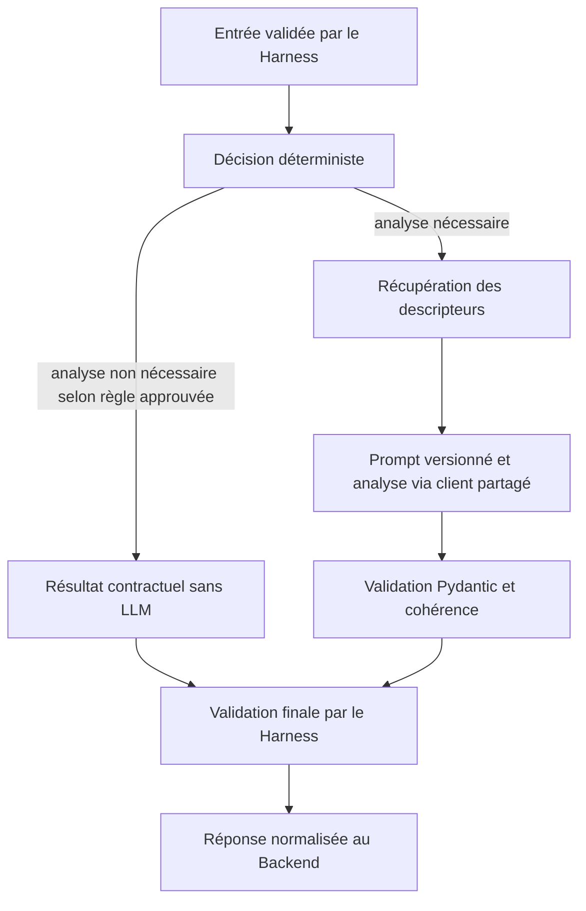

# Audit LangGraph — microservice IA

**Date :** 6 novembre 2026
**Périmètre :** `ia-service/` uniquement
**Base auditée :** branche `feature/langgraph-audit`, créée depuis `origin/develop` (`de77fc45d81b47f8a93c6af3175489f40a10659`).

## Synthèse

LangGraph n'est ni déclaré dans les dépendances ni utilisé dans le code du microservice. Aucun import de
`langgraph`, `langchain` ou `langchain_core`, ni aucun `StateGraph`, node ou edge n'a été trouvé. Aucun paquet
correspondant n'est installé dans l'environnement Python du microservice disponible pendant l'audit ; aucune
version LangGraph n'est donc détectée.

Le service possède déjà un Agent Harness générique, un registre versionné et deux agents : Diagnostic et chatbot.
Le workflow Diagnostic est essentiellement séquentiel et n'a pas encore de route HTTP. L'architecture actuelle
est suffisante pour l'exécuter. Une intégration LangGraph pourrait devenir pertinente à l'intérieur de cet agent
si le Sprint 2 introduit des transitions conditionnelles réelles, notamment une règle métier déterministe pour
décider de ne pas appeler le LLM. Cette règle n'est pas définie dans l'implémentation auditée.

**Recommandation : conserver l'existant aujourd'hui et retenir une architecture hybride comme évolution
conditionnelle.** Ne pas installer ni introduire LangGraph avant que les branches métier, les résultats attendus
sans LLM et leur validation aient été spécifiés et approuvés.

## Dépendances et usage détecté

`requirements.txt` épingle FastAPI, Uvicorn, Pydantic, pydantic-settings, HTTPX et Packaging. `requirements-dev.txt`
ajoute pytest, pytest-cov et Ruff. `pyproject.toml` ne déclare pas de dépendances : il configure uniquement pytest
et Ruff.

| Vérification | Résultat |
| --- | --- |
| LangGraph déclaré dans les dépendances | Non |
| `langchain` ou `langchain_core` déclaré | Non |
| Import ou API LangGraph/LangChain dans `ia-service/` | Aucun trouvé |
| `StateGraph`, nodes, edges ou graphe compilé | Aucun trouvé |
| Version installée détectée | Aucune ; les trois paquets `langgraph`, `langchain` et `langchain-core` sont absents de l'environnement Python vérifié |

Cette conclusion porte sur le dépôt à la base indiquée et l'environnement Python disponible pour l'audit ; elle ne
prétend pas décrire d'autres environnements ou branches.

## Agents et workflows existants

- **Diagnostic (`diagnostic@1.0.0`)** : `DiagnosticAgent` reçoit un scénario, des réponses et le score
  préliminaire fourni par le Backend. Il interroge le port RAG, filtre et borne les descripteurs, rend le prompt
  versionné avec le few-shot approprié, appelle le client LLM partagé, puis vérifie la cohérence du résultat et
  des preuves. Il signale les écarts importants. Il n'a pas de route HTTP d'inférence dans cette version.
- **Chatbot (`chatbot@1.0.0`)** : prépare le prompt conversationnel et demande au client LLM une sortie JSON
  validée. `POST /chatbot/message` est sa route d'inférence.
- **Supervision** : `GET /health`.

Au démarrage FastAPI, le service crée le registre de prompts, le client LLM, le registre d'agents, le récupérateur
RAG et le Harness. Les définitions Diagnostic et chatbot y sont enregistrées. Le RAG actuellement branché est
`RecuperateurVide` ; il ne fournit pas de corpus réel.

### Harness actuel

Le Harness résout l'agent et sa version, valide l'entrée, injecte le client LLM, les prompts et le RAG dans le
contexte d'exécution, exécute l'agent sous budget, valide le résultat et renvoie une enveloppe normalisée de succès
ou d'erreur. Le registre ne connaît pas la logique métier des agents. Les agents consomment le protocole
`FournisseurLLM` et n'initialisent pas directement le fournisseur.

Le score objectif relève du Backend : l'agent Diagnostic ne le recalcule pas et n'accède pas à PostgreSQL. Le
microservice produit une estimation et des points faibles structurés ; la persistance reste au Backend.

## Évaluation du workflow Diagnostic Sprint 2

Le flux envisagé est compatible avec une orchestration hybride :

1. FastAPI reçoit la requête ; les schémas Pydantic et le Harness valident et routent l'exécution.
2. Le Backend reste propriétaire du score objectif et transmet le score préliminaire et le contexte.
3. Une étape déterministe pourrait établir, selon des critères approuvés, si une analyse LLM est utile.
4. Si nécessaire, l'agent récupère les descripteurs, rend son prompt et demande l'analyse au client LLM partagé.
5. Le résultat est validé par le schéma Pydantic et les contrôles métier déjà présents.
6. Le Harness normalise la réponse ; le Backend conserve la responsabilité de la persistance.

**Point à décider avant de créer une branche conditionnelle :** quels critères déterministes permettent d'éviter
l'appel LLM, et quel résultat conforme au contrat retourner lorsque l'appel est évité ? Le code actuel appelle le
LLM après la récupération RAG à chaque exécution valide. Le score préliminaire est transmis au prompt, mais aucun
seuil ou routage « LLM si nécessaire » n'est implémenté. L'audit ne propose pas d'inventer cette règle ni une
estimation déterministe de remplacement.

## À conserver et améliorations possibles

### À conserver

- Le Harness, le registre d'agents et leurs contrats typés.
- La séparation entre API, agents, prompts, RAG, adaptateur LLM et Backend.
- Les validations d'entrée/sortie, les contrôles de cohérence et la traduction centralisée des erreurs.
- La propriété du score objectif et de la persistance par le Backend.
- La politique sans état apprenant persistant dans le microservice.

### À améliorer avant ou pendant Sprint 2

- Définir avec l'équipe les critères de branchement et la sortie contractuelle de la voie sans LLM.
- Garder les règles de décision déterministes ; ne demander au LLM que les analyses qui en ont besoin.
- Ajouter des tests de chaque branche, y compris appel LLM évité, erreurs, délais et sorties non conformes.
- Distinguer explicitement les validations et règles métier déterministes de la génération et de l'interprétation LLM.
- N'envisager la persistance de checkpoints qu'en présence d'un besoin démontré ; l'état peut contenir des données
  apprenant sensibles.

## Recommandation d'architecture

**Architecture hybride, uniquement si les branches du workflow deviennent utiles et sont spécifiées.** Le Harness
doit rester l'orchestrateur de haut niveau des agents et le propriétaire des dépendances communes, budgets,
validation finale et erreurs. LangGraph, s'il est adopté après validation de l'équipe, doit rester une
implémentation interne au workflow Diagnostic : états, nodes et transitions conditionnelles, sans remplacer le
Harness, les schémas, les services LLM, le registre de prompts ni le port RAG.

À court terme, **conserver le workflow séquentiel actuel** : l'agent existant est déjà testé, validé et borné par
le Harness, tandis qu'aucune bifurcation « sans LLM » définie ne justifie une dépendance supplémentaire. Ne pas
introduire LangGraph pour le chatbot ou pour les futurs agents sans besoin de workflow concret.

## Proposition minimale pour Diagnostic

Après approbation des critères métier, garder la frontière d'appel actuelle
`DefinitionAgent.executer(entree, contexte)` et implémenter à l'intérieur de Diagnostic un graphe local et
typé, sans état durable :

Le node de décision ne recalcule pas le score objectif. La branche sans LLM n'est réalisable que si le contrat
autorise une sortie déterministe sûre ; sinon, l'exécution reste sur le chemin LLM existant. Les nodes d'analyse
réutilisent le client, le registre de prompts et le récupérateur fournis dans `ContexteExecution`. Le Harness garde
son budget et sa validation finale ; les erreurs continuent d'être normalisées à sa frontière. Aucun node ne
communique avec PostgreSQL et aucun résultat n'est persisté par le service IA.

L'ajout éventuel de LangGraph nécessitera une dépendance explicitement versionnée, une vérification de
compatibilité Python 3.11 et des tests unitaires des transitions ; il est hors du périmètre de cet audit.
