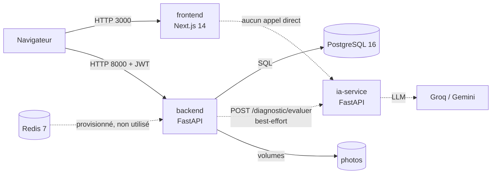

# Documentation technique — Centre de Langues IA (La Digithèque)

> Documentation pédagogique fondée sur l'inspection du code réel du dépôt
> (backend FastAPI, frontend Next.js, service IA, Docker et CI/CD).
> Version du 13 novembre 2026.

Ce document n'est pas une spécification idéale : il décrit **ce qui existe**, distingue
**ce qui est partiel** de **ce qui est seulement prévu**, et signale les écarts entre le
code, le contrat d'API et la documentation existante.

## Sommaire

| Fichier | Contenu |
| --- | --- |
| [01-frontend.md](01-frontend.md) | Next.js 14, App Router, Zustand, React Query, services, mocks, tests |
| [02-backend.md](02-backend.md) | FastAPI, SQLAlchemy, JWT, RBAC, diagnostic, migrations, seed, tests |
| [03-ia-service.md](03-ia-service.md) | Harness, agents, prompts, fournisseurs LLM, RAG, catalogue d'erreurs |
| [04-docker-ci-cd.md](04-docker-ci-cd.md) | Compose, Dockerfiles multi-étapes, CI GitHub Actions, CD GHCR |
| [05-integration-frontend-backend.md](05-integration-frontend-backend.md) | Chaîne du contrat, DTO, erreurs, séquence du diagnostic, dérives |
| [../donnees/README.md](../donnees/README.md) | État réel des données : emplacements, 22 tables, seed, données hors base, risques |
| [../donnees/directive-donnees.md](../donnees/directive-donnees.md) | Directive de production et de gouvernance des six jeux de données |
| [../fonctionnalites/README.md](../fonctionnalites/README.md) | Ce qui fonctionne réellement, couche par couche, et ce qui reste à brancher |

Ordre de lecture conseillé : ce README, puis 01 → 02 → 05 → 03 → 04, et enfin le dossier
[`docs/donnees/`](../donnees/README.md) pour savoir **quelles données** alimentent cette
architecture. Le chapitre 05 fait le lien entre le frontend et le backend ; il se lit mieux
après les deux premiers. Le dossier [`docs/fonctionnalites/`](../fonctionnalites/README.md)
répond à la question complémentaire : **qu'est-ce qui marche vraiment, et qu'est-ce qui reste
à brancher ?**

---

## 1. À qui s'adresse cette documentation

- **Développeur qui reprend le projet** : comprendre où se trouve chaque responsabilité.
- **Étudiant qui apprend l'architecture** : voir comment un monorepo réel relie UI, API, IA et infra.
- **Relecteur de PR** : savoir quels fichiers doivent changer ensemble.

Prérequis utiles : JavaScript/TypeScript, HTTP, notions de base de Python et de SQL.

---

## 2. Vue d'ensemble

Le dépôt est un **monorepo** de trois applications et deux services d'infrastructure.



| Composant | Dossier | Technologie | Port | Rôle |
| --- | --- | --- | --- | --- |
| Frontend | `frontend/` | Next.js 14, React 18, TypeScript, Tailwind, Zustand, React Query | 3000 | interface apprenant / formateur / admin |
| Backend | `backend/` | FastAPI, SQLAlchemy 2, Pydantic 2, Alembic, PostgreSQL | 8000 | API métier, auth, persistance, scoring |
| Service IA | `ia-service/` | FastAPI, Pydantic, clients LLM, Harness | 8001 | agents IA (diagnostic, chatbot) |
| Base | `docker-compose.yml` | PostgreSQL 16 Alpine | interne | données |
| Cache | `docker-compose.yml` | Redis 7 Alpine | interne | réservé |

**Point clé** : le navigateur appelle le backend **directement**, avec `NEXT_PUBLIC_API_URL`
et un JWT dans l'en-tête `Authorization`. Il n'y a ni BFF ni proxy Next.js. Le backend doit
donc autoriser l'origine du frontend en CORS.

### Les trois chemins à connaître

1. **Chemin d'une requête HTTP** : composant → hook → service → `apiRequest` → FastAPI →
   dépendance (JWT, permission) → service métier → SQLAlchemy → PostgreSQL → DTO → mapper →
   état React.
2. **Chemin d'une migration** : modèle SQLAlchemy → `make migration m="..."` → fichier Alembic
   → `alembic upgrade head` au démarrage du conteneur backend.
3. **Chemin d'une analyse IA** : frontend → backend → `ia-service` (`POST /diagnostic/evaluer`) →
   Harness → agent → prompt + RAG → LLM → sortie validée → backend (`analyse_ia` en base) →
   frontend. L'appel est **best-effort** : sans `IA_SERVICE_URL` ou si le service tombe, la
   clôture renvoie `200` avec le seul score (`competences`, `points_faibles` et
   `phase_assimil` omis).

---

## 3. État réel des fonctionnalités

Légende : **Implémenté** = utilisable de bout en bout ; **Partiel** = une partie existe mais
le parcours est incomplet ; **Prévu** = modèles, contrats ou UI sans implémentation complète.

| Domaine | Statut | Ce qui existe réellement | Ce qui manque |
| --- | --- | --- | --- |
| Inscription / connexion | Implémenté | `POST /auth/register`, `POST /auth/login`, JWT, bcrypt | — |
| Mot de passe oublié | Implémenté | jetons à usage `reinitialisation`, lien par e-mail | en dev, l'e-mail est écrit dans les journaux (SMTP absent) |
| Profil + photo | Implémenté | `GET/PATCH /users/me`, `POST/DELETE /users/me/photo`, volume `media_data` | — |
| RBAC | Implémenté | tables rôles/permissions, `permission_requise(...)` | l'UI ne fait qu'afficher/masquer |
| Administration utilisateurs | Implémenté | liste paginée, recherche, filtres, modification de statut | — |
| Formateurs | Implémenté | liste, création, modification (admin) | pas de suppression |
| Langues / niveaux | Implémenté | CRUD admin, association langue-niveaux | — |
| Formules | Implémenté (lecture) | `GET /formules` | pas de souscription |
| Tableau de bord admin | Implémenté | statistiques + inscriptions par jour | — |
| Diagnostic — création / réponses / score | Implémenté | tentative, questions, réponses, score déterministe | — |
| Diagnostic — reprise / abandon | Prévu | le frontend appelle `en-cours` et `abandonner` | routes absentes côté backend → 404 |
| Diagnostic — analyse IA détaillée | Partiel | agent `diagnostic@1.0.0`, route `POST /diagnostic/evaluer`, appel backend best-effort, `analyse_ia` persistée | aucun appelant frontend direct ; dégradation silencieuse en « Résultat partiel » si le service est absent |
| Chatbot | Partiel | `POST /chatbot/message` dans `ia-service` | aucun appelant (ni frontend ni backend), fournisseur `factice` par défaut |
| Questions audio | Partiel | modèle, UI d'enregistrement, contrat | le backend refuse les réponses audio ; le frontend les masque |
| Parcours / ateliers | Partiel | tables `Parcours`, `Exercice`, `Atelier`, migration `us45_parcours` ; `Atelier` est compté dans le tableau de bord admin | aucune route de gestion, aucune UI de parcours |
| Abonnements | Partiel | `Abonnement` créé automatiquement à l'inscription, visible dans les statistiques admin | aucune route de souscription ni de gestion |
| Docker | Implémenté | stack prod + dev, healthchecks, volumes | pas de TLS ni de reverse proxy |
| CI | Implémenté | 5 jobs (frontend, e2e, backend, ia-service, docker) | — |
| CD | Partiel | publication d'images sur GHCR | aucun déploiement, pas de dépendance à la CI |
| Limitation de débit | Prévu | variable `RATE_LIMIT_PER_MINUTE` | aucun middleware ne la lit |
| Sauvegardes | Prévu | variables `BACKUP_*` | aucun code ne les lit |

> **Règle de lecture** : une fonctionnalité n'est « faite » que si le parcours complet
> (UI → service → API → base) fonctionne. Un mock, un modèle SQLAlchemy ou un prompt ne
> suffisent pas.

---

## 4. Carte des fichiers importants

| Besoin | Fichier(s) |
| --- | --- |
| Contrat d'API (source de vérité) | `docs/api/contrat-frontend.md` |
| Toutes les routes backend | `backend/app/api/router.py` + `backend/app/api/routes/*.py` |
| Authentification / JWT | `backend/app/core/security.py`, `backend/app/api/deps.py` |
| Modèles et codes d'énumération | `backend/app/models/*.py`, `backend/app/models/enums.py` |
| Calcul du score | `backend/app/services/scoring.py` |
| Migration la plus récente | `backend/alembic/versions/20261110_diagnostic_analyse_ia.py` (tête unique après `us45_parcours`) |
| Données de départ | `backend/app/seed.py`, `backend/app/seed_diagnostic.py` |
| Client HTTP du frontend | `frontend/src/lib/api-client.ts` |
| Routes appelées par le frontend | `frontend/src/services/endpoints.ts` |
| Mappers `snake_case → camelCase` | `frontend/src/services/*.mapper.ts` |
| Session côté navigateur | `frontend/src/store/auth.store.ts`, `frontend/src/lib/jwt.ts` |
| Configuration React Query + 401 | `frontend/src/app/providers.tsx` |
| Test de positionnement (UI) | `frontend/src/hooks/useTestDiagnostic.ts`, `frontend/src/store/test-diagnostic.store.ts` |
| Test de positionnement (API) | `backend/app/api/routes/diagnostic.py`, `backend/app/services/diagnostic.py` |
| Harness IA | `ia-service/app/harness/execution.py` |
| Agents IA | `ia-service/app/agents/diagnostic.py`, appelé par le backend via `POST /diagnostic/evaluer` |
| Prompts versionnés | `ia-service/app/prompts/` |
| Catalogue d'erreurs IA | `ia-service/app/core/codes_erreur.py` |
| Client IA du backend | `backend/app/services/ia.py`, `backend/app/services/analyse_diagnostic.py` |
| État des données | `docs/donnees/README.md` |
| Directive données | `docs/donnees/directive-donnees.md`, `modele-questions.csv`, `exemple-questions.jsonl` |
| Stack Docker | `docker-compose.yml`, `docker-compose.dev.yml`, `Makefile` |
| CI / CD | `.github/workflows/ci.yml`, `.github/workflows/cd.yml` |

---

## 5. Glossaire

| Terme | Définition simple |
| --- | --- |
| **API** | Interface HTTP par laquelle le frontend demande des données au backend. |
| **App Router** | Système de routage de Next.js 14 fondé sur les dossiers de `frontend/src/app/`. |
| **BFF** | Backend For Frontend : serveur intermédiaire dédié à l'UI. **Absent ici**. |
| **Best-effort** | Appel facultatif : en cas d'échec, on dégrade la réponse au lieu de renvoyer une erreur (ici, l'analyse IA). |
| **CECRL / HSK** | Référentiels de niveaux : A1→C2 pour les langues européennes, HSK 1→6 pour le chinois. |
| **CI / CD** | Intégration continue (tester à chaque push) / livraison continue (publier des images). |
| **Corpus** | Ensemble de documents fournis au RAG ; ici les descripteurs CECRL, non versionnés. |
| **Composant serveur / client** | En Next.js, un composant est serveur par défaut ; `"use client"` active hooks et état navigateur. |
| **DTO** | Objet de transfert : la forme exacte des données échangées avec l'API (`snake_case`). |
| **Few-shot** | Exemples donnés au modèle dans le prompt pour orienter son format de réponse. |
| **Harness** | Pipeline commun qui encadre l'exécution d'un agent IA (validation, budget, erreurs). |
| **Healthcheck** | Commande périodique qui dit à Docker si un conteneur est prêt. |
| **Hook** | Fonction React qui encapsule de la logique réutilisable (`useTestDiagnostic`, `useForm`…). |
| **Idempotent** | Rejouable sans effet supplémentaire (le seed, par exemple). |
| **Jeu de cas** | Collection d'entrées et de sorties attendues qui sert à tester un agent IA. |
| **JWT** | Jeton signé contenant l'identité et une date d'expiration (`exp`). |
| **Mapper** | Fonction qui traduit un DTO `snake_case` en objet métier `camelCase`. |
| **Migration** | Fichier versionné qui fait évoluer le schéma de la base (Alembic). |
| **Mock** | Données simulées qui remplacent l'API en développement. |
| **RAG** | Retrieval-Augmented Generation : injecter des documents pertinents dans le prompt. |
| **RBAC** | Role-Based Access Control : droits accordés par rôle/permission. |
| **Seed** | Jeu de données initial (référentiel, comptes de démo, questions). |
| **SMALLINT** | Petit entier SQL ; ici, code numérique stable d'une énumération. |
| **snake_case / camelCase** | Conventions de nommage : `id_user` côté API, `idUser` côté TypeScript. |
| **Standalone** | Mode de build Next.js produisant un serveur Node autonome et léger. |
| **Zustand** | Bibliothèque d'état global côté navigateur (session, test en cours). |
| **React Query** | Bibliothèque de cache et de synchronisation des données serveur. |

---

## 6. Compétences travaillées par ce projet

À la fin de la lecture, tu dois savoir :

1. **Lire un contrat d'API** et vérifier qu'une route, un champ et un code HTTP respectent ce contrat.
2. **Suivre une requête de bout en bout** : navigateur, service, client HTTP, route, dépendance, service métier, SQL, réponse.
3. **Écrire un service et un mapper** sans laisser fuiter le `snake_case` dans les composants.
4. **Raisonner sécurité** : JWT, expiration, RBAC, CORS, secrets, utilisateur non-root dans Docker.
5. **Écrire un test utile** : test unitaire isolé (Jest), test d'intégration sur PostgreSQL (pytest), test E2E avec HTTP simulé (Playwright).
6. **Lire et écrire une migration Alembic**, comprendre le seed et l'idempotence.
7. **Dockeriser et déboguer une stack** : multi-étapes, volumes, healthchecks, variables au build.
8. **Reproduire une CI localement** et interpréter un échec.
9. **Concevoir un agent IA borné** : entrée/sortie typées, budget, erreurs stables, prompt versionné.
10. **Distinguer** ce qui est implémenté, partiel ou seulement prévu.

---

## 7. Parcours pratique en 6 étapes

### Étape 1 — Lancer et explorer la stack

```powershell
make up          # ou : docker compose up --build -d --wait
docker compose ps
```

Se connecter avec `apprenant@digitheque.mg` / `Demo2026`, puis `admin@digitheque.mg` /
`Demo2026`. Objectif : voir les trois espaces et le test de positionnement.

### Étape 2 — Suivre une connexion de bout en bout

1. Ouvrir l'onglet Réseau du navigateur sur `/login`.
2. Repérer `POST /api/v1/auth/login`, le corps `snake_case`, la réponse `access_token`.
3. Retrouver le code dans `backend/app/api/routes/auth.py`, puis `frontend/src/services/auth.service.ts`.
4. Vérifier dans `localStorage` (si « Se souvenir de moi ») ou `sessionStorage` la clé
   `digitheque-auth` et le champ `exp` du JWT.

Objectif : relier une action visuelle à une ligne de code et à une ligne de base.

### Étape 3 — Suivre une lecture protégée

1. Appeler `GET /api/v1/users/me` depuis l'interface.
2. Retirer le JWT (ou attendre l'expiration) et observer le 401, la purge du store et la redirection.
3. Retrouver `configureApiClient` dans `frontend/src/app/providers.tsx`.

Objectif : comprendre que la sécurité réelle est côté backend, pas dans `RequireAuth`.

### Étape 4 — Écrire deux tests

- Backend : un test de route qui vérifie un 403 pour un apprenant.
- Frontend : un test Jest d'un mapper ou d'un service avec `fetch` simulé.

```powershell
docker compose -f docker-compose.yml -f docker-compose.dev.yml run --rm backend pytest tests/test_rbac.py
cd frontend; npx jest src/services/__tests__/services.test.ts
```

### Étape 5 — Constater une dérive de contrat

Ouvrir `docs/api/contrat-frontend.md`, section « Test de positionnement adaptatif », et
comparer avec `backend/app/api/routes/diagnostic.py`. Constater que `tentatives/en-cours` et
`abandonner` sont décrits mais absents. Chercher l'appel dans `endpoints.ts`.

Objectif : apprendre à détecter une dérive sans exécuter l'application.

### Étape 6 — Reproduire la CI

```powershell
cd frontend; npm run check; npm run build
cd ..\backend; ruff check .; ruff format --check .
docker compose -f docker-compose.yml -f docker-compose.dev.yml run --rm backend pytest --cov=app --cov-fail-under=70
```

Puis lire `.github/workflows/ci.yml` et associer chaque job à une commande locale.

---

## 8. Commandes de référence

| Besoin | Commande |
| --- | --- |
| Stack de production | `make up` |
| Stack de développement (hot reload) | `make dev` |
| Arrêter sans perdre les données | `make down` |
| Tout effacer (base, Redis, photos) | `make reset` |
| Tests backend | `make test` |
| Contrôles complets | `make check` |
| Nouvelle migration | `make migration m="description"` |
| Recharger le seed | `make seed` |
| Journaux | `make logs` |
| Frontend : vérifications | `cd frontend; npm run check; npm run build` |
| Frontend : E2E | `cd frontend; npm run test:e2e` |
| Service IA : tests | `make test-ia` |
| Documentation interactive de l'API | http://localhost:8000/docs |

> Sous Windows, `make` peut être absent et la variable `--user "$(id -u):$(id -g)"` du
> Makefile n'est pas portable. Utiliser les commandes `docker compose` équivalentes
> (elles sont rappelées dans l'en-tête du Makefile et au chapitre 04).

---

## 9. Conventions du dépôt

- Tout est en **français** : identifiants, commentaires, messages, commits, documentation.
- Les rôles et statuts sont des **codes `SMALLINT` stables** (`backend/app/models/enums.py`) :
  on ajoute, on ne modifie jamais un code existant.
- Le frontend ne connaît pas le `snake_case` : la traduction se fait dans les services.
- Une route modifiée impose de mettre à jour, **dans la même PR** :
  `docs/api/contrat-frontend.md`, `frontend/src/services/endpoints.ts`, le service concerné,
  et `frontend/src/services/__tests__/services.test.ts`.
- La couverture de tests backend et IA doit rester **≥ 70 %**.
- Une branche part de `develop` et y retourne (`feature/US-XX-nom`, `bugfix/US-XX-nom`).

---

## 10. Écarts documentaires connus

Ces écarts sont réels et vérifiés dans le code ; les connaître évite de perdre du temps.

| Affirmation | Réalité |
| --- | --- |
| `AGENTS.md` : la CI du service IA ne vérifie que l'import | La CI exécute aussi **ruff** et **pytest avec couverture ≥ 70 %**. |
| `backend/README.md` : le contrat frontend est couvert | `GET /diagnostic/tentatives/en-cours` et `POST .../abandonner` sont absents ; les champs d'analyse ne sont jamais renvoyés. |
| `ia-service/README.md` : l'agent Diagnostic n'a pas de route HTTP | `POST /diagnostic/evaluer` existe et le backend l'appelle. |
| `IA_SERVICE_URL` est injectée au backend | Elle **est** lue par `backend/app/services/ia.py` (contrairement à une ancienne note). |
| Redis sert de cache | Aucun code backend ou IA ne l'utilise. |
| `RATE_LIMIT_PER_MINUTE`, `BACKUP_*` sont configurables | Ces variables ne sont lues par aucun code. |
| `NEXT_PUBLIC_IA_URL` est configurée | Le frontend n'appelle jamais directement le service IA. |
| La CD déploie | Elle publie seulement des images sur GHCR. |

Ces points sont détaillés dans les chapitres correspondants.
