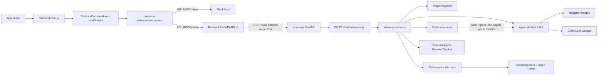
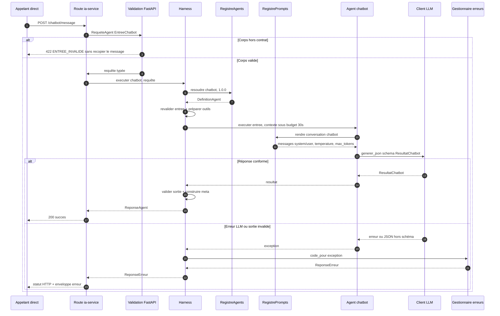
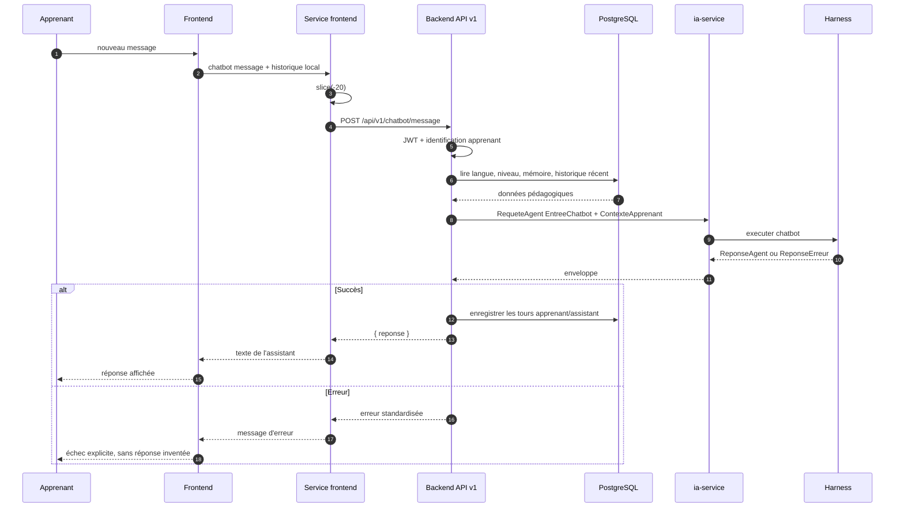

# Agent Chatbot — déroulement, architecture, état, résultats et validation dans le Harness

**Date :** 18 novembre 2026  
**Branche :** `develop` (HEAD `86c529f`)  
**Statut global :** **en cours — à terminer**. L’agent IA, sa route et ses tests sont livrés et validés dans `ia-service`, mais la chaîne applicative complète ne l’est pas : il n’existe aucun relais backend, et l’écran frontend reste en mode démonstration/mock dans la configuration par défaut.  
**Périmètre :** analyse de l’agent `chatbot@1.0.0`, du Harness qui l’exécute, des contrats HTTP et des points de branchement backend/frontend. Le code exécutable, les tests et les contrats versionnés sont les sources de vérité ; les README sont traités comme de la documentation, pas comme une preuve d’implémentation.  
**Rôle de cette analyse :** décrire ce qui se passe réellement, identifier le rôle de chaque acteur, montrer les résultats produits et apporter les preuves de test/validation.

---

## 1. Synthèse exécutive

| Élément | État vérifié |
| --- | --- |
| Identité de l’agent | `chatbot@1.0.0`, définie dans `ia-service/app/agents/chatbot.py:13-15`. |
| Prompt | `chatbot/conversation@1.0.0`, composé de `conversation@1.0.0.systeme.md` et `conversation@1.0.0.utilisateur.md`, chargé par `RegistrePrompts`. |
| Budget d’exécution | 30 000 ms, appliqué par le Harness via `asyncio.timeout`. |
| Point d’entrée IA | `POST /chatbot/message`, déclaré dans `ia-service/app/api/chatbot.py:19-42` et monté dans `app/main.py:84`. |
| Enregistrement | L’agent est enregistré au démarrage dans `app/main.py:37-38`, avec le client LLM, le Harness, le registre de prompts et le récupérateur RAG partagés. |
| Contrat d’entrée | `RequeteAgent[EntreeChatbot]` : `request_id`, `contexte`, `message` (1-2 000 caractères), `historique` (20 tours maximum, rôles `apprenant` ou `assistant`). |
| Contrat de sortie | `ReponseAgent[ResultatChatbot]` en succès ; `ReponseErreur` avec `request_id`, `agent`, `erreur.code`, `erreur.message` et `retryable` en erreur. |
| Logique métier | Aucune notation, aucun niveau attribué, aucune persistance : le service IA produit uniquement une réponse conversationnelle validée par schéma. |
| Tests IA | 22 cas de `tests/test_chatbot.py`, 57 tests ciblés Harness/chatbot/main, 608 tests complets avec 97,25 % de couverture. |
| Tests frontend | 16 tests du service parcours/chatbot réussis ; ils valident le mock et le service HTTP, pas une intégration backend réelle. |
| Relais backend | **Absent.** `backend/app/services/ia.py` ne relaye que `/diagnostic/evaluer`. Aucune route backend `chatbot` n’existe. |
| Frontend | Écran `ExerciceConversation.tsx`, hook `useChatbot` et service `chatbot()` existent, mais `ENDPOINTS.chatbotMessage` est explicitement annoté « tâche B-10, à créer ». |
| Conclusion | **En cours à terminer** : le noyau IA est prêt ; il manque le relais backend authentifié, le branchement frontend hors mock, la persistance de l’historique côté backend et une validation E2E de bout en bout. |

---

## 2. Déroulement

### 2.1 Déroulement réel aujourd’hui

1. **Côté frontend**, l’apprenant écrit un message dans `ExerciceConversation.tsx`. Le composant utilise `useChatbot`, qui appelle `parcoursPersonnaliseService.chatbot(message, historique)`.
2. **Le service frontend** borne l’historique aux 20 derniers tours (`HISTORIQUE_CHATBOT_MAX`) et choisit son implémentation selon `API_MOCK` :
   - avec `API_MOCK=true`, il appelle le mock local : aucun `fetch`, aucune requête HTTP ;
   - avec `API_MOCK=false`, il tente `POST /api/v1/chatbot/message` via `ENDPOINTS.chatbotMessage`.
3. **Le relais backend attendu n’existe pas.** La route `/api/v1/chatbot/message` n’est pas implémentée dans `backend/` : la chaîne s’arrête donc avant `ia-service` dans une configuration réelle non mockée.
4. **Si un appelant direct appelle `ia-service`**, FastAPI valide d’abord l’enveloppe `RequeteAgent[EntreeChatbot]`. Un corps hors contrat est refusé avant le Harness avec `422 ENTREE_INVALIDE`, sans recopier le message de l’apprenant.
5. **La route `POST /chatbot/message`** transmet la requête à `request.app.state.harness.executer("chatbot", requete)`. Elle ne contient aucune logique pédagogique.
6. **Le Harness** résout l’agent `(chatbot, 1.0.0)`, revalide l’entrée avec `EntreeChatbot`, prépare les outils communs, puis exécute l’agent sous le budget de 30 secondes.
7. **L’agent chatbot** construit `VariablesConversationChatbot`, rend le prompt versionné avec `RegistrePrompts`, puis appelle `client_llm.generer_json(..., schema=ResultatChatbot)` avec la température et le `max_tokens` du prompt.
8. **Le LLM** reçoit exactement deux messages : un message `system` et un message `user` contenant le bloc `<donnees_conversation_non_fiables>`. L’historique n’est jamais transmis comme faux message `assistant`.
9. **Le Harness** revalide la sortie contre `ResultatChatbot`, construit les métadonnées (`duree_ms`, fournisseur, modèle, version du corpus, empreinte du prompt) et retourne une enveloppe standardisée.
10. **La route** renvoie `200` avec `ReponseAgent[ResultatChatbot]`, ou convertit une `ReponseErreur` en statut HTTP à partir du catalogue `STATUTS_HTTP`.

### 2.2 Déroulement cible, une fois la chaîne terminée

Le point manquant est le **B-10** : une route backend authentifiée qui construit le `ContexteApprenant` à partir de l’utilisateur connecté, conserve un historique récent, appelle `IA_SERVICE_URL/chatbot/message`, puis renvoie le texte de réponse au frontend. Le backend reste propriétaire des données et de la session ; `ia-service` reste sans état.

---

## 3. Architecture

### 3.1 Architecture réelle et points de branchement



### 3.2 Composants et responsabilités

| Composant | Fichier source | Responsabilité | État |
| --- | --- | --- | --- |
| Route HTTP IA | `ia-service/app/api/chatbot.py` | Reçoit l’enveloppe, appelle le Harness, traduit les erreurs en statut HTTP. | ✅ Livré |
| Agent | `ia-service/app/agents/chatbot.py` | Rend le prompt, appelle `generer_json` avec `ResultatChatbot`. | ✅ Livré |
| Contrat chatbot | `ia-service/app/schemas/chatbot.py` | Bornes du message, de la réponse et de l’historique ; rôles autorisés. | ✅ Livré |
| Contrat commun | `ia-service/app/schemas/commun.py` | Enveloppes `RequeteAgent`, `ReponseAgent`, `ReponseErreur`, `MetaExecution`. | ✅ Livré |
| Contexte apprenant | `ia-service/app/schemas/contexte.py` | Langue, référentiel, niveau préliminaire, mémoire pédagogique résumée ; aucune donnée identifiante. | ✅ Livré |
| Prompt système | `ia-service/app/prompts/chatbot/conversation@1.0.0.systeme.md` | Règles de conversation, refus d’injection, pas de notation, pas d’outil externe. | ✅ Livré |
| Prompt utilisateur | `ia-service/app/prompts/chatbot/conversation@1.0.0.utilisateur.md` | Bloc de données non fiables avec contexte, historique et message. | ✅ Livré |
| Registre de prompts | `ia-service/app/prompts/registre.py` | Charge les fichiers versionnés, calcule l’empreinte et rend les variables. | ✅ Livré |
| Registre d’agents | `ia-service/app/harness/registre.py` | Résout `(code, version)` et refuse les doublons. | ✅ Livré |
| Harness | `ia-service/app/harness/execution.py` | Validation, budget, exécution, validation de sortie, enveloppe de résultat ou d’erreur. | ✅ Livré |
| Gestionnaire d’erreurs | `ia-service/app/core/gestionnaire_erreurs.py`, `codes_erreur.py` | Codes stables, messages génériques, `retryable`, correspondance HTTP. | ✅ Livré |
| Client LLM | `ia-service/app/llm/fabrique.py` et adaptateurs | Client unique du processus ; factice, compatible OpenAI ou Gemini. | ✅ Livré |
| Relais backend | `backend/app/services/ia.py` | Devrait construire le contexte, conserver l’historique et relier `/chatbot/message`. | ❌ Absent : seul `/diagnostic/evaluer` existe |
| Écran frontend | `frontend/src/components/pedagogie/parcours/exercices/ExerciceConversation.tsx` | Conversation à l’écrit ou à la voix, lecture audio, historique local à l’écran. | 🟡 Démo |
| Service frontend | `frontend/src/services/parcours-personnalise.service.ts` | Borne l’historique et appelle le relais backend. | 🟡 Branché sur une route à créer |
| Contrat frontend | `frontend/src/services/endpoints.ts` | Déclare `/api/v1/chatbot/message` avec le commentaire « tâche B-10, à créer ». | 🟡 En attente |

### 3.3 Frontières importantes

- `ia-service` ne persiste rien : ni conversation, ni score, ni décision pédagogique finale.
- Le chatbot ne calcule pas de niveau : le prompt interdit explicitement l’attribution d’une note ou d’un niveau, qui relève du diagnostic.
- Le chatbot n’appelle pas le RAG. Le Harness lui injecte bien l’outil commun, mais `repondre()` ne l’utilise pas.
- Le service IA est interne au `back-tier` et n’a pas de port hôte ; l’appel se fait par le backend via le réseau Docker.
- Le budget chatbot de 30 s couvre les reprises éventuelles du client LLM ; le frontend utilise un timeout de 45 s pour laisser de la marge au relais.

---

## 4. Séquence détaillée par rôle concerné

### 4.1 Séquence réelle dans `ia-service`



### 4.2 Séquence cible bout en bout



> Cette deuxième séquence est l’**objectif de finition**, pas un flux observé aujourd’hui : le participant `Backend API v1` n’a pas encore de route chatbot.

### 4.3 Rôle par acteur

| Acteur | Entrée | Action précise | Sortie / responsabilité |
| --- | --- | --- | --- |
| **Apprenant** | Message saisi, éventuellement dicté | Écrit ou dicte dans l’exercice de conversation ; peut demander une lecture audio. | Fournit le nouveau message et voit la réponse. |
| **Frontend** | Événement utilisateur, historique local | `ExerciceConversation` met à jour l’état, `useChatbot` appelle le service. | N’appelle jamais `fetch` directement ; passe par `api-client.ts`. |
| **Service frontend** | `message`, `historique` | Borne l’historique à 20 tours, choisit mock ou HTTP, mappe le DTO. | Renvoie `dto.reponse` sous forme de chaîne. En mode mock, aucune requête réelle. |
| **Backend (à créer)** | JWT, message, historique | Doit authentifier, construire le contexte apprenant, conserver l’historique et appeler `ia-service`. | Aujourd’hui absent : c’est le blocage principal de la chaîne. |
| **Route ia-service** | `RequeteAgent[EntreeChatbot]` | Valide le corps via FastAPI/Pydantic, appelle le Harness, traduit les erreurs. | `200 ReponseAgent` ou statut d’erreur avec enveloppe Harness. |
| **RegistreAgents** | `code_agent`, version éventuelle | Résout la version SemVer la plus récente ou la version demandée. | `DefinitionAgent chatbot@1.0.0`; `AGENT_INCONNU` sinon. |
| **Harness** | Requête + définition d’agent | Revalide l’entrée, injecte les outils, applique le budget, valide la sortie, construit `meta`. | Enveloppe unique de succès ou d’erreur ; aucune logique pédagogique. |
| **RegistrePrompts** | `VariablesConversationChatbot` | Charge `chatbot/conversation@1.0.0`, rend les deux messages, fournit température et limites. | Prompt immuable et empreinte `sha256` dans les métadonnées. |
| **Agent chatbot** | Entrée typée + `ContexteExecution` | Construit les variables, rend le prompt, appelle `generer_json` avec `ResultatChatbot`. | `ResultatChatbot(reponse=...)`; ne construit ni LLM ni Harness. |
| **Client LLM** | Messages + schéma | Produit un JSON conforme ou lève une erreur d’adaptateur. | Fournisseur/modèle renseignés dans `meta` ; erreurs mappées vers des codes stables. |
| **Gestionnaire d’erreurs** | Exception interne ou `ReponseErreur` | Choisit le code stable, le message public, `retryable` et le statut HTTP. | Aucun secret, aucune trace et aucun contenu d’entrée recopié vers l’extérieur. |
| **PostgreSQL (cible)** | Tours de conversation validés | Doit être le seul propriétaire de l’historique et de la session. | Non utilisé par `ia-service`. |

---

## 5. Résultats produits

### 5.1 Résultat de succès

Le résultat métier est volontairement minimal : `ResultatChatbot` ne contient qu’un champ `reponse`, limité à 4 000 caractères. La forme complète de la réponse IA est :

```json
{
  "request_id": "3f1c9b7e-6a2d-4f0e-9c1a-2b7d5e8f4a10",
  "agent": "chatbot",
  "version_agent": "1.0.0",
  "version_prompt": "chatbot/conversation@1.0.0",
  "statut": "succes",
  "resultat": {
    "reponse": "Bonne question ! On dit « I have been studying English for two years »."
  },
  "meta": {
    "duree_ms": 204,
    "fournisseur": "compatible-openai",
    "modele": "modele-local",
    "version_corpus": null,
    "empreinte_prompt": "sha256:…"
  }
}
```

Les tests utilisent un `FakeLLMClient` avec un scénario connu pour vérifier exactement cette enveloppe, sans réseau et sans clé API. Le texte ci-dessus est le résultat attendu du contrat ; avec le fournisseur `factice` par défaut, aucun texte conversationnel n’est généré automatiquement.

### 5.2 Résultats d’erreur observés

| Situation | Code / statut | Comportement |
| --- | --- | --- |
| Message vide, champ inconnu, rôle `system` dans l’historique, contexte incohérent | `ENTREE_INVALIDE` / 422 | La valeur refusée n’est pas recopiée dans la réponse. |
| Agent introuvable | `AGENT_INCONNU` / 404 selon le catalogue | Le Harness ne tente pas d’exécuter l’agent. |
| Sortie du modèle hors schéma | `LLM_REPONSE_INVALIDE` / 502 | Le Harness refuse l’objet produit. |
| Délai de 30 s dépassé | `LLM_TIMEOUT` / 504 | `retryable: true`. |
| Fournisseur indisponible | `LLM_INDISPONIBLE` / 503 | `retryable: true`. |
| Limite de débit | `LLM_LIMITE_REQUETES` / 429 | `retryable: true`. |
| Configuration LLM invalide | `LLM_CONFIGURATION` / 500 | `retryable: false`. |

Vérification locale complémentaire effectuée le 18 novembre 2026 avec `LLM_FOURNISSEUR=factice` :

- sans `LLM_FACTICE_SCENARIO`, la route répond `500` avec `LLM_CONFIGURATION` ;
- avec `LLM_FACTICE_SCENARIO=demonstration`, la route répond également `500` avec `LLM_CONFIGURATION`.

Ce second point est important : `repondre_demonstration()` ne sait construire qu’un `ResultatDiagnostic`. Le scénario de démonstration ne fournit donc **pas** de réponse conversationale valide au chatbot. Le `500 LLM_CONFIGURATION` reste le comportement attendu avec le fournisseur factice ; une réponse conversationnelle réelle nécessite Groq, Gemini ou un fournisseur compatible OpenAI.

### 5.3 Résultats non produits

- Aucun niveau CECRL/HSK n’est estimé par le chatbot.
- Aucune note, aucun score de confiance et aucune phase d’assimilation ne sont produits.
- Aucun descripteur RAG n’est renvoyé au frontend.
- Aucune conversation n’est persistée par `ia-service`.
- Aucun `ReponseAgent` issu d’un appel frontend réel n’est observable aujourd’hui, puisque le relais backend manque.

---

## 6. État actuel

### 6.1 Ce qui est terminé dans `ia-service`

- Agent `chatbot@1.0.0` enregistré au démarrage.
- Route `POST /chatbot/message` documentée dans OpenAPI.
- Prompt système et utilisateur versionnés, avec garde-fou contre l’injection et la clôture du bloc de données.
- Contrats stricts et bornés : 2 000 caractères pour le message, 4 000 pour la réponse, 20 tours d’historique.
- Exécution dans le Harness commun : résolution d’agent, revalidation, budget, gestion d’erreurs, métadonnées.
- 22 cas de tests dédiés, sans clé API ni réseau.

### 6.2 Ce qui reste à terminer

| Tâche | Priorité | Description |
| --- | --- | --- |
| B-10 — relais backend | P0 | Ajouter une route authentifiée `/api/v1/chatbot/message`, construire `ContexteApprenant`, appeler `ia-service`, valider l’enveloppe et renvoyer `{ reponse }`. |
| Persistance de l’historique | P0 | Conserver les tours côté backend/PostgreSQL, avec une fenêtre récente cohérente avec la limite de 20 tours. |
| Passage frontend hors mock | P0 | Vérifier `NEXT_PUBLIC_API_MOCK=false` et le override Compose ; le service HTTP existe déjà mais cible une route absente. |
| Validation E2E | P1 | Ajouter un scénario Playwright avec API interceptée pour le flux `{message, historique} → réponse`, puis un test d’intégration backend/ia-service. |
| Exploitation réelle du LLM | P1 | Configurer Groq/Gemini/compatible OpenAI ; le fournisseur factice ne produit pas de réponse conversationnelle. |
| Documentation de contrat | P1 | Mettre à jour `docs/api/contrat-frontend.md` et `frontend/src/services/endpoints.ts` quand la route backend sera créée, conformément aux conventions du dépôt. |
| Option streaming | P2 | Une route dédiée pourrait utiliser `generer_flux` si l’interface souhaite un affichage progressif. |

### 6.3 Verdict

Le chatbot est **prêt côté IA**, mais **non opérationnel de bout en bout**. Le verdict fonctionnel doit donc rester « en cours à terminer », et non « disponible ».

---

## 7. Tests et validation dans le Harness

### 7.1 Commandes exécutées et résultats

Depuis `ia-service/` :

```bash
python -m pytest -o addopts="" tests/test_chatbot.py tests/test_harness.py tests/test_main.py -p no:cacheprovider
```

Résultat :

```text
collected 57 items
tests\test_chatbot.py ...................... [ 38%]
tests\test_harness.py ........................ [ 87%]
tests\test_main.py ....... [100%]
57 passed, 1 warning in 6.21s
```

Suite complète avec couverture :

```bash
python -m pytest -o addopts="" --cov=app --cov-report=term-missing:skip-covered --cov-fail-under=70 -p no:cacheprovider
```

Résultat :

```text
collected 610 items
608 passed, 2 skipped, 1 warning in 23.83s
TOTAL 2143 59 97%
Required test coverage of 70% reached. Total coverage: 97.25%
```

Les 2 tests ignorés sont les tests d’intégration réels Gemini/Groq, optionnels et consommateurs de quota.

Qualité du code ciblée :

```bash
python -m ruff check app/agents/chatbot.py app/api/chatbot.py app/harness app/prompts/chatbot app/schemas/chatbot.py tests/test_chatbot.py
python -m ruff format --check app/agents/chatbot.py app/api/chatbot.py app/harness app/prompts/chatbot app/schemas/chatbot.py tests/test_chatbot.py
```

Résultats :

```text
All checks passed!
9 files already formatted
```

Ruff utilisé : `0.8.4`, version épinglée dans le dépôt. Un `ruff check .` global échoue sur 15 erreurs dans `ia-service/app/rag/La_Digitheque_RAG_CECRL_HSK.ipynb`, fichier non suivi et sans lien avec le chatbot ; il n’a pas été modifié.

Depuis `frontend/` :

```bash
npm test -- src/services/__tests__/parcours-personnalise.service.test.ts
```

Résultat :

```text
Test Suites: 1 passed, 1 total
Tests:       16 passed, 16 total
Time:        3.881 s
```

### 7.2 Ce que les tests prouvent

Les 22 cas de `tests/test_chatbot.py` couvrent :

- le contrat strict d’entrée et de sortie, y compris les bornes et les rôles autorisés ;
- le refus d’un message vide et d’un champ inconnu ;
- le rendu du prompt `chatbot/conversation@1.0.0` et le refus d’une version inconnue ;
- le refus d’un message qui tente de fermer le bloc `<donnees_conversation_non_fiables>` ;
- l’exécution de l’agent via le Harness, avec contrôle des messages envoyés au LLM (`system`, puis `user`) ;
- le refus d’une réponse hors schéma ;
- l’enregistrement de l’agent au démarrage de l’application ;
- la route HTTP en succès et ses erreurs : entrée invalide sans recopie, contexte incohérent, fournisseur en erreur, réponse inexploitable ;
- la présence de la route dans OpenAPI.

Les tests du Harness vérifient en plus la résolution d’agent, la revalidation d’entrée, le budget, la validation de sortie et la standardisation des erreurs. Les tests `test_main.py` vérifient le câblage FastAPI et le lifespan.

### 7.3 Limites de la validation

- Les tests IA utilisent un faux client LLM : ils valident le contrat et le pipeline, pas la qualité pédagogique d’un vrai modèle.
- La validation historique de bout en bout décrite dans `ia-service/docs/US-67-api-chatbot.md` utilisait un serveur local imitant `/v1/chat/completions` ; elle n’est pas rejouée automatiquement dans la suite actuelle.
- Les tests frontend valident le mock et le service HTTP isolé, mais pas une route backend réelle, puisque celle-ci n’existe pas encore.
- Aucun test E2E Playwright du chatbot n’a été exécuté dans le cadre de cette analyse.

### 7.4 Interprétation

Le Harness remplit son contrat : l’agent est résolu, exécuté sous budget, sa sortie est validée et toutes les erreurs sont converties en enveloppes exploitationnables par un appelant. La validation est donc **suffisante pour le périmètre `ia-service`**, mais **insuffisante pour déclarer la fonctionnalité terminée** côté produit.

---

## 8. Conclusion

L’agent chatbot est un composant IA correctement intégré au Harness : identité versionnée, prompt immuable, contrats stricts, budget, gestion d’erreurs et tests sont en place. Son résultat est une réponse conversationnelle courte, sans score et sans persistance, ce qui respecte la frontière entre `ia-service` et le backend.

Le travail restant n’est pas dans l’agent lui-même, mais dans la **chaîne d’intégration** : créer le relais backend B-10, conserver l’historique côté PostgreSQL, brancher le frontend hors mock, puis ajouter une validation E2E. Tant que ces éléments manquent, le statut correct reste **« en cours à terminer »**.

---

## 9. Références

- `ia-service/app/agents/chatbot.py` — identité, budget, rendu du prompt et appel LLM.
- `ia-service/app/api/chatbot.py` — route `POST /chatbot/message` et traduction des erreurs.
- `ia-service/app/main.py` — lifespan, enregistrement des agents et du Harness.
- `ia-service/app/harness/execution.py` — pipeline d’exécution du Harness.
- `ia-service/app/harness/agent.py` — `DefinitionAgent`, outils communs et contexte d’exécution.
- `ia-service/app/harness/registre.py` — résolution et unicité des versions d’agent.
- `ia-service/app/schemas/chatbot.py` — contrat d’entrée/sortie et bornes.
- `ia-service/app/schemas/commun.py` — enveloppes communes et métadonnées.
- `ia-service/app/prompts/chatbot/` — prompt versionné `chatbot/conversation@1.0.0`.
- `ia-service/app/llm/fabrique.py` et `app/llm/demonstration.py` — sélection du fournisseur et limite du scénario de démonstration au diagnostic.
- `ia-service/tests/test_chatbot.py` — 22 cas de test de l’agent et de la route.
- `ia-service/docs/US-67-api-chatbot.md` — contrat HTTP, décisions et vérifications de la US67.
- `backend/app/services/ia.py` — montre que seul le diagnostic est relayé côté backend.
- `frontend/src/components/pedagogie/parcours/exercices/ExerciceConversation.tsx` — écran de conversation.
- `frontend/src/services/parcours-personnalise.service.ts` — service et hook chatbot frontend.
- `frontend/src/services/endpoints.ts` — route `/api/v1/chatbot/message` annotée « tâche B-10, à créer ».
- `docs/fonctionnalites/06-matrice-fonctionnalites.md` — verdict 🔌 : route IA + prompt + tests, aucun appelant.
