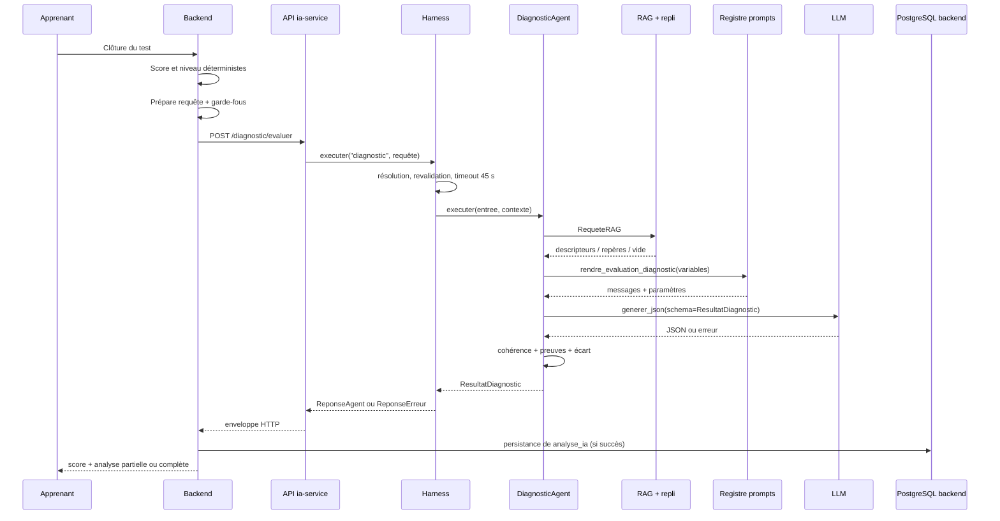

# Agent Diagnostique (« Agent Analytic ») — déroulement, architecture, état, résultats et validation dans le Harness

**Date :** 18 novembre 2026  
**Branche :** `develop` (HEAD `86c529f`, identique au code de `feature/PRE-13-audit-agent-diagnostique-rag` ; l’analyse a été relancée après bascule sur `develop`)  
**Statut global :** **en cours — à terminer**. Le socle applicatif est fonctionnel et validé par les tests, mais l’intégration documentaire complète (RAG hybride CECRL/HSK), la traçabilité fine et plusieurs points d’industrialisation restent à finaliser.  
**Périmètre :** `ia-service` principalement, avec la chaîne d’appel du backend uniquement pour expliquer l’entrée, la sortie et la persistance. Le code exécutable est la source de vérité ; certains README sont obsolètes sur la route, le budget et le port exposé.

---

## 1. Synthèse exécutive

| Élément | État vérifié |
| --- | --- |
| Identité de l’agent | `CODE_AGENT = "diagnostic"`, `VERSION_AGENT = "1.0.0"` |
| Point d’entrée IA | `POST /diagnostic/evaluer` |
| Exécution | Harness commun, budget `BUDGET_MS = 45_000` ms (45 s) |
| Prompt | `diagnostic/evaluation@1.1.0`, température `0.2`, `max_tokens = 900` |
| Contrat de sortie | `ResultatDiagnostic` validé par Pydantic, avec preuves et règles de cohérence déterministes |
| Scoring | Le backend reste la seule autorité sur le score et le niveau officiel ; l’IA fournit une **estimation** |
| Persistance | Aucune dans `ia-service` ; enveloppe complète enregistrée par le backend dans `TestDiagnostic.analyse_ia` |
| RAG | Port injectable et BM25 local implémentés, mais désactivés par défaut ; hybride non implémenté |
| Repli documentaire | Repères synthétiques non officiels pour `fr/en/it/de` en CECRL ; rien pour HSK, qui passe en `A_VERIFIER` |
| Tests IA | `608 passed, 2 skipped, 1 warning` ; couverture `97,25 %` |
| Verdict | **Utilisable en démonstration et solidement testé sur le socle ; à terminer avant industrialisation / activation RAG** |

Formulation courte de l’état actuel : **l’agent sait déjà recevoir, raisonner sous le Harness, produire un résultat strict et être consommé sans bloquer le parcours apprenant ; il manque encore surtout la qualité et la traçabilité de son socle documentaire.**

---

## 2. Déroulement global

### 2.1 Parcours fonctionnel complet

1. **L’apprenant répond** à un test de diagnostic dans le frontend. Le frontend ne parle pas directement à `ia-service` : il consomme l’API backend.
2. **Le backend clôt la tentative** via `POST /diagnostic/tentatives/{id_tentative}/terminer`. Seul le rôle `APPRENANT` est autorisé sur cette route.
3. **Le scoring déterministe est calculé** par le backend : score, niveau et compétences sont arrêtés avant tout appel IA.
4. **Le backend libère la session PostgreSQL** puis lance l’analyse IA de façon best-effort. Une panne IA ne doit jamais faire échouer la clôture du test.
5. **Le backend prépare la requête** : langue, référentiel (`CECRL` ou `HSK`), niveau préliminaire, réponses exploitables et score. Il applique des garde-fous : langue/niveau non supportés ou absence de réponse exploitable ⇒ aucun appel.
6. **Le backend appelle** `POST /diagnostic/evaluer` avec une enveloppe `RequeteAgent[EntreeDiagnostic]`.
7. **FastAPI valide l’enveloppe**, puis transmet au Harness.
8. **Le Harness résout l’agent `diagnostic`**, revalide l’entrée, injecte ses outils et exécute sous le budget de 45 secondes.
9. **L’agent construit sa requête documentaire**, récupère des descripteurs ou repères de repli, rend le prompt sélectionné, puis appelle le LLM avec `ResultatDiagnostic` comme schéme attendu.
10. **Le résultat est validé** : forme JSON, cohérence avec le contexte, preuves directes, écart recalculé, puis enveloppé dans `ReponseAgent`.
11. **Le backend revalide l’enveloppe**, persiste le document complet dans `analyse_ia`, en déduit les champs publics et retourne `score`, `level`, `competences`, `points_faibles` et `phase_assimil`.
12. **En cas d’erreur IA**, le backend journalise un code technique court et dégrade en résultat partiel ; l’apprenant conserve son score déterministe.

### 2.2 Ce que fait l’agent, exactement

`ia-service/app/agents/diagnostic.py` :

```text
DiagnosticAgent.executer(entree, contexte)
  ├─ 1. récupérer les descripteurs via le port RAG
  ├─ 2. construire les 7 variables du prompt
  ├─ 3. rendre le prompt via le registre (few-shot selon scénario/langue)
  ├─ 4. appeler client_llm.generer_json(..., schema=ResultatDiagnostic)
  ├─ 5. vérifier la cohérence avec le contexte et les réponses
  ├─ 6. journaliser un écart signé de magnitude >= 2 niveaux
  └─ 7. retourner ResultatDiagnostic
```

L’agent ne recalcule pas le score objectif. Il n’accède ni à PostgreSQL, ni à une mémoire apprenant persistée, ni à un outil externe, et ne sort jamais du pipeline du Harness.

---

## 3. Architecture

### 3.1 Vue d’ensemble

```mermaid
flowchart TD
    A[Apprenant / frontend] -->|clôture du test| B[Backend FastAPI\nscoring déterministe]
    B -->|requête best-effort| C[POST /diagnostic/evaluer\nAPI ia-service]
    C --> D[Harness.executer]
    D --> E[RegistreAgents\ndiagnostic 1.0.0]
    D --> F[OutilsCommuns\nLLM + prompts + RAG]
    F --> G[DiagnosticAgent]
    G --> H[RecuperateurRAG\n+ RecuperateurAvecRepli]
    G --> I[RegistrePrompts\ndiagnostic/evaluation@1.1.0]
    G --> J[FournisseurLLM\nfactice / OpenAI-compatible / Gemini]
    J --> K[ResultatDiagnostic\nvalidations Pydantic]
    K --> L[ReponseAgent ou ReponseErreur]
    L --> B
    B --> M[(PostgreSQL\nTestDiagnostic.analyse_ia)]
```

### 3.2 Responsabilités par couche

| Couche | Fichiers principaux | Responsabilité |
| --- | --- | --- |
| Frontend | `frontend/src/lib/api-client.ts`, `frontend/src/services/*`, `docs/api/contrat-frontend.md` | Consomme l’API backend via le client HTTP unique et les services, pas le service IA. Le contrat frontend est défini par `docs/api/contrat-frontend.md` et `frontend/src/services/endpoints.ts`. |
| Backend — scoring | `backend/app/services/scoring.py`, `backend/app/api/routes/diagnostic.py` | Autorité sur score, niveau et clôture. |
| Backend — orchestration IA | `backend/app/services/analyse_diagnostic.py`, `backend/app/services/ia.py` | Prépare la requête, appelle l’IA hors session DB, dégrade en résultat partiel, persiste l’enveloppe. |
| API IA | `ia-service/app/api/diagnostic.py`, `ia-service/app/main.py` | Route unique, validation d’entrée, traduction des erreurs en statuts HTTP. |
| Harness | `ia-service/app/harness/execution.py`, `agent.py`, `registre.py` | Point d’entrée unique : résolution, budget, timeout, outils, validation de sortie, enveloppe standard. |
| Agent | `ia-service/app/agents/diagnostic.py` | Logique pédagogique : RAG, prompt, LLM, cohérence, signalement d’écart. |
| Contrats | `ia-service/app/schemas/commun.py`, `diagnostic.py`, `contexte.py`, `regles.py` | Enveloppes strictes, résultat, contexte minimal et règles métier. |
| Prompt | `ia-service/app/prompts/registre.py`, `prompts/diagnostic/evaluation@1.1.0.*` | Chargement, version, empreinte, few-shot, paramètres LLM. |
| RAG | `ia-service/app/rag/base.py`, `config.py`, `fabrique.py`, `local.py`, `corpus.py`, `vide.py`, `repli.py` | Port injectable, BM25 lexical, intégrité corpus, repli synthétique étiqueté. |
| LLM | `ia-service/app/llm/fabrique.py`, `adaptateurs/*`, `demonstration.py` | Client partagé, adaptateurs et répondeur déterministe sans clé. |

### 3.3 Câblage au démarrage

`ia-service/app/main.py` construit une seule fois les ressources partagées :

- `RegistrePrompts()` ;
- `obtenir_client()` pour le client LLM ;
- `RegistreAgents()` avec les définitions `diagnostic` et `chatbot` ;
- `construire_recuperateur()` pour le port documentaire ;
- injection de ces objets dans `app.state` et construction du `Harness` ;
- fermeture propre des ressources à l’arrêt.

Une configuration LLM invalide empêche le démarrage du service : le choix de l’adaptateur est fait au démarrage, pas à la première requête.

### 3.4 Identité et contrat de l’agent

```python
CODE_AGENT = "diagnostic"
VERSION_AGENT = "1.0.0"
BUDGET_MS = 45_000
SEUIL_ECART_IMPORTANT = 2
```

Entrée métier `EntreeDiagnostic` :

- `scenario` : `quotidien` par défaut, ou `entretien` / `examen` ;
- `reponses` : 1 à 100 éléments, identifiants uniques, `competence` et `type_reponse` bornés, contenu de 1 à 5 000 caractères ;
- `score_preliminaire` : nombre de 0 à 100, booléen refusé.

Sortie `ResultatDiagnostic` :

- `code_langue`, `referentiel`, `niveau_estime`, `niveau_preliminaire` ;
- `phase_assimil` : `impregnation` ou `activation` ;
- `points_faibles` : 0 à 5 domaines uniques, chacun avec `id_question`, `observation` et `justification` ;
- `score_confiance` : nombre entre 0 et 1 ; **ce n’est pas un score de bonnes réponses** ;
- `ecart_avec_niveau_preliminaire` : entier signé de `-5` à `+5`, recalculé côté service.

---

## 4. Séquence détaillée par rôle concerné

### 4.1 Rôles métier

| Rôle | Participation réelle au diagnostic |
| --- | --- |
| **Apprenant** | Déclencheur du parcours : répond au test et demande sa clôture. Il reçoit le score déterministe et, si disponible, l’analyse IA. C’est le seul rôle autorisé par la route backend de clôture. |
| **Formateur** | Aucune action dans l’exécution de l’agent. Peut consulter les résultats selon les droits applicatifs, mais n’alimente pas le prompt et ne valide pas l’estimation. |
| **Administrateur** | Rôle d’exploitation/supervision (journaux, configuration, corpus), pas de participation à la chaîne d’inférence. |
| **Système / service** | Le backend est l’autorité métier ; `ia-service` est un producteur d’estimation sans état et sans base de données. Le Harness est le point d’exécution unique. |

### 4.2 Rôles techniques et séquence

| # | Rôle / acteur | Action | Résultat attendu |
| --- | --- | --- | --- |
| 1 | Apprenant / frontend | Envoie les réponses puis clôt la tentative. | Tentative en état terminable. |
| 2 | Backend scoring | Calcule score, niveau et statut ; met à jour la tentative. | Valeurs déterministes définitives. |
| 3 | Backend orchestration | Vérifie langue/niveau/réponses, lit les lignes détachées de la session. | `RequeteDiagnosticIA` ou résultat partiel immédiat. |
| 4 | Backend HTTP client | `POST /diagnostic/evaluer` via `httpx`, avec timeout configuré. | Enveloppe 200 ou erreur technique interne. |
| 5 | FastAPI IA | Valide `RequeteAgent[EntreeDiagnostic]`. | Requête typée ; sinon `ENTREE_INVALIDE` (422). |
| 6 | Harness | Résout `diagnostic@1.0.0` dans le registre. | `DefinitionAgent` avec schémas, budget et empreinte prompt. |
| 7 | Harness | Revalide `entree`, crée `OutilsCommuns` et `ContexteExecution`. | Contexte injecté, `SignalementRAG` initialisé. |
| 8 | Harness | Enveloppe le récupérateur dans `RecuperateurAvecRepli` et ouvre `asyncio.timeout(45)`. | Exécution bornée dans le temps. |
| 9 | Agent | Construit `RequeteRAG` : langue, référentiel, niveau, compétences dédupliquées, texte tronqué à 4 000 caractères, limite 8. | Requête documentaire typée. |
| 10 | RAG | Retourne des descripteurs officiels, des repères synthétiques ou rien. | Provenance déterminée dans le signalement. |
| 11 | Agent | Revalide chaque descripteur : schéma, langue, référentiel, doublons, limite. | Descripteurs sûrs ou `ErreurCorpusIndisponible`. |
| 12 | Registre de prompts | Sélectionne le few-shot selon `(scénario, langue)` et rend le prompt versionné. | Messages LLM, température et `max_tokens`. |
| 13 | Fournisseur LLM | `generer_json(..., schema=ResultatDiagnostic)`. | JSON brut ou erreur fournisseur. |
| 14 | Schémas de sortie | Valident le référentiel, les niveaux, l’écart recalculé, la confiance, les preuves directes et la phase Assimil. | `ResultatDiagnostic` exploitable ou erreur. |
| 15 | Agent | Vérifie la cohérence finale avec le contexte et journalise un écart `|écart| >= 2`. | Résultat prêt ; signal d’exploitation sans contenu apprenant. |
| 16 | Harness | Revalide la sortie et construit `MetaExecution` : durée, fournisseur, modèle, version corpus, empreinte prompt. | `ReponseAgent[ResultatDiagnostic]`. |
| 17 | API IA | Retourne l’enveloppe ou traduit `ReponseErreur` en statut HTTP via `STATUTS_HTTP`. | Réponse 200 ou 422/429/500/502/503/504. |
| 18 | Backend | Valide le miroir du contrat, persiste l’enveloppe complète si absent, calcule les compétences déterministes. | `TestDiagnostic.analyse_ia` renseignée, réponse publique construite. |
| 19 | Exploitation | Lit les journaux techniques et les métadonnées d’exécution. | Détection des timeouts, erreurs LLM, écarts et provenance dégradée. |

### 4.3 Diagramme de séquence



---

## 5. Résultats produits

### 5.1 Succès

Enveloppe retournée par `ia-service` :

```json
{
  "request_id": "3f1c9b7e-6a2d-4f0e-9c1a-2b7d5e8f4a10",
  "agent": "diagnostic",
  "version_agent": "1.0.0",
  "version_prompt": "diagnostic/evaluation@1.1.0",
  "statut": "succes",
  "resultat": {
    "code_langue": "en",
    "referentiel": "CECRL",
    "niveau_estime": "B2",
    "phase_assimil": "activation",
    "points_faibles": [
      {
        "domaine": "expression_ecrite",
        "id_question": "q-entretien-en-01",
        "observation": "La réponse comporte une phrase au présent là où le passé serait attendu.",
        "justification": "Cette observation semble indiquer un emploi irrégulier des temps ; elle reste à confirmer."
      }
    ],
    "score_confiance": 0.78,
    "niveau_preliminaire": "B1",
    "ecart_avec_niveau_preliminaire": 1
  },
  "meta": {
    "duree_ms": 1840,
    "fournisseur": "factice",
    "modele": "modele-test",
    "version_corpus": "2026.10",
    "empreinte_prompt": "sha256:..."
  }
}
```

Ce document est un exemple de contrat issu des tests, pas une réponse live d’un fournisseur réel.

### 5.2 Résultats selon la provenance documentaire

| Situation | Contenu reçu par le LLM | `meta.version_corpus` | Interprétation |
| --- | --- | --- | --- |
| Corpus officiel cohérent | Descripteurs réels validés | Version du récupérateur principal | Estimation documentée. |
| Corpus vide ou indisponible en `fr/en/it/de` CECRL | Repères synthétiques explicitement non officiels | `synthetique_fallback` | Estimation prudente attendue ; journal d’avertissement. |
| HSK sans descripteur validé | Aucun descripteur | `A_VERIFIER` | Le refus de fabriquer une référence HSK est volontaire. |
| Descripteur incohérent | Aucun résultat | Erreur `ErreurCorpusIndisponible` | Le diagnostic échoue proprement plutôt que de transmettre une référence fausse. |

### 5.3 Résultat côté backend

Le backend ne renvoie pas l’enveloppe brute au frontend. Il conserve l’enveloppe complète dans `analyse_ia` et expose notamment :

- les compétences calculées de façon déterministe sur les questions à choix ;
- les points faibles extraits de `resultat.points_faibles` ;
- la phase Assimil proposée ;
- le score et le niveau officiels, qui restent ceux du scoring backend.

### 5.4 Erreurs et dégradation

| Famille | Comportement |
| --- | --- |
| Entrée hors contrat | `ENTREE_INVALIDE`, HTTP 422. |
| Agent/version inconnu | `AGENT_INCONNU` via le catalogue d’erreurs. |
| Budget dépassé | `LLM_TIMEOUT`, HTTP 504 ; journalisation sans contenu apprenant. |
| Réponse LLM invalide ou incohérente | `LLM_REPONSE_INVALIDE` / erreur service, HTTP 502. |
| Fournisseur ou corpus indisponible | Code dédié du catalogue, HTTP 503. |
| Erreur IA côté backend | `ErreurServiceIA` avec code technique court, puis résultat partiel ; la clôture du test réussit quand même. |

Le champ `retryable` est dérivé de `CODES_RETRYABLES`, ce qui garantit qu’un même code n’est pas annoncé différemment selon l’endroit. Il n’est toutefois pas encore exploité pour une reprise automatique côté backend.

### 5.5 Mode démonstration sans clé

Avec `LLM_FOURNISSEUR=factice` et `LLM_FACTICE_SCENARIO=demonstration`, le répondeur déterministe :

- ne fait aucun appel réseau ;
- produit un `ResultatDiagnostic` valide au sens du schéma ;
- choisit un niveau supérieur si `score >= 85`, inférieur si `score < 30`, sinon le niveau initial ;
- choisit `activation` en présence d’une production libre et si `score >= 60` ;
- fixe `score_confiance = 0.5` ;
- étiquette explicitement ses points faibles comme analyse de démonstration.

Ce mode sert à la démonstration ; le fournisseur factice reste interdit en production par la configuration LLM.

---

## 6. État actuel : ce qui est fait et ce qui reste à terminer

### 6.1 Socle terminé et fiable

- Route `POST /diagnostic/evaluer` réellement enregistrée dans `app/main.py`.
- Harness centralisé avec budget 45 s, timeout, catalogue d’erreurs et enveloppes standardisées.
- Contrats Pydantic stricts, sans champs inconnus, avec validations métier déterministes.
- Prompt versionné `diagnostic/evaluation@1.1.0`, few-shot sélectionné par scénario et langue, règles de prudence et de preuve directe.
- Injection du LLM et du RAG : l’agent dépend de ports, pas d’implémentations concrètes.
- BM25 local déterministe et contrôle d’intégrité SHA256 du corpus implémentés.
- Repli synthétique étiqueté et distinction de provenance dans `meta.version_corpus`.
- Intégration backend best-effort, idempotente sur la seconde clôture et sans connexion DB bloquée pendant l’appel IA.
- Suite de tests IA large et verte.

### 6.2 Travaux en cours / à terminer

| Priorité | Point | État réel |
| --- | --- | --- |
| P0 | Flag et chemin du corpus | `RAG_CORPUS_ACTIF=false` par défaut ; un corpus absent ou incohérent retombe sur `RecuperateurVide` avec un simple journal. Vérifier ce flag avant tout debug de récupération. Le manifeste versionné est `corpus/CECRL`, alors que le code cherche `corpus/cecrl` : sur Linux, le chemin par défaut ne pointe donc pas vers le manifeste. |
| P0 | Descripteurs CECRL | `descripteurs.jsonl` absent et exclu du dépôt ; manifeste `cecrl-2020.1`, licence `non_clarifiee`. |
| P0 | HSK | Aucun manifeste ni descripteur consommable ; le modèle de corpus est structurellement CECRL. Le refus actuel est une protection, pas un bug à contourner. |
| P0 | Juridique | Droits CECRL/HSK/CARCL à clarifier avant toute ingestion ou exposition ; pas d’OCR/transcription à lancer avant ce gate. |
| P1 | RAG hybride | Aucun embedding, index vectoriel, fusion RRF, reranker ni test hybride. Seul le BM25 lexical existe. |
| P1 | Traçabilité prompt | `MetaExecution.empreinte_prompt` utilise l’empreinte statique de la définition ; l’empreinte dynamique calculée après sélection du few-shot n’est pas exposée. |
| P1 | Contexte backend | `_preparer()` n’envoie ni `scenario` ni `memoire_pedagogique` : le scénario reste `quotidien` en production. |
| P1 | Reprise automatique | `retryable` n’est pas utilisé ; toute erreur IA dégrade directement en résultat partiel. |
| P1 | Documentation | Plusieurs README annoncent une absence de route diagnostic, 15 s de budget, un port 8001 exposé ou l’absence totale de descripteurs fabriqués : c’est obsolète ou partiellement faux. |
| P2 | Qualité de code locale | `ruff check .` échoue sur le notebook non suivi `app/rag/La_Digitheque_RAG_CECRL_HSK.ipynb` (`Found 15 errors`) ; `ruff format --check .` demande aussi de le reformater. Ce fichier n’a volontairement pas été modifié. |
| P2 | Validation globale | La suite exécutée ici est celle de `ia-service` ; `make check` complet, tests backend avec vraie PostgreSQL, build frontend, E2E et job Docker doivent être relancés en CI avant merge. |

### 6.3 Ce qu’il ne faut pas faire

- Ne pas remplacer le Harness ni mettre de logique pédagogique dans la route.
- Ne pas mettre d’embedding ou de base vectorielle dans l’agent.
- Ne pas supprimer les validations Pydantic existantes.
- Ne pas transformer un repère synthétique en descripteur officiel.
- Ne pas activer HSK avec des références inventées.
- Ne pas versionner `.env`, `.env.local`, `descripteurs.jsonl`, modèles, corpus lourds, PDF, MP3 ou xlsx.

---

## 7. Tests et validation dans le Harness

### 7.1 Cartographie des tests

| Domaine | Fichiers | Ce qui est vérifié |
| --- | --- | --- |
| Agent diagnostic | `tests/test_agent_diagnostic.py` | Exécution complète, requête RAG, few-shot, bornage, repli, provenance, `A_VERIFIER`, écart important, refus d’entrée, incohérences, HSK, définition enregistrée. |
| Schéma et règles | `tests/test_diagnostic.py`, `tests/test_contexte.py`, `tests/test_commun.py` | Niveaux, écart recalculé, preuves directes, phase Assimil, contexte, enveloppes et `retryable`. |
| Jeu de cas | `tests/test_jeu_cas_diagnostic.py`, `tests/data/diagnostic/jeu_cas.json` | Douze cas : débutant/intermédiaire/avancé, réponses insuffisantes ou hors sujet, CECRL/HSK, JSON invalide, indisponibilité, timeout, écart de trois niveaux. |
| API | `tests/test_api_diagnostic.py`, `tests/test_main.py` | Route, statuts HTTP, enveloppes, initialisation du Harness. |
| Harness | `tests/test_harness.py`, `tests/test_registre.py`, `tests/test_gestionnaire_erreurs.py`, `tests/test_codes_erreur.py` | Résolution, revalidation, timeout, validation sortie, métadonnées, traduction des exceptions, codes publics. |
| Prompts et LLM | `tests/test_prompts.py`, `tests/test_bibliotheque_few_shot.py`, `tests/test_llm_factice.py`, `tests/test_llm_demonstration.py`, tests des adaptateurs | Version, empreinte, rendu, sélection few-shot, client sans clé et adaptateurs. |
| RAG | `tests/test_rag_corpus.py`, `tests/test_rag_local.py`, `tests/test_rag_fabrique.py`, `tests/test_rag_repli.py`, `tests/test_ingestion_cecrl.py` | Manifeste, SHA256, BM25, filtres, fabrique, repli étiqueté, ingestion hors dépôt. |
| Exemples JSON | `tests/test_exemples_json.py` | Validité des exemples versionnés. |

Les tests d’intégration Gemini et Groq réels nécessitent des clés externes et expliquent les deux éléments ignorés de la suite locale. Aucun test d’hybride n’existe : la fonctionnalité n’est pas implémentée.

### 7.2 Commandes et résultats réellement exécutés

Les commandes ci-dessous ont été relancées sur la branche `develop`, depuis `ia-service/` :

```powershell
& '.venv/Scripts/python.exe' -m pytest --disable-warnings
```

Résultat :

```text
608 passed, 2 skipped, 1 warning in 17.80s
```

Avec couverture minimale imposée par le projet :

```powershell
& '.venv/Scripts/python.exe' -m pytest --cov=app --cov-report=term --cov-fail-under=70 --disable-warnings
```

Résultat :

```text
TOTAL                                 2143    59    97%
Required test coverage of 70% reached. Total coverage: 97.25%
608 passed, 2 skipped, 1 warning in 24.90s
```

Le seuil de 70 % est largement dépassé. Les exécutions précédentes rapportaient les mêmes `608 passed, 2 skipped` avec des durées de 13,94 s, 22,73 s et 29,47 s : seuls les temps varient, le nombre de tests et la couverture sont identiques.

### 7.3 Ce que la validation Harness garantit

- toute requête passe par les deux niveaux de validation Pydantic (API puis Harness) ;
- l’agent ne peut pas sortir du budget de 45 s sans être converti en erreur standard ;
- aucune exception Python n’atteint le backend : elle est traduite en code public et statut HTTP ;
- une réponse LLM invalide est refusée avant le backend ;
- les niveaux, référentiels et écarts sont vérifiés de façon déterministe ;
- les points faibles doivent citer des preuves directement observables ;
- la provenance documentaire est visible dans `meta.version_corpus` ;
- les journaux n’exposent ni réponse apprenant, ni prompt, ni secret.

### 7.4 Limites de cette validation

- Les deux tests d’intégration des fournisseurs réels restent ignorés sans clé ; aucun appel LLM réel n’a été facturé ici.
- Le corpus officiel n’est pas réellement chargé par défaut : les tests couvrent le port, le BM25 et le repli, pas un RAG hybride productif.
- La suite IA ne remplace pas les tests backend sur une vraie PostgreSQL, ni `npm run check`, `npm run build`, `npm run test:e2e` ou le job Docker complet.
- `ruff check .` / `ruff format --check .` échouent uniquement à cause du notebook non suivi mentionné plus haut : `Found 15 errors` et `1 file would be reformatted, 84 files already formatted`.

---

## 8. Conclusion et prochaine étape

L’Agent Diagnostique possède déjà une architecture saine : **backend autoritaire, Harness centralisé, agent sans état, prompt versionné, contrats stricts, repli prudent et dégradation non bloquante**. Sa validation locale est solide : 608 tests réussis et 97,25 % de couverture sur `ia-service`.

Il doit néanmoins rester qualifié **« en cours — à terminer »** tant que :

1. le corpus CECRL n’est pas réellement chargeable avec le bon chemin et les bons descripteurs ;
2. le gate juridique n’est pas levé ;
3. HSK n’a pas de référentiel validé ;
4. le RAG hybride et ses tests n’existent pas ;
5. la provenance exacte du few-shot n’est pas exposée ;
6. les écarts de documentation et le lint du notebook ne sont pas traités.

La prochaine étape recommandée est de **verrouiller le comportement actuel par les tests existants, corriger le chemin/les artefacts du corpus, puis ajouter le récupérateur hybride derrière le port `RecuperateurRAG` sans modifier l’agent ni le Harness**. C’est le chemin le plus court pour conserver les garanties déjà validées tout en terminant la partie documentaire.

---

## Références principales

- `ia-service/app/agents/diagnostic.py`
- `ia-service/app/harness/execution.py`
- `ia-service/app/harness/agent.py`
- `ia-service/app/schemas/commun.py`
- `ia-service/app/schemas/diagnostic.py`
- `ia-service/app/prompts/registre.py`
- `ia-service/app/prompts/diagnostic/evaluation@1.1.0.systeme.md`
- `ia-service/app/rag/fabrique.py`
- `ia-service/app/rag/repli.py`
- `ia-service/app/llm/demonstration.py`
- `ia-service/app/main.py`
- `backend/app/services/analyse_diagnostic.py`
- `backend/app/services/ia.py`
- `backend/app/api/routes/diagnostic.py`
- `docs/ia/audit-agent-diagnostique-avant-rag.md`
