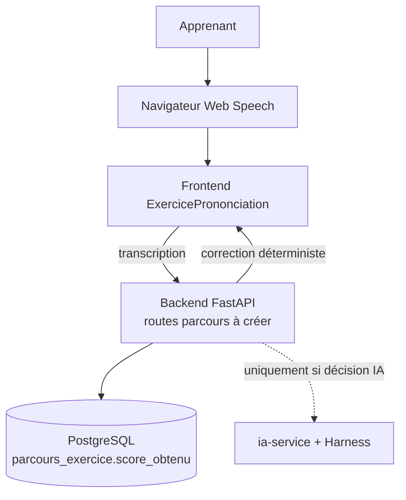
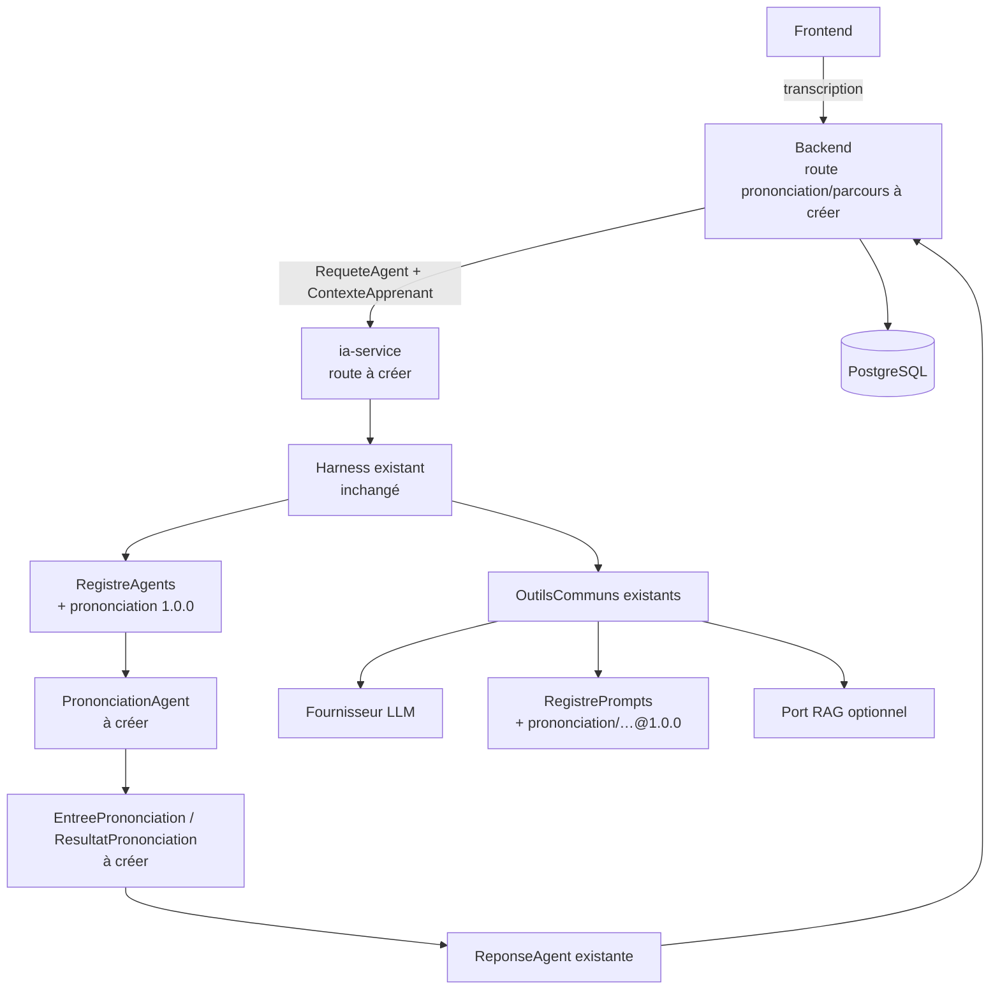
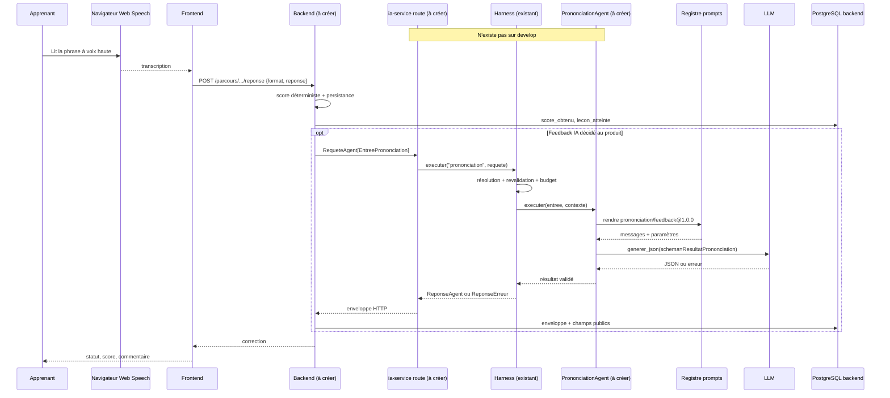

# Agent Prononciation — déroulement, architecture, état, résultats et validation dans le Harness

**Date :** 18 novembre 2026  
**Branche :** `develop` (HEAD `86c529f`)  
**Statut global :** **en cours — à terminer**. Le parcours frontend sait déjà proposer un exercice de prononciation, le transcrire avec la reconnaissance vocale du navigateur et le noter de façon déterministe **en mode mock**. En revanche, **aucun agent `prononciation` n’existe dans `ia-service`**, aucune route IA/backend n’est branchée, et le contrat versionné prévoit aujourd’hui une correction `AUTOMATIQUE` côté backend, pas une inférence LLM.  
**Périmètre :** analyser ce qui se passe réellement, identifier le rôle de chaque acteur, décrire les résultats produits et apporter les preuves de test/validation. Le code exécutable, les contrats et les tests sont les sources de vérité ; les README sont traités comme de la documentation, pas comme une preuve d’implémentation.

---

## 1. Synthèse exécutive

| Élément | État vérifié |
| --- | --- |
| Identité de l’agent | **Aucune.** Aucun `CODE_AGENT = "prononciation"`. `ia-service/app/main.py:37-38` n’enregistre que `diagnostic@1.0.0` et `chatbot@1.0.0`. |
| Point d’entrée IA | **Aucun.** `app/main.py:78-85` n’expose que `GET /health`, `POST /chatbot/message` et `POST /diagnostic/evaluer`. Aucune route `/prononciation/*`. |
| Exécution Harness | Le pipeline générique existe (`app/harness/execution.py:58-130`), mais un appel `executer("prononciation", …)` s’arrête à la résolution : `AGENT_INCONNU` (`execution.py:75-77`, `registre.py:30-42`). Preuve exécutée en section 7.3. |
| Contrat agent | **Aucun.** Pas de `EntreePrononciation` ni de `ResultatPrononciation` dans `app/schemas/`. Seules les enveloppes génériques `RequeteAgent[T]` / `ReponseAgent[T]` existent (`app/schemas/commun.py:39-61`). |
| Prompt / LLM | **Aucun.** `app/prompts/` ne contient que les familles `diagnostic/` et `chatbot/`. Aucune version `prononciation/…@x.y.z`, aucune empreinte, aucun scénario factice dédié. |
| Correction réellement active | **Frontend mock uniquement.** `frontend/src/mocks/parcours-personnalise.mock.ts:218-235,356-363` normalise la transcription et calcule un pourcentage de mots retrouvés. |
| Capture de la parole | **Navigateur.** `frontend/src/hooks/useReconnaissanceVocale.ts:27-31,45-85` utilise l’API Web Speech (`SpeechRecognition` / `webkitSpeechRecognition`) avec repli saisie clavier. Aucun audio n’est envoyé à un serveur. |
| Contrat frontend | Le format `prononciation` est décrit dans `docs/api/contrat-frontend.md:884-885,897-906` : phrase à lire, transcription en réponse, correction **`AUTOMATIQUE`** déterministe. Le backend ne compare pas encore. |
| Relais backend | **Aucun.** `backend/app/api/router.py:5-17` n’inclut aucun routeur `parcours`, `chatbot` ou `prononciation`. Les endpoints déclarés dans `frontend/src/services/endpoints.ts:40-49` sont explicitement « à exposer par le backend ». |
| Tests dédiés | **Aucun test Harness `prononciation`.** Les tests frontend couvrent le mock et l’UI ; les tests `test_harness.py` couvrent le socle générique, dont `test_agent_inconnu`. |
| Résultats produits | Transcription, score 0–100, statut `REUSSI`/`A_REVOIR`, commentaire. **Aucun `ReponseAgent` avec `agent: "prononciation"` n’est produit.** |
| Verdict | **À terminer**, d’abord comme route.backend déterministe conforme au contrat, puis seulement comme agent Harness si le produit décide de passer à une évaluation IA (phonèmes, accentuation, feedback pédagogique). Qualifier l’agent de « terminé » serait faux. |

Formulation courte : **la prononciation est aujourd’hui un exercice frontend simulé et un contrat backend en attente, pas un agent IA. Le Harness est prêt à accueillir un agent, mais l’appel direct échoue avec `AGENT_INCONNU`.**

> **Point d’arbitrage important :** le contrat dit explicitement que la prononciation est corrigée par le backend de façon déterministe (`mode_correction: AUTOMATIQUE`). Si l’équipe veut un véritable « Agent Prononciation » dans le Harness, il faut d’abord changer ce contrat ou créer une route distincte (`POST /prononciation/evaluer`) avec un `mode_correction: IA`. Sinon, on risque de construire un agent IA qui contourne la règle métier déjà versionnée.

---

## 2. Déroulement

### 2.1 Ce qui se passe réellement aujourd’hui

1. L’apprenant ouvre une leçon du parcours (`/parcours/lecons/{numero}`). Le contenu de l’exercice est soit mocké, soit — en mode HTTP — attendu du backend ; dans les deux cas, le format est `prononciation`.
2. `ExercicePrononciation` affiche la phrase à lire et un bouton « Écouter le modèle » si la synthèse vocale est disponible (`ExercicePrononciation.tsx:37-48`).
3. Le hook `useReconnaissanceVocale` instancie l’API Web Speech avec la locale de la langue étudiée (`fr-FR`, `en-US`, …), `interimResults = true` et `continuous = false` (`useReconnaissanceVocale.ts:58-81`).
4. La voix de l’apprenant est transcrite côté navigateur ; la transcription s’affiche et peut être arrêtée manuellement. Si le navigateur ne prend pas en charge la reconnaissance, un champ texte editable est proposé (`ExercicePrononciation.tsx:51-83`).
5. La validation envoie `{ format: "prononciation", reponse: "<transcription>" }` au service parcours (`ExercicePrononciation.tsx:31-34`).
6. `parcoursPersonnaliseService.corriger()` choisit le mock si `NEXT_PUBLIC_API_MOCK=true`, sinon appelle `POST /api/v1/parcours/{id}/exercices/{id}/reponse` avec un délai de 45 s (`parcours-personnalise.service.ts:65-71,83-93`).
7. En mode mock, `scorePrononciation()` compare les mots attendus aux mots entendus après normalisation, puis renvoie un score, un statut et un commentaire (`parcours-personnalise.mock.ts:356-363`).
8. Le score est mémorisé, la leçon avance si tous ses exercices ont une réponse (`parcours-personnalise.mock.ts:376-381`).
9. **Aucun appel n’atteint `ia-service`.** Le Harness n’est pas traversé ; le backend n’a pas de route `parcours` et ne persiste donc rien pour cet exercice.

### 2.2 Ce que le contrat prévoit (mais qui n’est pas branché)

`docs/api/contrat-frontend.md:821-825` indique que tout le parcours est simulé et qu’aucune route backend n’existe. Pour la prononciation précisément :

- `contenu` est `{ "format": "prononciation", "consigne": "…", "phrase": "…" }` (`:884-885`) ;
- la réponse envoyée est `{ "format": "prononciation", "reponse": "…" }` (`:897-898`) ;
- le mode de correction attendu est `AUTOMATIQUE` : le backend compare sans tenir compte de la casse, des accents ni de la ponctuation (`:901-906`) ;
- la réponse peut contenir `statut`, `score_obtenu`, `mode_correction`, `commentaire`, `reponse_attendue`, `explication` (`:908-931`) ;
- le backend doit enregistrer le score dans `parcours_exercice.score_obtenu` et faire avancer `lecon_atteinte` (`:929-931`).

Ce chemin est donc **backend-déterministe**, pas IA. C’est la différence majeure avec le diagnostic ou le chatbot.

### 2.3 Ce que le Harness fait aujourd’hui

Même si aucune route ne l’appelle pour la prononciation, le comportement générique est vérifiable :

1. `Harness.executer("prononciation", requete)` demande au registre de résoudre le code (`:75`).
2. `RegistreAgents.resoudre()` ne trouve aucune entrée et lève `ErreurAgentInconnu` (`registre.py:32-34`).
3. Le Harness convertit cette exception en `CodeErreur.AGENT_INCONNU` et renvoie une `ReponseErreur` (`:76-77`).
4. Aucun prompt, aucun LLM, aucun RAG et aucun budget d’agent ne sont sollicités : l’arrêt a lieu **avant** la création des `OutilsCommuns`.

Le message public est « L'agent demandé n'existe pas ou sa version est inconnue. », code non rejouable, statut HTTP 404 s’il était exposé (`app/core/codes_erreur.py:19,43,75`).

### 2.4 Déroulement cible — deux options

**Option A — conforme au contrat actuel (recommandée pour terminer le chantier tel qu’il est spécifié).**

1. Le backend expose les routes `parcours` et reçoit la transcription.
2. Il recharge la phrase attendue depuis `exercice.contenu` **sans l’envoyer au frontend avant la réponse** (règle US43-BE, `contrat-frontend.md:888-890`).
3. Il applique la même normalisation que le mock (accents, casse, apostrophes, ponctuation) et calcule le pourcentage de mots retrouvés.
4. Il enregistre `score_obtenu`, déduit le statut, avance `lecon_atteinte`, renvoie la correction.
5. Le Harness n’intervient pas. La validation Harness se limite alors à vérifier qu’il n’existe pas d’agent fantôme.

**Option B — agent Harness (nécessite une décision produit et un changement de contrat).**

1. Le backend décide que la correction doit être IA (ex. retour phonétique, Prosodie, erreurs de liaison) et crée une route dédiée.
2. Il construit `RequeteAgent[EntreePrononciation]` avec un `ContexteApprenant` (langue/référentiel/niveau) et la transcription, **sans audio brut ni donnée identifiante**.
3. La route IA appelle `Harness.executer("prononciation", requete)`.
4. Le Harness résout `prononciation@1.0.0`, revalide l’entrée, injecte les outils communs et ouvre un budget explicite.
5. Le prompt versionné `prononciation/…@1.0.0` est rendu ; le LLM produit un JSON contraint par `ResultatPrononciation`.
6. L’agent applique des garde-fous déterministes : score borné 0–100, cohérence langue/niveau, nombre maximal d’erreurs, prudence si la transcription est trop courte.
7. Le Harness valide la sortie et renvoie `ReponseAgent[ResultatPrononciation]`.
8. Le backend revalide le miroir de contrat, persiste l’enveloppe et renvoie les champs publics au frontend ; en cas de panne IA, il dégrade vers le score déterministe.

---

## 3. Architecture

### 3.1 Architecture réelle sur `develop`

```mermaid
flowchart TD
    U[Apprenant] -->|parle| N[Navigateur\nWeb Speech API]
    N -->|transcription| C[ExercicePrononciation.tsx]
    C -->|{format, reponse}| S[parcours-personnalise.service]
    S -->|NEXT_PUBLIC_API_MOCK=true| M[Mock frontend\nscorePrononciation]
    S -.->|NEXT_PUBLIC_API_MOCK=false| X[Backend /api/v1/parcours/...\nROUTE ABSENTE]
    M --> R[CorrectionExercice\nstatut + score + commentaire]
    R --> C
    X -.->|aucun relais| IA[ia-service]
    IA --> H[Harness]
    H --> REG[RegistreAgents\n2 définitions seulement]
    REG --> D[diagnostic 1.0.0]
    REG --> CH[chatbot 1.0.0]
```

Aucun nœud « prononciation » n’existe côté `ia-service`. `docs/fonctionnalites/06-matrice-fonctionnalites.md:120-125` classe d’ailleurs le parcours comme absent/🔌 : tables créées, aucune route, aucun écran réellement branché.

### 3.2 Architecture cible — option A (backend déterministe)



### 3.3 Architecture cible — option B (agent dans le Harness)



Tout ce qui est marqué « existant » est réutilisable tel quel. Tout ce qui est marqué « à créer » n’existe pas sur `develop`.

### 3.4 Responsabilités par couche

| Couche | Fichiers principaux | État pour la prononciation |
| --- | --- | --- |
| Navigateur | `useReconnaissanceVocale.ts`, `lib/voix.ts` | **Existant** : transcription Web Speech, locale, messages d’erreur, libération du micro. Aucun audio transmis au serveur. |
| UI frontend | `ExercicePrononciation.tsx`, `BoutonMicro.tsx`, `BoutonValider.tsx` | **Existant** : phrase, écoute du modèle, transcription non modifiable, repli clavier, soumission. |
| Service frontend | `parcours-personnalise.service.ts`, `endpoints.ts` | **Existant côté signature** : `corriger()` et route HTTP déclarée, mais backend absent. |
| Mock frontend | `parcours-personnalise.mock.ts` | **Existant** : normalisation, score de mots, commentaires, progression en mémoire. |
| Backend routes | `backend/app/api/router.py:5-17` | **À créer** : aucun routeur `parcours` / `prononciation`. |
| Backend scoring | `backend/app/services/` | **À créer** : le scoring déterministe n’existe que dans le mock frontend. |
| API IA | `ia-service/app/main.py:78-85`, `app/api/` | **À créer si option B** : aucune route de prononciation. |
| Harness | `app/harness/execution.py`, `agent.py`, `registre.py` | **Existant et générique** : aucune modification nécessaire pour accueillir un agent de plus. |
| Agent | `app/agents/` | **À créer si option B** : `app/agents/prononciation.py`. |
| Contrats | `app/schemas/commun.py`, `contexte.py` | Enveloppes et contexte existants ; schémas métier prononciation à créer si option B. |
| Prompt | `app/prompts/` | **À créer si option B** : famille `prononciation/*` versionnée avec empreinte. |
| RAG | `app/rag/*` | Inutile en option A ; optionnel en option B. `RAG_CORPUS_ACTIF=false` par défaut. |
| PostgreSQL | `backend/app/models/parcours.py` | Tables `parcours` / `parcours_exercice` / `exercice` présentes, mais aucune route ne les écrit pour la prononciation. |

### 3.5 Câblage au démarrage et identité cible

`app/main.py:29-49` construit une seule fois les ressources partagées puis enregistre :

```python
registre_agents.enregistrer(construire_definition(registre_prompts))      # diagnostic
registre_agents.enregistrer(definir_agent_chatbot(registre_prompts))     # chatbot
```

Pour l’option B, il faudra une troisième ligne du même type avec une `DefinitionAgent` valide (`app/harness/agent.py:60-110`) : code `prononciation`, version SemVer, prompt `prononciation/<tache>@x.y.z`, empreinte `sha256:…`, budget 1–600 000 ms, schémas Pydantic et exécuteur appelable. Une définition invalide est refusée au démarrage, pas à la première requête.

Identité proposée, **pas encore code** :

```python
CODE_AGENT = "prononciation"
VERSION_AGENT = "1.0.0"
VERSION_PROMPT = "prononciation/feedback@1.0.0"
BUDGET_MS = None  # à arbitrer : 30 000 ms paraît cohérent avec la correction frontend actuelle (45 s)
```

---

## 4. Séquence détaillée par rôle concerné

### 4.1 Rôles métier

| Rôle | Participation réelle aujourd’hui | Participation attendue une fois terminé |
| --- | --- | --- |
| **Apprenant** | Lit la phrase, parle, voit sa transcription et son score simulé. | Idem, avec correction persistée et progression réelle ; en option B, feedback IA enrichi. |
| **Formateur** | Aucune action dans l’exercice. | Pourrait consulter les scores oraux, aucun écran dédié n’existe aujourd’hui. |
| **Administrateur** | Aucune action dans l’exercice. | Supervise erreurs/budgets si un agent IA est créé ; ne participe pas à l’inférence. |
| **Navigateur** | Acteur technique clé : transforme l’audio en texte via Web Speech. | Reste la source de la transcription ; la qualité dépend du navigateur, de la locale, du micro et parfois du réseau. |
| **Backend** | Absent de la chaîne. | Seul propriétaire de la correction déterministe, de la persistance et de la progression. |
| **Service IA / Harness** | Non appelé pour la prononciation. | Option B seulement : produit une proposition validée par le backend, sans DB et sans décision finale. |

### 4.2 Séquence réelle, acteur par acteur

| # | Acteur | Action | Statut | Résultat observé |
| --- | --- | --- | --- | --- |
| 1 | Apprenant | Ouvre la leçon 23 du parcours simulé. | Existant (mock) | Exercice « Demander son chemin » affiché. |
| 2 | Frontend | Lit le `contenu` `{ format: "prononciation", phrase: "…" }`. | Existant | Phrase et bouton « Écouter le modèle ». |
| 3 | Navigateur | `new SpeechRecognition()` / `webkitSpeechRecognition`, `lang = fr-FR`. | Existant | Écoute active, transcription partielle. |
| 4 | Apprenant | Dit la phrase puis arrête le micro. | Existant | `onresult` remplit `transcription` ; `onend` met fin à l’écoute. |
| 5 | Frontend | Soumet `{ format: "prononciation", reponse: transcription }`. | Existant | Appel à `parcoursPersonnaliseService.corriger()`. |
| 6 | Service frontend | `API_MOCK=true` → service mock. | Existant en dev local | Aucun `fetch`. En Compose, `NEXT_PUBLIC_API_MOCK=false` par défaut : l’appel irait vers une route absente. |
| 7 | Mock | `normaliserReponse()` puis `scorePrononciation()` (`mock:218-235`). | Existant | Score arrondi 0–100. |
| 8 | Mock | `statutDe(score)` avec seuil 50 ; commentaire à 80 (`mock:36,199,356-363`). | Existant | `REUSSI` / `A_REVOIR` + commentaire. |
| 9 | Mock | Met à jour `scores` et `leconAtteinte` (`mock:376-381`). | Existant en mémoire | Leçon suivante ouverte, mais rien n’est persisté. |
| 10 | Backend | Aucune route, aucune écriture DB. | **Absent** | Aucune trace serveur de la réponse. |
| 11 | Harness | Aucun appel. | **Absent** | Aucune métadonnée d’exécution produite. |

### 4.3 Séquence cible (option A puis extension option B)

| # | Acteur | Action | Statut | Résultat attendu |
| --- | --- | --- | --- | --- |
| 1 | Apprenant | Parle après avoir écouté le modèle. | Existant | Transcription navigateur. |
| 2 | Frontend | Envoie la transcription au backend authentifié. | Existant côté service | `POST /api/v1/parcours/{id}/exercices/{id}/reponse`. |
| 3 | Backend | Charge la phrase attendue et retire la réponse du `contenu` renvoyé plus tôt. | **À créer** | Aucune fuite de la bonne réponse avant soumission. |
| 4 | Backend | Normalise et calcule le score de mots. | **À créer** | Même entrée → même score. |
| 5 | Backend | Enregistre `parcours_exercice.score_obtenu`, déduit le statut, avance la leçon. | **À créer** | Progression réelle. |
| 6 | Backend | Renvoie `CorrectionExerciceDto`. | **À créer** | `mode_correction: AUTOMATIQUE`. |
| 7 | Backend (option B) | Construit `RequeteAgent[EntreePrononciation]` et appelle la route IA. | **À créer** | Contexte minimal, sans identifiant apprenant. |
| 8 | API IA (option B) | Valide l’enveloppe puis `harness.executer("prononciation", requete)`. | **À créer** | `ENTREE_INVALIDE` si hors contrat. |
| 9 | Harness (option B) | Résolution, revalidation, `OutilsCommuns`, `asyncio.timeout`. | Mécanisme existant, définition absente | `DefinitionAgent` ou `AGENT_INCONNU`. |
| 10 | Prompt + LLM (option B) | Rend le prompt versionné, génère un JSON contraint. | **À créer** | Feedback ou erreur fournisseur standard. |
| 11 | Agent (option B) | Bornage du score, cohérence, prudence si transcription courte. | **À créer** | Résultat validable. |
| 12 | Harness (option B) | Valide la sortie, construit `MetaExecution`. | Existant | `ReponseAgent[ResultatPrononciation]`. |
| 13 | Backend (option B) | Revalide, persiste l’enveloppe, dégrade si panne. | **À créer** | L’apprenant n’est jamais bloqué par l’IA. |

### 4.4 Diagramme de séquence cible (option B)



---

## 5. Résultats produits

### 5.1 Résultats réels aujourd’hui

Aucun `ReponseAgent` avec `agent: "prononciation"` n’est produit. Les seuls résultats observables sont :

| Source | Résultat réel |
| --- | --- |
| Navigateur | Transcription Web Speech, par exemple « Excusez-moi où se trouve la gare ». |
| Mock frontend | `scorePrononciation("Où se trouve la gare ?", "ou se trouve la gare") === 100` ; `scorePrononciation("Où se trouve la gare ?", "la gare") === 40` (`parcours-personnalise.service.test.ts:180-183`). |
| Correction mock | `{ statut: "REUSSI", scoreObtenu: 100, mode: "AUTOMATIQUE" }` pour la phrase attendue (`parcours-personnalise.service.test.ts:128-132`). |
| UI | Commentaire « Très bonne prononciation ! » au-dessus de 80, « Bien ! Quelques mots ne sont pas reconnus. » entre 50 et 79, « Réessayez en articulant chaque mot. » en dessous de 50 (`mock:362`). |
| Progression | Leçon suivante ouverte en mémoire uniquement. |

Ce score mesure **la proportion de mots attendus retrouvés dans la transcription**. Il ne mesure pas la qualité acoustique, le phonème, l’accentuation ni la prosodie : toute l’évaluation phonétique dépend du moteur de reconnaissance du navigateur.

### 5.2 Forme d’enveloppe attendue si un agent Harness est créé

```json
{
  "request_id": "<uuid>",
  "agent": "prononciation",
  "version_agent": "1.0.0",
  "version_prompt": "prononciation/feedback@1.0.0",
  "statut": "succes",
  "resultat": "<ResultatPrononciation : contrat à définir>",
  "meta": {
    "duree_ms": 0,
    "fournisseur": "factice",
    "modele": "<modèle>",
    "version_corpus": null,
    "empreinte_prompt": "sha256:<64 hexadécimaux>"
  }
}
```

Ce schéma illustre `ReponseAgent[T]` (`app/schemas/commun.py:52-61`) et **doit être lu comme un objectif**, pas comme une sortie observée.

### 5.3 Familles d’erreurs déjà couvertes par le Harness

| Famille | Comportement générique |
| --- | --- |
| Code d’agent inconnu | `AGENT_INCONNU`, HTTP 404 — c’est le comportement actuel de `"prononciation"` (`execution.py:75-77`). |
| Entrée hors contrat | `ENTREE_INVALIDE`, HTTP 422 (`execution.py:79-82`). |
| Budget dépassé | `LLM_TIMEOUT`, HTTP 504 (`execution.py:98-102`). |
| Sortie agent invalide | `LLM_REPONSE_INVALIDE`, HTTP 502 (`execution.py:108-111`). |
| Exception fournisseur ou prompt | Code du catalogue central, traduit par `STATUTS_HTTP` (`execution.py:103-106`, `codes_erreur.py:73-88`). |
| Métadonnées | `MetaExecution` : durée bornée à 600 000 ms, fournisseur, modèle, version corpus, empreinte prompt (`execution.py:113-121`). |

### 5.4 Mode démonstration

Le client `FakeLLMClient` et le scénario `demonstration` (`LLM_FACTICE_SCENARIO=demonstration` par défaut dans Compose) permettent de tester sans clé. Pour un éventuel agent prononciation, ce mode reste **à créer** : il faut d’abord définir `ResultatPrononciation` et un jeu de cas déterministe. La démonstration actuelle de la prononciation ne dépend pas du LLM : elle vient entièrement du mock frontend.

---

## 6. État actuel : ce qui est fait et ce qui reste à terminer

### 6.1 Déjà terminé et testé

- UI d’exercice : phrase, synthèse du modèle, micro, transcription lisible, bouton de validation, message clair si la reconnaissance n’est pas disponible.
- Hook Web Speech : locale de la langue étudiée, résultats partiels, erreurs traduites, arrêt/abort du micro à la sortie.
- Normalisation déterministe : casse, accents, apostrophes et ponctuation neutralisés (`normaliserReponse`).
- Score de mots et commentaires associés, avec progression simulée de la leçon.
- Service frontend prêt : signature `corriger()`, DTO mappés, endpoint HTTP déclaré, timeout 45 s.
- Socle Harness complet et générique : registre, budget, outils communs, enveloppes strictes, catalogue d’erreurs.
- Tests frontend ciblés et suite `ia-service` verts (section 7).

### 6.2 Travaux à terminer

| Priorité | Point | État réel et preuve |
| --- | --- | --- |
| P0 | Décision de architecture | Choisir l’option A (backend déterministe, conforme au contrat) ou l’option B (agent IA, contrat à modifier). Tant que ce choix n’est pas fait, ajouter un agent Harness serait une dérive du contrat. |
| P0 | Routes backend | Aucun `parcours` ni `prononciation` dans `backend/app/api/router.py:5-17`. Les endpoints frontend restent sans appelant réel. |
| P0 | Scoring serveur | `scorePrononciation` n’existe que dans `frontend/src/mocks/`. Le backend n’a ni normalisation ni seuil 50/80 ni persistance pour cet exercice. |
| P0 | Identité Harness (si option B) | Aucun `CODE_AGENT`, aucune version, aucun schéma métier, aucun prompt, aucune enregistrement dans `main.py`. |
| P0 | Route IA (si option B) | Aucune route `/prononciation/*` dans `app/main.py:78-85`. |
| P1 | Contrat frontend | Si option B, mettre à jour `docs/api/contrat-frontend.md`, `endpoints.ts` et le service dans la même PR, comme l’exige le contrat (`:9`). |
| P1 | Jeu de cas | Aucun cas pédagogique de prononciation côté IA ; aucun scénario factice dédié. |
| P1 | Persistance | Aucune écriture de `parcours_exercice.score_obtenu` pour la prononciation ; progression simulée en mémoire. |
| P2 | Validation navigateur réelle | Jest simule `webkitSpeechRecognition` ; aucun test ne couvre un vrai micro, une vraie locale ou un vrai moteur Web Speech. |
| P2 | CI complète | `make check`, `npm run build`, `npm run test:e2e` et le job Docker de CI doivent être relancés avant PR (`AGENTS.md`). |

### 6.3 Pièges à éviter

- Ne pas affirmer que l’agent existe : l’appel direct renvoie `AGENT_INCONNU`.
- Ne pas confondre l’exercice `format: "prononciation"` du parcours avec le champ `scorePrononciation?` du test diagnostic : `ia-service` refuse `prononciation` comme domaine de `points_faibles` (`tests/test_diagnostic.py:96`, `ia-service/docs/US-30-points-faibles-phase-assimil.md:36`). Ce sont deux périmètres distincts.
- Ne pas croire que le score mesure la prononciation acoustique : il mesure des mots retrouvés dans une transcription produite par le navigateur.
- Ne pas envoyer la phrase attendue au frontend avant la réponse (règle US43-BE).
- Ne pas contourner le Harness ni assouplir Pydantic si un agent IA est créé.
- Ne pas confondre les deux environnements frontend : `frontend/.env.development` force `NEXT_PUBLIC_API_MOCK=true`, tandis que Compose force `false` par défaut. Le même écran n’a donc pas le même comportement selon le mode de lancement.
- Ne pas transformer la correction `AUTOMATIQUE` en `IA` sans mise à jour synchronisée du contrat, de `endpoints.ts` et du service.

---

## 7. Tests et validation dans le Harness

### 7.1 Cartographie des tests existants utiles

| Domaine | Fichiers | Ce qui est vérifié et utile ici |
| --- | --- | --- |
| Harness | `ia-service/tests/test_harness.py` | Nominal, version demandée, dernière version, **agent inconnu (`:194`)**, entrée invalide, champ supplémentaire refusé, sortie invalide, timeout, erreurs LLM, métadonnées, contexte transmis, injection outils/horloge. |
| Registre | `ia-service/tests/test_registre.py` | Enregistrement/résolution, tri, doublons, extensibilité. Aucune définition `prononciation`. |
| Démarrage | `ia-service/tests/test_main.py` | Initialisation du Harness et des deux agents enregistrés seulement. |
| Contrats IA | `ia-service/tests/test_commun.py`, `test_contexte.py`, `test_diagnostic.py` | Enveloppes, `retryable`, contexte apprenant, rejet de `prononciation` comme domaine de point faible. |
| UI parcours | `frontend/src/components/pedagogie/parcours/__tests__/ModuleEtLecon.test.tsx` | Transcription Web Speech simulée (`:89-98`), repli saisie clavier (`:100-106`), conversation et dictée (`:108-129`). |
| Service/mock parcours | `frontend/src/services/__tests__/parcours-personnalise.service.test.ts` | Format `prononciation` dans le contrat (`:94`), présence dans chaque leçon (`:109-112`), correction mock (`:128-132`), score normalisé (`:180-183`), appel HTTP futur avec body et timeout 45 s (`:208-225`). |

**Aucun test ne vise un agent `prononciation` dans le Harness**, puisque cet agent n’existe pas.

### 7.2 Commandes et résultats réellement exécutés

Relancés le 18 novembre 2026 depuis la racine du dépôt.

Socle Harness + registre + démarrage, depuis `ia-service/` :

```powershell
python -m pytest -p no:cacheprovider tests/test_harness.py tests/test_registre.py tests/test_main.py
```

Résultat : **61 tests réussis**.

Suite IA complète avec le seuil de couverture du projet :

```powershell
python -m pytest --cov=app --cov-report=term --cov-fail-under=70 -p no:cacheprovider --disable-warnings --tb=no
```

Résultat :

```text
TOTAL                                       2143     59    97%
Required test coverage of 70% reached. Total coverage: 97.25%
608 passed, 2 skipped, 1 warning in 25.26s
```

Tests frontend ciblés sur la prononciation :

```powershell
cd frontend
npm test -- src/services/__tests__/parcours-personnalise.service.test.ts src/components/pedagogie/parcours/__tests__/ModuleEtLecon.test.tsx
```

Résultat :

```text
Test Suites: 2 passed, 2 total
Tests:       25 passed, 25 total
```

Contrôle frontend complet :

```powershell
cd frontend
npm run check
```

Résultat : typecheck OK, lint OK avec un avertissement préexistant sur `src/components/Hero.tsx` (`@next/next/no-img-element`), puis :

```text
Test Suites: 37 passed, 37 total
Tests:       288 passed, 288 total
```

Depuis la racine, les commandes canoniques restent :

```bash
make test-ia
make check
```

et, pour un test ciblé IA :

```bash
docker compose -f docker-compose.yml -f docker-compose.dev.yml run --build --rm --no-deps \
  --user "$(id -u):$(id -g)" ia-service pytest -p no:cacheprovider \
  tests/test_harness.py::test_agent_inconnu
```

> Sur Windows, les cibles `make` utilisent `sh -c` et `id -u` : les lancer depuis Git Bash/WSL, pas depuis PowerShell natif (`AGENTS.md`).

### 7.3 Preuve directe : `executer("prononciation", …)` renvoie `AGENT_INCONNU`

Depuis `ia-service/`, avec un `RegistreAgents` vide et un `FakeLLMClient` :

```python
import asyncio
import uuid

from app.harness.execution import Harness
from app.harness.registre import RegistreAgents
from app.llm.adaptateurs.factice import FakeLLMClient
from app.schemas.commun import RequeteAgent
from app.schemas.contexte import ContexteApprenant

harness = Harness(RegistreAgents(), FakeLLMClient())
requete = RequeteAgent(
    request_id=uuid.uuid4(),
    contexte=ContexteApprenant(
        code_langue="fr",
        referentiel="CECRL",
        niveau_preliminaire="A1",
    ),
    entree={"phrase": "Où se trouve la gare ?"},
)
reponse = asyncio.run(harness.executer("prononciation", requete))
print(reponse.model_dump_json())
```

Résultat observé :

```json
{
  "request_id": "<uuid>",
  "agent": "prononciation",
  "statut": "erreur",
  "erreur": {
    "code": "AGENT_INCONNU",
    "message": "L'agent demandé n'existe pas ou sa version est inconnue.",
    "retryable": false,
    "details": null
  }
}
```

C’est la validation Harness la plus importante pour cet agent : **elle prouve l’absence d’enregistrement**, sans ambiguïté sur une éventuelle panne LLM ou un prompt manquant.

### 7.4 Ce que la validation Harness garantit déjà

- toute requête à un agent enregistré passe par deux niveaux de validation Pydantic (API puis Harness) ;
- une `DefinitionAgent` invalide est refusée au démarrage, pas à la première requête ;
- l’exécution est bornée par un budget explicite et convertie en `LLM_TIMEOUT` si nécessaire ;
- aucune exception Python n’atteint le backend : elle est traduite en code public et statut HTTP ;
- une réponse LLM hors schéma est rejetée avant le backend ;
- `retryable` est dérivé d’un catalogue central, sans valeur contradictoire ;
- les métadonnées d’exécution sont standardisées et sans secret.

Ces garanties s’appliqueront automatiquement à un agent prononciation **du moment où il sera enregistré avec une `DefinitionAgent` valide** et appelé via une route.

### 7.5 Limites de cette validation

- Les 608 tests IA verts valident le socle et les agents existants ; **aucun ne valide un agent prononciation**.
- Le test `test_agent_inconnu` et la preuve directe de la section 7.3 confirment précisément l’état actuel : un appel `"prononciation"` échoue à la résolution.
- Les 25 tests frontend ciblés valident le mock et l’UI avec une reconnaissance vocale simulée ; ils ne valident ni le backend, ni le service IA, ni un vrai microphone.
- `npm run check` ne remplace pas `npm run build`, `npm run test:e2e` ni le job Docker complet de la CI.
- Aucun appel LLM réel n’a été effectué ici ; les fournisseurs `gemini` / `compatible-openai` restent hors de cette analyse.

---

## 8. Conclusion et prochaine étape

L’« Agent Prononciation » est aujourd’hui **un périmètre à terminer, pas un agent à corriger**. Trois éléments sont déjà solides : la capture vocale dans le navigateur, la correction déterministe simulée côté frontend, et le Harness générique validé par 608 tests. Trois éléments manquent : la décision d’architecture, le relais backend persistant, et — seulement si le produit choisit l’IA — la définition de l’agent, son prompt et sa route.

Il doit rester qualifié **« en cours — à terminer »** tant que :

1. l’option A (backend déterministe) ou l’option B (agent Harness) n’est pas arbitrée ;
2. les routes `parcours` ne sont pas exposées par le backend et le score n’est pas persisté ;
3. le contrat frontend n’est pas branché hors mock ;
4. pour l’option B, `app/agents/prononciation.py`, `EntreePrononciation`, `ResultatPrononciation`, le prompt versionné et la route IA n’existent pas ;
5. un `tests/test_prononciation.py` avec jeu de cas et scénario factice n’existe pas ;
6. la preuve `executer("prononciation", …)` ne renvoie pas une `ReponseAgent` valide.

**Prochaine étape recommandée :** arbitrer d’abord l’option A ou B. Pour terminer le chantier tel que le contrat est écrit, implémenter l’option A : reprendre `normaliserReponse` / `scorePrononciation` dans le backend, exposer les routes `parcours`, persister le score, puis brancher le frontend avec `NEXT_PUBLIC_API_MOCK=false`. Si un feedback réellement IA est souhaité, modifier le contrat en même temps que `endpoints.ts`, créer le schéma de sortie et le jeu de cas, puis enregistrer l’agent derrière le Harness existant. C’est le seul ordre qui évite de fabriquer un agent qui ne correspond pas au contrat ou un contrat que personne n’appelle.

---

## Références principales

- `docs/api/contrat-frontend.md` — § Parcours personnalisé, formats `prononciation` et modes de correction.
- `docs/fonctionnalites/06-matrice-fonctionnalites.md` — § 2.6 et 2.7, état réel des couches.
- `frontend/src/components/pedagogie/parcours/exercices/ExercicePrononciation.tsx`
- `frontend/src/hooks/useReconnaissanceVocale.ts`
- `frontend/src/mocks/parcours-personnalise.mock.ts`
- `frontend/src/services/parcours-personnalise.service.ts`
- `frontend/src/services/endpoints.ts`
- `frontend/src/types/parcours-personnalise.ts`
- `frontend/src/services/__tests__/parcours-personnalise.service.test.ts`
- `frontend/src/components/pedagogie/parcours/__tests__/ModuleEtLecon.test.tsx`
- `backend/app/api/router.py`
- `ia-service/app/main.py`
- `ia-service/app/harness/execution.py`
- `ia-service/app/harness/agent.py`
- `ia-service/app/harness/registre.py`
- `ia-service/app/schemas/commun.py`
- `ia-service/app/core/codes_erreur.py`
- `ia-service/tests/test_harness.py`
- `ia-service/tests/test_registre.py`
- `ia-service/tests/test_main.py`
- `AGENTS.md`
