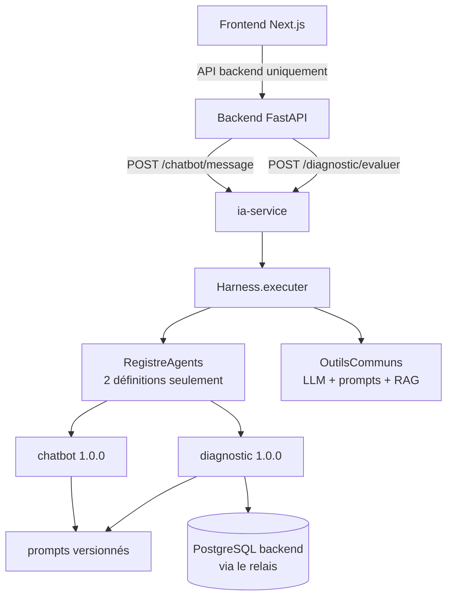
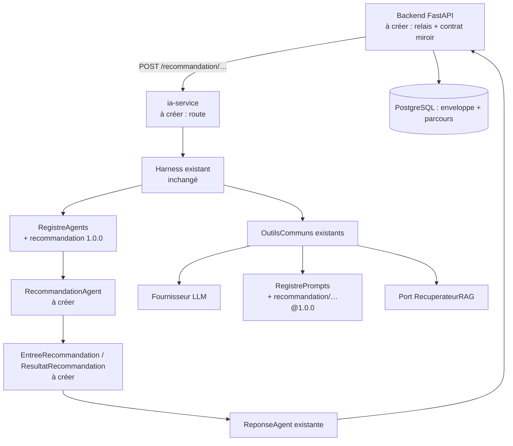
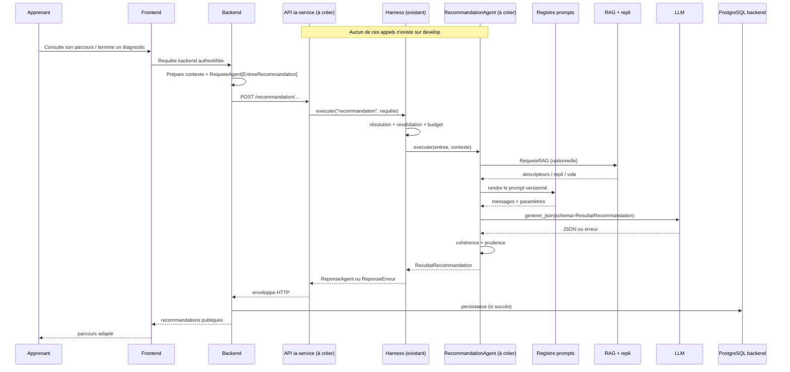

# Agent Recommandation — déroulement, architecture, état, résultats et validation dans le Harness

**Date :** 18 novembre 2026  
**Branche :** `develop` (HEAD `86c529f`)  
**Statut global :** **en cours — à terminer**, au sens où la fonctionnalité est prévue dans la vision produit mais **aucun agent Recommandation dédié n’est implémenté sur `develop`**. Le socle Harness, lui, est opérationnel et testé.  
**Périmètre :** `ia-service` principalement ; la chaîne backend/frontend est décrite uniquement pour expliquer l’entrée, la sortie et les points de branchement manquants. Le code exécutable est la source de vérité ; les README qui annoncent la recommandation sont une roadmap, pas un état d’implémentation.

---

## 1. Synthèse exécutive

| Élément | État vérifié |
| --- | --- |
| Identité de l’agent | **Aucune.** Aucun `CODE_AGENT = "recommandation"`. Seuls `diagnostic@1.0.0` et `chatbot@1.0.0` sont enregistrés (`ia-service/app/main.py:37-38`). |
| Point d’entrée IA | **Aucun.** `app/main.py:78-85` n’enregistre que `GET /health`, `POST /chatbot/message` et `POST /diagnostic/evaluer`. |
| Exécution | Le Harness générique fonctionne (`app/harness/execution.py:58-130`), mais un appel `executer("recommandation", …)` s’arrête à la résolution : `AGENT_INCONNU` (`execution.py:75-77`, `registre.py:30-42`). |
| Invocation Harness | `Harness.executer(code_agent, requete, version_agent=None)` → résolution, revalidation d’entrée, outils communs, `asyncio.timeout(budget_ms/1000)`, validation de sortie, `ReponseAgent` / `ReponseErreur` (`execution.py:58-130`). |
| Prompt | **Aucun.** `app/prompts/` ne contient que `diagnostic/` et `chatbot/`. Aucune version `recommandation/…@x.y.z`, aucune empreinte associée. |
| Contrats Pydantic | **Aucun.** Pas de `EntreeRecommandation` ni de `ResultatRecommandation` dans `app/schemas/`. Seules les enveloppes génériques `RequeteAgent[T]` / `ReponseAgent[T]` existent (`app/schemas/commun.py:39-61`). |
| Relais backend | **Aucun.** `backend/app/api/router.py:5-17` n’inclut aucun routeur recommandation/parcours ; `backend/app/services/ia.py:18` ne connaît que `CHEMIN_EVALUATION = "/diagnostic/evaluer"`. |
| Frontend | **Aucun endpoint de recommandation.** `frontend/src/services/endpoints.ts:40-47` déclare des endpoints `parcours` explicitement « à exposer par le backend ». `docs/api/contrat-frontend.md:821-825` précise qu’aucune route n’existe encore et que le parcours est simulé. |
| Tests | **Aucun test recommandation.** `ia-service/tests/test_registre.py:90-102` utilise le mot `"recommandation"` uniquement comme chaîne factice pour prouver que le registre peut trier plusieurs agents. |
| Résultats produits | **Aucun résultat IA de recommandation.** Le seul résultat exploitable aujourd’hui est l’analyse diagnostique persistée dans `TestDiagnostic.analyse_ia` et l’écran de parcours simulé côté frontend. |
| Verdict | **À cadrer puis à implémenter** derrière le Harness existant. Qualifier l’agent de « terminé » serait faux ; qualifier le Harness de « prêt à l’accueillir » est exact. |

Formulation courte : **la recommandation est une intention produit, pas encore un agent. Tout ce qu’il faut pour la porter existe (Harness, registre, prompts versionnés, contrats stricts, client LLM, port RAG) ; il manque la définition métier, le code de l’agent, sa route, son relais backend et ses tests.**

---

## 2. Déroulement

### 2.1 Ce qui se passe réellement aujourd’hui

1. **Aucun acteur ne déclenche de recommandation.** Ni l’apprenant via le frontend, ni le backend, ni le Harness n’appellent un agent de recommandation.
2. **Le seul chemin générique possible** est `Harness.executer("recommandation", requete)`, mais le registre ne contient pas ce code : `RegistreAgents.resoudre()` lève `ErreurAgentInconnu` (`app/harness/registre.py:32-34`), converti en `CodeErreur.AGENT_INCONNU` par le Harness (`execution.py:75-77`).
3. **La « recommandation » présente dans le code est une règle pédagogique interne au Diagnostic** : la phase Assimil `imprégnation` / `activation` et l’heuristique associée dans `app/agents/diagnostic.py` et `app/prompts/diagnostic/evaluation@1.0.0.systeme.md`. Ce n’est pas un agent autonome.
4. **La « recommandation » du README** (`README.md:34`, schéma `:70-72`, responsabilités `:207`, sprint 2 `:468`) est une vision produit : « diagnostic de niveau, recommandation, chatbot conversationnel », avec un bloc « Recommand. — embeddings ». Le code ne contient ni embedding ni `scikit-learn` dans `ia-service/requirements.txt`.
5. **Le parcours affiché dans le frontend est simulé** (`NEXT_PUBLIC_API_MOCK=true` en dev local) ; il ne provient d’aucune inférence IA.

### 2.2 Intrants déjà disponibles pour un futur agent

| Intrant | Emplacement | Utilité pour la recommandation |
| --- | --- | --- |
| `ResultatDiagnostic` | `app/schemas/diagnostic.py` | Niveau estimé, `points_faibles`, `phase_assimil`, `score_confiance`, écart avec le niveau préliminaire. |
| `ContexteApprenant` | `app/schemas/contexte.py:64-85` | Langue, référentiel (`CECRL`/`HSK`), niveau préliminaire, contrôle de cohérence langue/référentiel/niveau. |
| `MemoirePedagogique` | `app/schemas/contexte.py:24-61` | Résumé du parcours, 5 points forts et 5 points faibles maximum, `nb_activites`, refus d’un point simultanément fort et faible. |
| `OutilsCommuns` | `app/harness/agent.py:27-34` | Injecte le client LLM, le registre de prompts, le récupérateur RAG et l’horloge : un futur agent n’a pas à les importer. |
| `ReponseAgent[T]` / `ReponseErreur` | `app/schemas/commun.py:52-119` | Enveloppe standard, métadonnées d’exécution et erreurs publiques déjà normées. |

Le backend transmet aujourd’hui `memoire_pedagogique` au diagnostic de façon optionnelle ; c’est le type de contexte qu’un agent Recommandation devrait recevoir, sans jamais accéder à PostgreSQL.

### 2.3 Déroulement de référence : le diagnostic (seul agent adjacent réellement en production)

1. L’apprenant répond au test puis demande la clôture via `POST /api/v1/diagnostic/tentatives/{id}/terminer`.
2. Le backend calcule le score, le niveau et le statut **avant** tout appel IA : il reste l’autorité métier.
3. La session PostgreSQL est libérée, puis l’analyse IA est lancée en best-effort : une panne IA ne doit pas faire échouer la clôture.
4. Le backend appelle `POST /diagnostic/evaluer` (`backend/app/services/ia.py:33-64`) avec une enveloppe `RequeteAgent[EntreeDiagnostic]`.
5. La route IA valide l’enveloppe puis appelle `request.app.state.harness.executer("diagnostic", requete)` (`app/api/diagnostic.py:32-42`).
6. Le Harness résout l’agent, borne l’exécution à 45 s, injecte les outils, appelle `DiagnosticAgent.executer()` et valide `ResultatDiagnostic` (`app/agents/diagnostic.py:90-109`).
7. Le backend revalide le miroir de contrat, persiste l’enveloppe complète dans `analyse_ia`, puis expose score, compétences, points faibles et phase Assimil à l’apprenant.

C’est exactement ce chemin qu’un agent Recommandation devrait suivre, avec sa propre route et son propre contrat de sortie.

### 2.4 Déroulement cible proposé (non implémenté)

1. Le backend détecte qu’un diagnostic est terminé ou qu’un parcours doit être adapté.
2. Il prépare un contexte minimal : `ContexteApprenant` + `MemoirePedagogique` + les éléments utiles de `ResultatDiagnostic`.
3. Il appelle une nouvelle route `POST /recommandation/…` via un client HTTP miroir de `backend/app/services/ia.py`.
4. La route IA instancie `RequeteAgent[EntreeRecommandation]`.
5. Le Harness résout `recommandation@1.0.0`, revalide l’entrée, prépare les outils communs et ouvre le budget.
6. L’agent interroge optionnellement le port RAG pour des descripteurs pertinents.
7. Le registre de prompts rend un prompt `recommandation/…@x.y.z` versionné.
8. Le client LLM produit un JSON contraint par `ResultatRecommandation`.
9. L’agent applique des validations déterministes : cohérence niveau/langue/référentiel, bornage du nombre de recommandations, exclusion des points déjà traités, prudence si preuves insuffisantes.
10. Le Harness valide la sortie, construit `MetaExecution` et retourne `ReponseAgent[ResultatRecommandation]`.
11. Le backend persiste l’enveloppe, en déduit les champs publics et alimente le parcours.
12. En cas d’erreur, le backend dégrade sans bloquer l’apprenant, comme pour le diagnostic.

---

## 3. Architecture

### 3.1 Architecture réelle sur `develop`



Aucun nœud « recommandation » n’existe dans ce graphe. `docs/architecture/03-ia-service.md:5,25-35` confirme : « agents IA bornés (diagnostic, chatbot) » et « deux routes métier sont exposées ».

### 3.2 Architecture cible pour la recommandation



**Tout ce qui est marqué « existant » peut être réutilisé tel quel. Tout ce qui est marqué « à créer » n’existe pas sur `develop`.**

### 3.3 Responsabilités par couche

| Couche | Fichiers principaux | État pour la recommandation |
| --- | --- | --- |
| Frontend | `frontend/src/services/endpoints.ts`, `frontend/src/services/*`, `docs/api/contrat-frontend.md` | À étendre : aucun endpoint de recommandation. Le parcours est encore mocké (`contrat-frontend.md:821-825`). |
| Backend — orchestration | `backend/app/services/analyse_diagnostic.py`, `backend/app/services/ia.py` | À étendre : seul le relais diagnostic existe. |
| Backend — routes | `backend/app/api/router.py:5-17` | À étendre : aucun routeur dédié. |
| API IA | `ia-service/app/main.py:78-85`, `app/api/diagnostic.py` | À créer : aucune route de recommandation. |
| Harness | `app/harness/execution.py`, `agent.py`, `registre.py` | **Existant et générique** : aucune modification nécessaire pour accueillir un agent de plus. |
| Agent | `app/agents/diagnostic.py`, `app/agents/chatbot.py` | À créer : `app/agents/recommandation.py`. |
| Contrats | `app/schemas/commun.py`, `contexte.py`, `diagnostic.py` | Enveloppes et contexte existants ; schémas métier recommandation à créer. |
| Prompt | `app/prompts/registre.py`, `prompts/diagnostic/…`, `prompts/chatbot/…` | À créer : famille `recommandation/*` versionnée avec empreinte. |
| RAG | `app/rag/base.py`, `fabrique.py`, `local.py`, `repli.py`, `vide.py` | Port existant, `RAG_CORPUS_ACTIF=false` par défaut ; à réutiliser, pas à contourner. |
| LLM | `app/llm/fabrique.py`, `adaptateurs/*`, `demonstration.py` | Client partagé existant ; un scénario factice de démonstration sera nécessaire pour tester sans clé. |
| PostgreSQL | `backend/app/models/`, migrations Alembic | Le service IA n’y accède jamais ; la persistance reste au backend. |

### 3.4 Câblage au démarrage

`app/main.py:29-49` construit une seule fois les ressources partagées : `RegistrePrompts()`, `obtenir_client()`, `RegistreAgents()`, `construire_recuperateur()`, puis le `Harness` injecté dans `app.state`. Les deux seuls enregistrements sont :

```python
registre_agents.enregistrer(construire_definition(registre_prompts))      # diagnostic
registre_agents.enregistrer(definir_agent_chatbot(registre_prompts))     # chatbot
```

Pour ajouter la recommandation, il faudra une troisième ligne du même type, avec une `DefinitionAgent` valide, **sans toucher au Harness**. Une définition invalide est refusée au démarrage (`app/harness/agent.py:78-110`) : code en minuscules/chiffres/tirets, version SemVer, `version_prompt` au format `agent/tache@x.y.z`, empreinte `sha256:…`, budget entre 1 et 600 000 ms, schémas Pydantic et exécuteur appelable.

### 3.5 Identité et contrat cible (proposition, pas encore code)

```python
CODE_AGENT = "recommandation"
VERSION_AGENT = "1.0.0"
VERSION_PROMPT = "recommandation/actions@1.0.0"
BUDGET_MS = None  # à arbitrer : 30 000–45 000 ms par analogie avec chatbot/diagnostic
```

Entrée et sortie : **à spécifier**. Les contraintes à respecter sont déjà connues :

- entrée : `RequeteAgent[EntreeRecommandation]` avec `contexte: ContexteApprenant`, donc langue/référentiel/niveau cohérents ;
- sortie : `ReponseAgent[ResultatRecommandation]` validée par Pydantic, sans champ inconnu ;
- le service IA ne recalcule ni le score, ni le niveau officiel, ni la décision pédagogique finale ; il produit une **proposition** que le backend valide et enregistre ;
- aucune donnée identifiante ni mot de passe ne doit entrer dans le prompt.

La variable `MODEL_RECO_PATH=./models/recommandation.pkl` existe dans `.env.example:106-108`, mais aucun code ne la lit. Il ne faut pas en déduire qu’un modèle est prêt : `ia-service/models/`, `ia-service/app/models/` et `ia-service/app/services/` ne contiennent aucun artefact ni code.

---

## 4. Séquence détaillée par rôle concerné

### 4.1 Rôles métier

| Rôle | Participation réelle aujourd’hui | Participation attendue une fois l’agent terminé |
| --- | --- | --- |
| **Apprenant** | Passe le diagnostic et consulte un parcours simulé. | Reçoit des recommandations contextualisées, sans appel direct au service IA. |
| **Formateur** | Aucune action dans l’inférence ; peut consulter les résultats selon ses droits. | Pourrait recevoir un résumé des recommandations, mais aucun rôle n’alimente le prompt aujourd’hui. |
| **Administrateur** | Rôle d’exploitation : configuration, corpus, supervision. | Supervise budgets, erreurs, provenance et journaux ; ne participe pas à l’inférence. |
| **Backend** | Seul autorité métier et seul client du service IA. | Doit construire la requête, appeler la nouvelle route, valider et persister l’enveloppe, dégrader en cas de panne. |
| **Service IA / Harness** | Producteur d’estimations sans état, sans DB, sans décision finale. | Exécute l’agent dans le même pipeline borné que diagnostic/chatbot. |

### 4.2 Rôles techniques et séquence cible

| # | Acteur | Action | Statut | Résultat attendu |
| --- | --- | --- | --- | --- |
| 1 | Apprenant / frontend | Termine un diagnostic ou ouvre « Mon parcours ». | Existant (diagnostic), mocké (parcours) | Déclencheur côté backend. |
| 2 | Backend | Récupère niveau, compétences, points faibles et mémoire pédagogique. | Existant en partie | Contexte minimal non identifiant. |
| 3 | Backend | Construit `RequeteAgent[EntreeRecommandation]`. | **À créer** | Enveloppe typée. |
| 4 | Backend | Appelle `POST /recommandation/…` avec timeout configuré. | **À créer** | 200 ou erreur technique interne. |
| 5 | API IA | Valide l’enveloppe FastAPI/Pydantic. | **À créer** | `ENTREE_INVALIDE` (422) si hors contrat. |
| 6 | Harness | Résout `recommandation@1.0.0` dans `RegistreAgents`. | Mécanisme existant, définition absente | `DefinitionAgent` valide ou `AGENT_INCONNU`. |
| 7 | Harness | Revalide `entree`, crée `OutilsCommuns` et `ContexteExecution`. | Existant | Contexte immuable injecté. |
| 8 | Harness | Démarre `asyncio.timeout(budget_ms/1000)`. | Existant | Exécution bornée ; `LLM_TIMEOUT` si dépassement. |
| 9 | Agent | Interroge le port RAG avec un contexte borné. | **À créer** | Descripteurs ou repli prudent. |
| 10 | Registre de prompts | Rend `recommandation/actions@1.0.0`. | **À créer** | Messages, température, `max_tokens`, empreinte. |
| 11 | Fournisseur LLM | `generer_json(..., schema=ResultatRecommandation)`. | Client existant, schéma absent | JSON contraint ou erreur fournisseur. |
| 12 | Agent / schémas | Applique les règles déterministes de cohérence et de prudence. | **À créer** | Résultat exploitable ou erreur standard. |
| 13 | Harness | Revalide la sortie et construit `MetaExecution`. | Existant | `ReponseAgent[ResultatRecommandation]`. |
| 14 | API IA | Traduit `ReponseErreur` en statut HTTP via `STATUTS_HTTP`. | Existant | 200 / 422 / 429 / 500 / 502 / 503 / 504. |
| 15 | Backend | Valide le miroir de contrat, persiste l’enveloppe, alimente le parcours. | **À créer** | Aucune connexion DB bloquée pendant l’appel IA. |
| 16 | Exploitation | Lit journaux et métadonnées. | Existant | Détection des timeouts, erreurs LLM et provenance dégradée. |

### 4.3 Diagramme de séquence cible



---

## 5. Résultats produits

### 5.1 Résultats réels aujourd’hui

**Aucun `ReponseAgent` avec `agent: "recommandation"` n’est produit.** Les seuls résultats observables sont :

| Source | Résultat réel |
| --- | --- |
| Agent Diagnostic | `ResultatDiagnostic` validé : langue, référentiel, niveau estimé, phase Assimil, points faibles avec preuves, confiance, écart signé. |
| Backend | Enveloppe diagnostique complète persistée dans `TestDiagnostic.analyse_ia` ; champs publics calculés de façon déterministe. |
| Frontend | Parcours « Mon parcours », modules et leçons issus de `frontend/src/mocks/parcours-personnalise.mock.ts`, pas d’une inférence. |

### 5.2 Forme d’enveloppe attendue (structure générique, pas une réponse réelle)

```json
{
  "request_id": "<uuid>",
  "agent": "recommandation",
  "version_agent": "1.0.0",
  "version_prompt": "recommandation/actions@1.0.0",
  "statut": "succes",
  "resultat": "<ResultatRecommandation : contrat à définir>",
  "meta": {
    "duree_ms": 0,
    "fournisseur": "factice",
    "modele": "<modèle>",
    "version_corpus": null,
    "empreinte_prompt": "sha256:<64 hexadécimaux>"
  }
}
```

Ce schéma illustre `ReponseAgent[T]` (`app/schemas/commun.py:52-61`) et **doit être lu comme un objectif**, pas comme une sortie observée : `ResultatRecommandation` n’existe pas encore.

### 5.3 Familles d’erreurs déjà couvertes par le Harness

| Famille | Comportement générique |
| --- | --- |
| Code d’agent inconnu | `CodeErreur.AGENT_INCONNU` (`execution.py:75-77`) — c’est ce qui se produirait aujourd’hui pour `"recommandation"`. |
| Entrée hors contrat | `ENTREE_INVALIDE`, HTTP 422 (`execution.py:79-82`, `app/api/diagnostic.py:23-24`). |
| Budget dépassé | `LLM_TIMEOUT`, HTTP 504 (`execution.py:98-102`). |
| Sortie agent invalide | `LLM_REPONSE_INVALIDE`, HTTP 502 (`execution.py:108-111`). |
| Exception fournisseur ou prompt | Code du catalogue central, traduit par `STATUTS_HTTP` (`execution.py:103-106`). |
| Métadonnées | `MetaExecution` : durée bornée à 600 000 ms, fournisseur, modèle, version corpus, empreinte prompt (`execution.py:113-121`). |

### 5.4 Mode démonstration

Le client `FakeLLMClient` et le scénario `demonstration` permettent au diagnostic de répondre 200 sans clé ni réseau. Pour la recommandation, ce mode reste **à créer** : sans `ResultatRecommandation`, le répondeur factice n’a aucun schéma à respecter et aucun jeu de cas à satisfaire.

---

## 6. État actuel : ce qui est fait et ce qui reste à terminer

### 6.1 Socle réutilisable, déjà terminé et testé

- Harness centralisé : résolution, revalidation d’entrée, budget, outils communs, validation de sortie, enveloppes standardisées (`app/harness/execution.py`).
- Registre d’agents par `(code, version)` avec résolution SemVer et refus des doublons (`app/harness/registre.py:15-42`).
- `DefinitionAgent` validé au démarrage, jamais à la première requête (`app/harness/agent.py:60-110`).
- Enveloppes strictes `RequeteAgent` / `ReponseAgent` / `ReponseErreur` et catalogue d’erreurs central (`app/schemas/commun.py`).
- Contexte apprenant sans donnée identifiante, avec `MemoirePedagogique` déjà modelée (`app/schemas/contexte.py:24-85`).
- Registre de prompts versionnés avec empreintes et few-shot (`app/prompts/registre.py`).
- Client LLM partagé, adaptateurs `factice` / `compatible-openai` / `gemini`.
- Port RAG injectable, BM25 local et repli prudent ; désactivé par défaut.
- Intégration backend best-effort du diagnostic, sans session DB bloquée pendant l’appel IA.

### 6.2 Travaux à terminer pour l’agent Recommandation

| Priorité | Point | État réel et preuve |
| --- | --- | --- |
| P0 | Décision métier | Aucune US, aucun document `docs/ia/`, aucune tâche `B-*`/`I-*`/`F-*` ne décrit la recommandation. Les seules mentions sont la roadmap du README et des exemples de commit dans `CONTRIBUTING.md:110-111`. |
| P0 | Identité et contrat | Aucun `CODE_AGENT`, aucune version, aucun `EntreeRecommandation` / `ResultatRecommandation`, aucune règle de sortie. |
| P0 | Agent et enregistrement | Aucun `app/agents/recommandation.py` ; `main.py:37-38` n’enregistre que deux agents. |
| P0 | Route et relais | Aucune route dans `app/api/`, aucun `CHEMIN_RECOMMANDATION` dans `backend/app/services/ia.py:18`, aucun endpoint frontend. |
| P0 | Prompt | Aucun dossier `app/prompts/recommandation/`, aucune version, aucune empreinte, aucun few-shot. |
| P0 | Tests | Aucun test dédié. `tests/test_registre.py:92,101` ne prouve que l’extensibilité du registre. |
| P1 | Jeu de cas et scénario factice | Aucun cas pédagogique, aucun répondeur déterministe pour produire une recommandation valide sans clé. |
| P1 | Persistance et parcours | Aucun modèle/table de recommandation ; les routes `parcours` du contrat frontend restent à créer (`docs/api/contrat-frontend.md:821-825`). |
| P1 | Documentation technique | `README.md:70-72` annonce des « embeddings » que le code ne contient pas ; `MODEL_RECO_PATH` (`.env.example:108`) n’est lu nulle part. |
| P2 | Validation CI | L’ajout d’un module non testé ferait échouer `--cov-fail-under=70` (`Makefile:44-48`) ; toute la chaîne `make check`, build, E2E et job Docker doit être relancée. |

### 6.3 Ce qu’il ne faut pas faire

- Ne pas affirmer que l’agent existe : la chaîne s’arrête à `AGENT_INCONNU`.
- Ne pas contourner le Harness ni mettre de logique pédagogique dans la route HTTP.
- Ne pas supprimer ou assouplir les validations Pydantic existantes pour « faire passer » une sortie de recommandation.
- Ne pas introduire d’embedding, de base vectorielle ou de `scikit-learn` par héritage du schéma README sans décision technique explicite.
- Ne pas confondre l’heuristique Assimil du diagnostic avec un agent de recommandation.
- Ne pas versionner `.env`, modèles, corpus lourds ou artefacts générés.

---

## 7. Tests et validation dans le Harness

### 7.1 Cartographie des tests existants utiles

| Domaine | Fichiers | Ce qui est vérifié et utile pour la suite |
| --- | --- | --- |
| Harness | `tests/test_harness.py` | Nominal (`:107`), version demandée (`:128`), dernière version (`:172`), agent inconnu (`:194`), entrée invalide (`:224`), champ supplémentaire refusé (`:234`), sortie invalide (`:244`), timeout `asyncio.timeout` (`:278`), erreurs LLM (`:315-357`), métadonnées partagées (`:389`), contexte transmis (`:419`), injection outils/horloge (`:448`). |
| Registre | `tests/test_registre.py` | Enregistrement/résolution, tri, doublons, extensibilité à 9 agents (`:105-109`). Le mot `"recommandation"` n’y est qu’une chaîne de tri (`:92,101`). |
| API / démarrage | `tests/test_api_diagnostic.py`, `tests/test_main.py` | Initialisation du Harness, route, statuts HTTP et enveloppes. Aucun équivalent recommandation. |
| Contrats | `tests/test_commun.py`, `tests/test_contexte.py`, `tests/test_diagnostic.py` | Enveloppes, `retryable`, contexte et mémoire pédagogique, résultat diagnostique. |
| Prompts / LLM | `tests/test_prompts.py`, `tests/test_llm_factice.py`, `tests/test_llm_demonstration.py` | Version, empreinte, rendu, few-shot, client sans clé et scénario de démonstration. |
| RAG | `tests/test_rag_*.py`, `tests/test_ingestion_cecrl.py` | Port, fabrique, corpus, BM25, repli, ingestion hors dépôt. |
| Agents existants | `tests/test_agent_diagnostic.py`, `tests/test_chatbot.py` | Exemples de ce que devra couvrir un futur `test_recommandation.py`. |

**Aucun test ne vise la recommandation.** Les 2 tests ignorés de la suite sont les tests d’intégration des fournisseurs réels Gemini et Groq (clés requises, non lancés en automatisme).

### 7.2 Commandes et résultats réellement exécutés

Relancés sur `develop` depuis `ia-service/` le 18 novembre 2026 :

```powershell
python -m pytest -p no:cacheprovider --disable-warnings --tb=no
```

Résultat :

```text
608 passed, 2 skipped, 1 warning in 13.96s
```

Avec le seuil de couverture imposé par le projet :

```powershell
python -m pytest --cov=app --cov-report=term --cov-fail-under=70 -p no:cacheprovider --disable-warnings --tb=no
```

Résultat :

```text
TOTAL                                       2143     59    97%
Required test coverage of 70% reached. Total coverage: 97.25%
608 passed, 2 skipped, 1 warning in 23.59s
```

Sous-ensemble Harness + registre + démarrage, en ciblant précisément le mécanisme qui accueillera l’agent :

```powershell
python -m pytest -p no:cacheprovider tests/test_harness.py tests/test_registre.py tests/test_main.py
```

Résultat : **61 tests collectés et réussis**.

Depuis la racine, les commandes canoniques restent :

```bash
make test-ia
make check
```

et, pour un test ciblé :

```bash
docker compose -f docker-compose.yml -f docker-compose.dev.yml run --build --rm --no-deps \
  --user "$(id -u):$(id -g)" ia-service pytest -p no:cacheprovider \
  tests/test_harness.py::test_agent_inconnu
```

### 7.3 Ce que la validation Harness garantit déjà

- toute requête passe par deux niveaux de validation Pydantic (API puis Harness) ;
- une définition d’agent invalide est refusée au démarrage, pas à la première requête ;
- l’exécution est bornée par un budget explicite et convertie en `LLM_TIMEOUT` si nécessaire ;
- aucune exception Python n’atteint le backend : elle est traduite en code public et statut HTTP ;
- une réponse LLM hors schéma est rejetée avant le backend ;
- `retryable` est dérivé d’un catalogue central, sans valeur contradictoire ;
- les métadonnées d’exécution sont standardisées et sans secret.

Ces garanties s’appliqueront automatiquement à la recommandation **du moment où elle sera enregistrée avec une `DefinitionAgent` valide**.

### 7.4 Limites de cette validation

- Les 608 tests réussis valident le socle et les agents existants ; **aucun ne valide la recommandation**, qui n’existe pas.
- Le test `test_agent_inconnu` confirme précisément le comportement actuel d’un appel `"recommandation"` : il échoue comme agent inconnu.
- Les tests fournisseurs réels restent ignorés sans clé ; aucun appel LLM réel n’a été facturé ici.
- La suite IA ne remplace pas `make test` (backend sur vraie PostgreSQL), `npm run check`, `npm run build`, `npm run test:e2e` ni le job Docker complet de la CI.

---

## 8. Conclusion et prochaine étape

L’Agent Recommandation est aujourd’hui **un périmètre à terminer, pas un agent à corriger**. La bonne nouvelle est que le difficulté architecturale est déjà résolue : le Harness, le registre, les prompts versionnés, les enveloppes strictes, le client LLM et le port RAG sont en place, avec 608 tests verts et 97,25 % de couverture sur `ia-service`. Il reste à produire la partie métier et ses tests.

Il doit rester qualifié **« en cours — à terminer »** tant que :

1. le besoin pédagogique et le contrat de sortie ne sont pas arbitrés (quelles recommandations, à partir de quoi, avec quelles contraintes) ;
2. `app/agents/recommandation.py` et sa `DefinitionAgent` n’existent pas ;
3. le prompt `recommandation/…@1.0.0` et son scénario factice ne sont pas créés ;
4. la route IA, le relais backend et l’endpoint frontend ne sont pas branchés ;
5. la persistance et le lien avec le parcours ne sont pas définis ;
6. un `tests/test_recommandation.py` avec jeu de cas n’existe pas.

**Prochaine étape recommandée :** cadrer d’abord le contrat `EntreeRecommandation` / `ResultatRecommandation` et un jeu de cas pédagogique, puis implémenter l’agent derrière le Harness existant avec tests et scénario `factice`, ensuite seulement ajouter la route IA et le relais backend. C’est l’ordre qui permet de ne jamais toucher au Harness ni de fabriquer des résultats non validés.

---

## Références principales

- `ia-service/app/main.py`
- `ia-service/app/harness/execution.py`
- `ia-service/app/harness/agent.py`
- `ia-service/app/harness/registre.py`
- `ia-service/app/schemas/commun.py`
- `ia-service/app/schemas/contexte.py`
- `ia-service/app/schemas/diagnostic.py`
- `ia-service/app/agents/diagnostic.py`
- `ia-service/app/agents/chatbot.py`
- `ia-service/app/api/diagnostic.py`
- `ia-service/app/prompts/registre.py`
- `ia-service/tests/test_harness.py`
- `ia-service/tests/test_registre.py`
- `backend/app/services/ia.py`
- `backend/app/api/router.py`
- `frontend/src/services/endpoints.ts`
- `docs/api/contrat-frontend.md`
- `docs/architecture/03-ia-service.md`
- `docs/ia/analyse-agent-diagnostique-harness.md`
- `.env.example`
