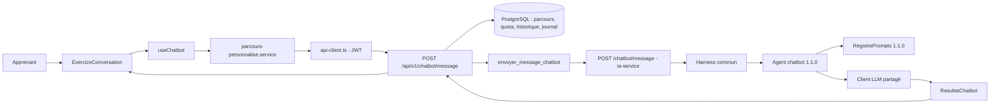

# Agent Chatbot intégré — état, résultats et validation

**Date :** 22 novembre 2026  
**Base :** `develop` (HEAD `9a1ee8a2457ea4da46312cda5d6dbb98c6d0a883`)  
**Statut global :** **livré, fusionné et opérationnel de bout en bout en démonstration**. Les trois livraisons successives sont dans `develop` : PR #96 (relais backend US67, fusion `33fa471`), PR #97 (corrections en marge US74, fusion `9c4897d`) et PR #98 (interface chat US72, fusion `9a1ee8a`). Les six checks de CI sont au vert sur les trois fusions.  
**Périmètre :** analyser la chaîne réellement intégrée `frontend → backend → ia-service → Harness → LLM`, les contrats, la persistance, les résultats observés et les limites restantes. Le code exécutable, les tests et `docs/api/contrat-frontend.md` sont les sources de vérité.

> Ce document remplace le verdict de [`analyse-agent-chatbot-harness.md`](analyse-agent-chatbot-harness.md), écrit avant l’intégration : celui-ci décrivait à juste titre le noyau IA comme prêt mais le relais backend comme absent. Ce n’est plus le cas à la date de ce document.

---

## 1. Synthèse exécutive

| Élément | État vérifié |
| --- | --- |
| Identité de l’agent | `chatbot@1.1.0` (`ia-service/app/agents/chatbot.py:13-15`). |
| Prompt | `chatbot/conversation@1.1.0`, avec réponse conversationnelle obligatoire et jusqu’à 3 corrections en marge. |
| Budget IA | 30 000 ms dans le Harness ; timeout frontend de 45 000 ms pour laisser de la marge au relais. |
| Route IA | `POST /chatbot/message` (`ia-service/app/api/chatbot.py:19-42`), exécutée via `Harness.executer("chatbot", requete)`. |
| Contrat IA | `EntreeChatbot` : message 1-2 000 caractères, historique ≤ 20 tours ; `ResultatChatbot` : `reponse` 1-4 000 caractères, `corrections` ≤ 3. |
| Client IA backend | `CHEMIN_CHATBOT = "/chatbot/message"`, `envoyer_message_chatbot()` (`backend/app/services/ia.py:30,102-108`). |
| Route backend | `POST /api/v1/chatbot/message` et `DELETE /api/v1/chatbot/session/{identifiant_session}` (`backend/app/api/routes/chatbot.py:47-65`). |
| Autorisation | JWT requis ; rôle relu en base à chaque appel ; seuls les `APPRENANT` peuvent utiliser le chat. |
| Source de l’historique | Le backend lit l’historique **en base** pour la session donnée ; le `historique` envoyé par le frontend est validé mais n’est pas la source de vérité. |
| Quota | 20 échanges par session par défaut (`backend/app/core/config.py:47`), consommés avant l’appel IA. |
| Persistance | `quota_chatbot`, `message_chatbot`, `journal_chatbot` ; historique limité aux 20 tours les plus récents ; journal sans texte brut. |
| Corrections | Validation backend : au plus 3 et chaque `extrait` doit apparaître dans le message courant normalisé. |
| Frontend | Écran de conversation, dictée, lecture audio, `useChatbot`, service typé, mapper snake_case, endpoint déclaré. |
| Contrat frontend | Documenté dans `docs/api/contrat-frontend.md:1094-1114` et `frontend/src/services/endpoints.ts:50-54`. |
| Tests | Backend 387 tests verts ; IA ciblés verts ; frontend 60 suites / 386 tests verts ; E2E chat desktop 1 test réussi. |
| Validation réelle | Stack backend + IA reconstruite ; deux messages envoyés avec un compte apprenant de démonstration ; corrections, quota et fermeture de session observés. |
| Verdict | **Chaîne fonctionnelle et fusionnée**. La qualité pédagogique réelle reste à valider avec un fournisseur LLM non factice ; le scénario `demonstration` valide le contrat et le comportement, pas la linguistique. |

---

## 2. Ce qui a changé depuis l’analyse précédente

| Domaine | Avant (analyse du 18 novembre) | Maintenant (22 novembre) |
| --- | --- | --- |
| Relais backend | absent | routes, service, schémas, modèles et migrations livrés |
| Version de l’agent | `chatbot@1.0.0` / prompt `1.0.0` | `chatbot@1.1.0` / prompt `conversation@1.1.0` |
| Corrections en marge | pas dans le contrat | `corrections[]` validé de bout en bout et affiché dans l’UI |
| Historique | non persisté | conservé côté backend pendant la session, puis supprimable |
| Quota | non implémenté | 20 échanges par session, `429` au dépassement |
| Fournisseur factice | le scénario `demonstration` ne répondait pas au chatbot | réponse déterministe et valide pour le chat |
| Frontend | endpoint annoté « B-10, à créer » | service HTTP actif, contrat documenté, E2E dédiée |
| Validation | tests IA/mocks uniquement | tests backend/IA/frontend + E2E + appel réel backend→IA |

Les trois conflits de fusion ont été résolus sans régression fonctionnelle :

- PR #96 : conservation simultanée du contrat IA US67 et de la migration de recommandation ; commit de correction CI `ae54967`.
- PR #97 : conservation des corrections US74 et du répondeur de recommandation REC-00 dans `ia-service/app/llm/demonstration.py` ; commit `dd91055`.
- PR #98 : conservation du bloc chatbot US72 et des recommandations REC-03 dans `endpoints.ts`, le mapper et le service frontend ; commit `43be11a`.

---

## 3. Architecture intégrée



### 3.1 Frontières respectées

- `frontend` ne parle qu’au backend via `api-client.ts` ; aucun `NEXT_PUBLIC_IA_URL`, aucun `fetch` direct depuis un composant.
- `backend` possède l’authentification, le parcours, le quota, l’historique, la validation métier et la persistance.
- `ia-service` ne touche pas PostgreSQL, ne persiste rien et ne décide pas de l’autorisation ou du quota.
- Le Harness reste commun et inchangé : il valide l’entrée et la sortie, applique le budget et standardise les erreurs.
- Le LLM reçoit un contexte sans donnée identifiante : langue, référentiel et niveau préliminaire uniquement.

---

## 4. Déroulement réel

1. L’apprenant saisit ou dicte un message dans `ExerciceConversation.tsx`.
2. Le composant ajoute le tour apprenant à l’écran, appelle `useChatbot`, puis ajoute la réponse et les éventuelles corrections en marge.
3. `parcours-personnalise.service.ts` génère un identifiant de session, tronque l’historique affiché aux 20 derniers tours et appelle `POST /api/v1/chatbot/message` avec un timeout de 45 s.
4. La route backend vérifie le JWT et le rôle `APPRENANT`.
5. `envoyer_message()` lit le parcours en cours, en déduit la langue, le référentiel et le niveau estimé, puis refuse une langue ou un niveau non pris en charge.
6. Le backend lit l’historique **depuis PostgreSQL**, consomme un échange du quota, puis libère la session avant l’appel IA.
7. Il construit `RequeteChatbotIA` avec `request_id`, contexte apprenant et historique issu de la base, puis appelle `ia-service`.
8. Le Harness résout `chatbot@1.1.0`, revalide l’entrée, rend le prompt versionné et appelle le client LLM sous un budget de 30 s.
9. La sortie est revalidée contre `ResultatChatbot` ; les erreurs sont converties en enveloppes `ReponseErreur` avec statut HTTP.
10. Le backend rejette toute réponse dont les corrections dépassent 3 ou dont un `extrait` ne figure pas dans le message courant.
11. Il enregistre les deux tours de conversation, le compteur de quota mis à jour et un journal anonymisé (durée, modèle, version du prompt, nombre de corrections).
12. Le frontend reçoit `reponse`, `corrections`, `quota_restant` et `version_prompt`, puis affiche la correction sous la forme `extrait → correction` sans interrompre la conversation.

### 4.1 Contrat public du backend

Requête :

```json
{
  "message": "hello  world",
  "identifiant_session": "<uuid>",
  "historique": [{ "role": "apprenant", "contenu": "..." }]
}
```

Réponse :

```json
{
  "reponse": "...",
  "corrections": [
    {
      "extrait": "world",
      "correction": "world.",
      "explication": "Terminez la phrase par un point."
    }
  ],
  "quota_restant": 19,
  "version_prompt": "chatbot/conversation@1.1.0"
}
```

### 4.2 Codes d’erreur exposés

| Situation | Statut | Comportement frontend |
| --- | --- | --- |
| Utilisateur non apprenant | 403 | message d’erreur générique |
| Aucun parcours en cours | 404 | message d’erreur générique |
| Langue ou niveau non pris en charge | 422 | message d’erreur générique |
| Quota atteint | 429 | message indiquant de démarrer une nouvelle session |
| IA lente | 504 | message invitant à réessayer |
| IA indisponible ou configuration invalide | 503 | message invitant à réessayer |
| Réponse IA invalide | 502 | message invitant à réessayer |

Les détails techniques et le contenu des messages ne sont pas journalisés ni exposés à l’apprenant.

---

## 5. Résultats observés

### 5.1 Validation réelle de la stack

Après reconstruction des conteneurs `backend` et `ia-service` :

- `GET /health` backend : `ok`.
- `GET /health` service IA : `{"status":"ok","service":"ia-service"}`.
- Connexion avec le compte apprenant de démonstration et récupération du parcours `id_parcours = 1`.
- Premier message : `"hello  world"`.
  - corrections reçues : `hello → Hello`, `world → world.` et `hello  world → hello world` ;
  - `quota_restant = 19` ;
  - `version_prompt = chatbot/conversation@1.1.0`.
- Deuxième message avec historique : `"How long I study"`.
  - correction reçue : `study → study.` ;
  - `quota_restant = 18`, confirmant la consommation côté backend.
- `DELETE /api/v1/chatbot/session/{identifiant_session}` : `{"supprime": true}`.

Ces résultats prouvent le transport HTTP, l’authentification, le relais IA, la validation des corrections, le quota et la fermeture de session. Ils ne prouvent pas la qualité linguistique d’un vrai modèle.

### 5.2 Comportement du fournisseur de démonstration

Avec `LLM_FOURNISSEUR=factice` et `LLM_FACTICE_SCENARIO=demonstration`, le répondeur est déterministe :

- il détecte la majuscule initiale manquante ;
- il détecte la ponctuation finale manquante ;
- il détecte les espaces multiples ;
- il annonce toujours qu’il s’agit d’une réponse de démonstration sans modèle de langue ;
- il ne produit jamais plus de 3 corrections.

C’est ce scénario qui est utilisé par défaut dans la stack de développement et par la validation manuelle ci-dessus. Il est interdit en production par la configuration LLM (`ENVIRONNEMENT=prod` côté IA).

### 5.3 Résultats non produits

Le chatbot ne produit pas :

- de niveau CECRL ou HSK ;
- de note ou de score de confiance ;
- de phase d’assimilation ;
- de descripteurs RAG ;
- de décision pédagogique finale.

Ces éléments appartiennent aux agents Diagnostic, Correction et Recommandation ou au backend.

---

## 6. État des composants

| Composant | Fichier | État |
| --- | --- | --- |
| Route backend | `backend/app/api/routes/chatbot.py` | ✅ livrée |
| Orchestration backend | `backend/app/services/chatbot.py` | ✅ livrée |
| Contrats backend | `backend/app/schemas/chatbot.py` | ✅ livrés |
| Modèles et migration | `backend/app/models/chatbot.py`, `backend/alembic/versions/` | ✅ livrés |
| Client IA backend | `backend/app/services/ia.py` | ✅ livré |
| Route IA | `ia-service/app/api/chatbot.py` | ✅ livrée |
| Agent IA | `ia-service/app/agents/chatbot.py` | ✅ livré en 1.1.0 |
| Prompt versionné | `ia-service/app/prompts/chatbot/` | ✅ livré en 1.1.0 |
| Répondeur factice | `ia-service/app/llm/demonstration.py` | ✅ livré |
| Écran frontend | `frontend/src/components/pedagogie/parcours/exercices/ExerciceConversation.tsx` | ✅ livré |
| Hook et service | `frontend/src/hooks/useParcoursPersonnalise.ts`, `frontend/src/services/parcours-personnalise.service.ts` | ✅ livrés |
| Contrat frontend | `docs/api/contrat-frontend.md`, `frontend/src/services/endpoints.ts` | ✅ synchronisés |
| E2E | `frontend/e2e/chat.spec.ts` | ✅ livrée et exécutée |
| LLM réel | configuration externe | ⚠️ non validé dans cette analyse |

---

## 7. Tests et validations

| Portée | Commande ou contexte | Résultat |
| --- | --- | --- |
| Backend | `ruff` + `pytest` | 387 tests réussis |
| IA | `ruff` + tests ciblés chatbot/Harness/main | verts |
| Frontend | `npm run check` (typecheck, lint, Jest) | 60 suites, 386 tests réussis |
| E2E | `npm run test:e2e -- e2e/chat.spec.ts --project=desktop` | 1 test réussi |
| CI | commits de fusion #96, #97 et #98 | 6/6 checks verts à chaque fusion |
| Intégration manuelle | stack Docker reconstruite | deux échanges + fermeture de session validés |

### 7.1 Ce que les tests prouvent

- Le backend refuse un message vide, une langue non prise en charge, une session sans parcours et un quota dépassé.
- Le relais IA isole la transaction PostgreSQL de l’appel réseau.
- Les corrections incohérentes sont rejetées.
- L’historique est conservé en base, ramené à 20 tours et supprimé avec la session.
- Le journal conserve des métadonnées mais aucun texte.
- Le service IA valide le prompt, l’enveloppe Harness et le schéma de sortie.
- Le frontend envoie le bon corps JSON et affiche les corrections sans bloquer la conversation.
- Le scénario E2E vérifie aussi l’avertissement RG11, le message envoyé, l’identifiant de session et la borne d’historique.

### 7.2 Limites de la validation

- Les tests IA utilisent un faux client LLM ; ils valident le pipeline, pas la qualité pédagogique.
- Le test E2E intercepte l’API backend : il valide l’UI et le contrat, pas le relais réel.
- L’appel réel de la stack a utilisé le fournisseur factice de démonstration.
- Aucun test de quota à 20 échanges complets ni de concurrence sur une même session n’a été ajouté.

---

## 8. Limites et points d’attention

| Priorité | Point | Recommandation |
| --- | --- | --- |
| P1 | Le fournisseur factice ne fournit qu’une analyse de surface. | Configurer Groq, Gemini ou un compatible OpenAI et ajouter une batterie de prompts de contrôle qualité avant production. |
| P1 | L’ancien document d’analyse dit encore que le relais backend est absent. | Le conserver comme archive historique ou ajouter un avertissement en tête ; s’appuyer sur ce document pour l’état courant. |
| P2 | Le frontend envoie un `historique` qui n’est pas utilisé par le backend. | Soit le retirer du corps, soit documenter explicitement qu’il est informatif et que la base fait foi ; éviter deux sources divergentes. |
| P2 | L’identifiant de session frontend est généré une seule fois au chargement du module. | Le régénérer à chaque nouvelle conversation et appeler `DELETE /session/{id}` à la fin ou au changement d’exercice. |
| P2 | L’endpoint de fermeture de session est déclaré dans `endpoints.ts` mais n’est pas appelé par le frontend. | Exposer une méthode de service et l’appeler depuis le hook ou la page de chat. |
| P2 | Le commentaire de `useParcoursPersonnalise.ts:55` dit encore qu’aucun historique n’est conservé. | Le corriger : l’historique est désormais conservé côté backend pendant la session. |
| P3 | Le champ `scenario` du journal est toujours `None`. | Alimenter la provenance du scénario si l’exploitation des journaux en a besoin. |
| P3 | Le streaming n’est pas utilisé. | Envisager `generer_flux` seulement si l’UI demande un affichage progressif. |

---

## 9. Conclusion

L’agent Chatbot n’est plus un composant IA isolé : il est intégré à toute la chaîne applicative. Le frontend appelle un backend authentifié, le backend applique les règles métier et persiste l’état de session, le service IA exécute l’agent dans le Harness, et les corrections en marge sont validées puis affichées sans couper la conversation.

Le verdict courant est donc **livré et opérationnel en démonstration**, avec deux réserves principales : la qualité pédagogique doit être validée avec un vrai LLM, et le cycle de vie de la session frontend doit être finalisé pour éviter que l’historique et le quota ne restent attachés à un identifiant unique trop longtemps.

---

## 10. Références

- `backend/app/api/routes/chatbot.py` — routes message et fermeture de session.
- `backend/app/api/router.py:31` — enregistrement du routeur chatbot.
- `backend/app/services/chatbot.py` — orchestration, contrôle des corrections, persistance.
- `backend/app/schemas/chatbot.py` — contrat public backend.
- `backend/app/models/chatbot.py` — tables quota, journal et messages.
- `backend/app/services/quota_chatbot.py` — consommation et libération du quota.
- `backend/app/services/historique_chatbot.py` — lecture, troncature et suppression de l’historique.
- `backend/app/services/ia.py:30,102-108` — relais vers `/chatbot/message`.
- `backend/alembic/versions/20261122_dfbf0715302a_fusion_quota_historique_chatbot_et_.py` — migration de fusion.
- `ia-service/app/api/chatbot.py` — route IA.
- `ia-service/app/agents/chatbot.py` — identité `chatbot@1.1.0` et appel LLM.
- `ia-service/app/schemas/chatbot.py` — contrat IA et bornes.
- `ia-service/app/prompts/chatbot/` — prompt `chatbot/conversation@1.1.0`.
- `ia-service/app/llm/demonstration.py:289-333` — réponse de démonstration du chat.
- `frontend/src/components/pedagogie/parcours/exercices/ExerciceConversation.tsx` — interface et affichage des corrections.
- `frontend/src/hooks/useParcoursPersonnalise.ts:55-60` — mutation React Query.
- `frontend/src/services/parcours-personnalise.service.ts:31-115` — session, timeout, appel HTTP et mock.
- `frontend/src/services/parcours-personnalise.mapper.ts:124-147` — DTO et mapping.
- `frontend/src/services/endpoints.ts:50-54` — endpoints message et fermeture de session.
- `frontend/e2e/chat.spec.ts` — scénario Playwright desktop.
- `docs/api/contrat-frontend.md:1094-1114` — contrat frontend source de vérité.
